# Migration v1: MS SQL (legacy) to Postgres, planning document

**Created:** 2026-11-10 · **Status:** PLANNING ONLY. No migration is run today (planned for 2026-11-11, only after the open questions below are answered).
**Jira:** epic ES-515, task ES-516 (the earlier audit comments are there).
**Why this file exists:** `migration.md` already exists (the operator log of the loan replay incidents), so this new file `migration-v1.md` holds the whole plan, the table-by-table comparison and the question register. Append to it; do not replace earlier sections. `migration.md` and `MIGRATION_SOP.md` stay as the history and the run commands.

Everything below was measured on 2026-11-10 with **read-only** queries (legacy `EMP_Espat_Society_dan` on `.\SQLEXPRESS`, Postgres `EMP_Espat_Society`). Nothing was written to either database. Personal data in examples is masked.

---

## 0. The short answer: is it hard?

- **Copying the data is not hard.** For all 67 legacy tables that have a same-name Postgres table, **no legacy column is missing in Postgres** (checked column by column). Postgres only has *extra* columns that the new app added. Types line up except three (below). The 15-table copy script already proves this on real data.
- **What is hard is not the copy, it is three decisions and one replay:**
  1. **Master / configuration tables** (users, rights, menus, financial years, voucher counters): Postgres already holds app-edited values, so "copy legacy over it" would destroy work. Each needs a rule. (Section 4.) Heads and opening balances turned out fine on 2026-11-11 (4.1, 4.7).
  2. **Postgres is not clean.** It holds test and app-written rows (future-dated ledger rows up to 2030-06-15, loan rows up to 2027-10-01). A re-run needs an agreed reset. (Q4.)
  3. **Loan history (Phase 2 replay)** is the genuinely hard, fragile part: it is a rules engine, not a copy, and about 1,300 members are still "to confirm" or "manual" from the Sep-Oct work. (Section 5.)
  4. The legacy dump is **stale** (cutoff 25-Sep-2026) and must be restored under a known name before anything runs. (Q1.)
- So: the mechanical part is easy and safe; the risk sits in the master-data rules and in the loan replay. I would not call the whole thing "easy", and I would not start before Section 7 is answered.

### Three type differences (the only ones found)
| Table.column | Legacy | Postgres | Meaning |
|---|---|---|---|
| `dt_master.sharecr`, `dt_master.loandr`, same two in `dt_member` | nvarchar (text) | numeric | text must be cast; both tables are unused scratch tables, so skip |
| `bank_signature.signature` | image (binary) | bytea | binary copy needs a special path; table not referenced by the app, so skip unless asked |
| float columns (e.g. `member_balances` amounts) | float | numeric | the real script reads floats as JSON numbers; do not CONVERT them to text (scientific notation like `6.1003e+008` breaks matching; this tripped my own check today) |

---

## 1. The plan in steps (we do one step at a time and agree before moving on)

| Step | What | Status |
|---|---|---|
| **1** | Tables we can migrate easily (same schema, no conflict) | **Written below (Section 3). Needs your OK.** |
| **2** | Tables that need care: problem, example, how I propose to do it | **Written below (Section 4). For discussion.** |
| 3 | Loan history (Phase 2 replay): what is done, what is left, what I propose | Outline in Section 5; detailed discussion after Step 2 |
| 4 | Pre-flight: source restore, schema-drift check, orphan check, reset rule, freeze | Checklist in Section 6; becomes a script once agreed |
| 5 | Dry run, reconciliation report per table, sign-off | Not started |

---

## 2. Classification of all 112 non-empty legacy tables

| Group | Count | Meaning | Action |
|---|---|---|---|
| **A. Phase-1 tables** | 15 | Member/ledger/loan data, same schema, script exists and was verified | Re-run on the new dump (Section 3A) |
| **B. Already identical in Postgres** | 13 | Postgres already holds every legacy row (some plus app additions) | Nothing to copy; re-verify on the new dump (Section 3B) |
| **C. Same schema, Postgres empty, app never reads them** | 21 | Old report scratch / snapshot tables | Skip on purpose, list them in the sign-off (Section 3C) |
| **D. Need care** | 17 | Both sides hold different data, or the app uses the table differently | Section 4, one decision each |
| **E. Junk / backup / temp copies in legacy** | 46 | `_ledger_20072023`, `ledger_`, `member_master_temp`, `yogesh`, `tmp*` and so on | Ignore (Q6), except the pre-2019 archive (Q8) |
| **F. New in the app, nothing in legacy** | about 110 | mobile_*, 2FA, support, onboarding, FD/RD/SB, notifications, logs | Cannot be migrated; just must not be wiped by mistake (Section 6) |

(Counts are from the comparison below; a few tables sit on a border and are explained in their own row.)

---

## 3. STEP 1: tables we can migrate easily

### 3A. Phase-1 tables (15): "easy", with four caveats
Schema identical column for column. Script: `migrate-all-members.js` (dry run by default, backup, row count plus SHA-256 per batch).

| Table | Legacy rows | Caveat |
|---|---|---|
| `ledger` | 1,582,476 | None on schema. Postgres has 1,576,773 now: the gap is legacy activity after the last copy plus Postgres test rows. Future-dated Postgres rows (to 2030-06-15) must be explained or removed first (Q4). |
| `demand_master`, `demand_masterdelete` | 330,988 / 564,442 | None. |
| `loan_balance_history`, `bank_cheq_master`, `loan_masterhistory`, `loan_product`, `membercategory`, `ledger_data`, `frs`, `fundsmaster` | see catalogue | `fundsmaster`: 3 rows differ because the app edited `shareamt`; the script already skips a member/table when Postgres holds more than legacy and flags it. |
| `member_master` | 7,302 | Postgres has 9 extra columns (`full_name`, `email`, `cast_category`, `compulsory_deposit`, `share_amount`, `doc_front_path`, `doc_back_path`, `signature_image_path`, `profile_photo_path`): they stay empty/default after a copy, which is fine. **`dor` differs on 7,273 rows**: legacy is blank, Postgres holds a date set by the ES-99 insurance work (backup table `member_dor_backup_es99`). A re-copy would blank it. Must decide (Q16). 4 legacy members are not in Postgres yet. |
| `loan_master`, `loan_pending` | 20,034 / 19,044 | Postgres has 10 / 7 extra columns (for example `consolidated_into_loancaseno`, `delay_months`, `gracedays`, `rate`, `application_kind`) with defaults. **After the copy, Phase 2 rewrites balances, so the result is not "as legacy" by design** (Section 5). |
| `member_balances` | 6,505 | The loan columns (`regularloan`, `emergency_loan_balance`) differ on 1,343 and 1,972 members **by design**: legacy figures are stale, Phase 2 reconciles them to the ledger. Example (masked member): legacy emergency balance 0 vs Postgres 2,70,000. Everything else matches. |

### 3B. Already identical in Postgres (13): nothing to copy
| Table | Legacy rows | Postgres today | Note |
|---|---|---|---|
| `society_details` | 1 | 1 identical | |
| `wingmast` | 1 | 1 identical | |
| `division_master` | 6 | 6 identical | |
| `membertypemaster` | 4 | 4 identical | |
| `parameter_setting` | 11 | 11 identical | |
| `headtype` | 20 | 20 identical | |
| `crybsnew`, `crplhor1` | 105 / 41 | identical | report layout tables |
| `bank_passbook_page_setting` | 2 | 2 identical | |
| `busrules` | 4,025 | 4,118 (all 4,025 legacy rows present, 93 added by the app) | Postgres is a superset; **keep Postgres**. The new Postgres-only columns (`rlnsmpct`, `alnpenalrate`, `rlngracedays`, ...) hold the app's new penalty rules. |
| `menumaster` | 92 | 141 (all 92 present, 49 new menus from the app) | keep Postgres |
| `userlevelmaster` | 9 | 13 (all 9 present, 4 new roles) | keep Postgres |
| `frs_balance` | 6,735 | 6,735 identical | |

### 3C. Same schema, Postgres empty, **the app never reads them** (skip on purpose)
`bank_passbook` (1,931 rows), `bank_passbooksetting`, `bank_passbook_bank_setting`, `bank_passbook_first_page`, `bank_passbook_detail_page`, `member_transfer` (115), `member_bookbal` (134), `balsheet` (151), `crytb` (152), `crplhor` (41), `codes_table` (4), `main` (4), `trf_slab` (4), `member_data` (42), `loan_pending_aln` (156) and `loan_pending_rln` (105) (these two are old snapshot copies of `loan_pending`), `tblmembrectotal` (13,616), `daily_gl_history` (25,415), `dt_master` / `dt_member` (7,2xx each), `bank_signature` (55 images).
Evidence: none of these names appears in any backend source file. If you want any of them anyway (for example the 55 signatures), tell me and I move it to Section 4.

### What "easy" means here, and what I did NOT prove
Proven today: same columns, same types (except the 3 above), same-name table, row counts and, for small tables, row-by-row equality. Not proven: that the next legacy dump keeps the same schema (needs the pre-flight in Section 6), and nothing was run against the app UI.

---

## 4. STEP 2: tables that need care (my proposal for each; we discuss)

Format: **what differs, example, how I propose to do it, decision needed.**

### 4.1 `headmaster` (chart of accounts, 151 legacy rows)
- **CORRECTION (2026-11-11, found while checking `bankopbal`):** the first version of this section said 6 legacy heads were missing in Postgres. That was wrong. A column-by-column check shows **all 151 legacy heads exist in Postgres with the same parent, name, type, interest flag, position and opening balance (`op_bal`)**. The only difference on those 6 rows (for example `A1048 ELECTION ADVANCE`, `A1050 FFD UNION BANK OF INDIA`) is `pflag`: blank in legacy, `A` in Postgres (filled by the app). My first row-equality check had counted that as a different row.
- Postgres has 3 extra heads: `I1013 INTT FROM MEMBER - REGULAR LOAN`, `I1014 INTT FROM MEMBER - EMERGENCY LOAN` (app interest heads) and one junk row with an empty code and name `x`.
- Proposal: **do not copy**; keep Postgres. Pre-flight checks: every `ledger.code` of the new dump exists in `headmaster`, and `headmaster.op_bal` equals the new legacy dump's value for every head. Flag (do not delete) the junk `x` row.
- Decision: Q3 (now low risk).

### 4.2 `usermaster` (27 legacy users, 41 in Postgres) and `userinfo`
- 20 identical, 7 legacy-only users, 21 Postgres-only. Postgres has 15 extra columns (2FA, avatar, email, `force_logout_at`, `permissions`).
- Passwords: the app has its own hashing and 2FA, so I will **not** copy credentials blindly. I did not read any password values.
- `userinfo`: legacy 1 row vs Postgres 39 rows: not the same use.
- Proposal: do not touch existing users; for the 7 legacy-only users decide create-with-forced-reset or ignore.
- Decision: Q10.

### 4.3 `userrights` (2,242 / 2,194) and `userleveldefaultrights` (144 / 63)
- `userrights`: 2,049 identical, 193 legacy-only, 145 Postgres-only. `userleveldefaultrights`: only 61 of 144 legacy rows exist in Postgres. Example legacy-only: role 1 → menu 2, role 1 → menu 3.
- Why: Postgres rights were curated by the role-governance work (menu ids 7 and 38 for role 9 are new).
- Proposal: **Postgres wins** for roles/menus the app defines; add legacy rows only for users that exist after Q10. Needs your confirmation because it changes who can open what.
- Decision: Q15.

### 4.4 `yearend` (financial years)
- Legacy 8 rows, Postgres 2 rows, 0 identical. Example legacy: year 1 = 2019-11-01 to 2020-03-31 (user ADMIN), year 3 = 2020-04-01 to 2021-03-31. Postgres: year 1 = 2026-04-01 to 2027-03-31 (`admin`), year 2 = 2027-04-01 to 2028-03-31 (`demo-setup`, test data).
- Same year code means different years: a plain copy would collide, and Postgres has a `closed_at` column that legacy lacks.
- Also: Postgres stores `05:30:00` times on some rows (a timezone offset), legacy stores midnight.
- Proposal: build the full legacy year list, mark legacy years closed, remove the two test years, keep the same `yearcode` meaning as legacy (year 1 = 2019-11-01) so ledger/closing balances line up. Needs your confirmation.
- Decision: Q11.

### 4.5 `getworkingdate` (day-end log)
- Legacy 2,319 days (2019-11-01 onward, day-end flag `Y`), Postgres 12 days (2026-08, test). Example legacy: 2019-11-01, payment voucher counter 25, receipt 17, dayend `Y`, GL updated `Y`.
- Proposal: copy the legacy days so Day-End does not treat 2,300 historic days as open; drop the 12 test days.
- Decision: Q12.

### 4.6 `voucher_master` (voucher counters)
- Legacy (as of 25-Sep): P26197, R58382, J34182, D00795. Postgres: P26212, R58421, J34247, D01204 (already ahead because of test postings).
- Risk: if the counter is lower than the highest voucher already in the ledger, the next voucher number duplicates an old one.
- Proposal: **never lower a counter**: set each to the max of (legacy counter, highest number in the migrated ledger, Postgres counter). A pre-flight check proves no duplicates.
- Decision: Q9.

### 4.7 `bankopbal` (opening balances per head and year, 130 legacy rows): INVESTIGATED 2026-11-11
**CORRECTION:** my first version said there were "two head-code schemes". That was wrong (I had looked at different slices of each table). Both sides use the same codes (`A` assets, `L` liabilities, `E` expenses, `I` income). What is really going on:

**What the table is.** Legacy `BANKOPBAL` holds one financial year (`fycode` 1) of balances per head, 130 rows: A 47, L 44, E 30, I 9. The head `A1001` is literally named `CASH IN HAND-31-10-2019`, so these are the balances at 31-Oct-2019, the day before the ledger starts (2019-11-01). They are balanced: assets 8,24,815,217.60 = liabilities 8,24,815,217.60; expenses 2,98,64,080 = income 2,98,64,080 (income stored negative). Two legacy stored procedures read it: `PR_GETOPBAL` and `Pr_Rpt_NBALANCE_SHEET`.

**How the new app uses it.** The app code only ever **writes** `bankopbal` (in the Year-End Transfer in `financial-year.service.ts` and in `utilities.service.ts`, as a "backward compatibility" copy of `yearend_head`). **Nothing in the app reads it.** Opening balances in the reports come from `headmaster.op_bal` plus the ledger (`head-balances.sql.ts`).

**What Postgres holds.** 151 rows, `fycode` 1. These are **not legacy data**: they are an exact copy of Postgres `yearend_head` year 1 (151 rows), i.e. the output of an app Year-End Transfer run on test data. Evidence: Postgres `A1001` cash = -2,59,155 in both `bankopbal` and `yearend_head`, but `headmaster.op_bal` for `A1001` = 1,78,940 (the legacy value). Same for `A1047` emergency loan (558,000 vs 0) and `E1018` (401,324 vs 406,774).

**Row comparison legacy vs Postgres `bankopbal`:** 88 identical, 42 different, 0 legacy-only, 21 Postgres-only (all zero-balance group/new heads). Of the 42: about 30 are rupee rounding (legacy has paise, for example `L1002` 3,27,03,540.61 vs 3,27,03,565 is a 24 difference in one case); 9 are income heads with the opposite sign (legacy `I1002` = -2,87,80,646, Postgres +2,87,80,646); about 12 are real differences caused by the test year-end run (cash, emergency loan, AGM expense, regular loan).

**The good news (verified):** `headmaster.op_bal` in Postgres already equals legacy for all 151 heads, and it balances: assets 82,48,15,219 vs liabilities 82,48,15,218 (₹1 apart, inherited rounding; legacy paise totals match exactly), expenses 2,98,64,080 = income 2,98,64,080. So the opening balances the new app really uses are already correct.

**Proposal.**
1. **Do not copy legacy `bankopbal` into the live opening-balance logic.** The source of truth stays `headmaster.op_bal`. Add a pre-flight check that `headmaster.op_bal` equals the new dump for every head and that A = L and E = I.
2. In the reset (Q4/Q11), **delete the Postgres test rows** (`bankopbal` fycode 1 and `yearend_head` year 1/NULL, which came from the test year-end run), because they clash with the legacy meaning of year 1 (2019-11-01).
3. Optional: store the 130 legacy rows as `bankopbal` fycode 1 for history (income sign kept as legacy). Only if you want the archive; the app will not read it.
- Decision: Q13 (rewritten below). Risk is now **low**, not high.

### 4.8 `suretymaster` (6 legacy, 5 Postgres, 0 identical)
- Legacy example: member (masked), amount -8,459, guarantor amounts -4,230 each, `addflag` N. Postgres has an extra column `loancaseno` and 5 test rows (member 9999962473 style, test).
- The negative amounts and the missing `loancaseno` make the legacy rows ambiguous.
- Proposal: copy legacy rows with `loancaseno` empty only if the app accepts that; otherwise list for manual entry (6 rows).
- Decision: Q14.

### 4.9 `tblcashbook` (SUPERSEDED by section 39: the app does not regenerate the history)
- Legacy: 8 rows of head-level cash totals (example `A1002 REGULAR LOAN`, receipt transfer 18,13,916). Postgres: 855 rows and **4 extra columns** (`voucher_no`, `trans_date`, `username`, `voucher_id`): the app now uses it as a daily cash book, not the same meaning.
- Proposal: **do not copy**; the app regenerates it from the ledger. Document it.
- Decision: confirm in Q3.

### 4.10 `castcategorymaster`
- Legacy 4 rows, Postgres 6. Id clash: legacy id 1 = `OBC`; Postgres id 6 = `OBC`, id 5 = `General`.
- Legacy `member_master` has no cast column (Postgres added `cast_category`), so no member points at legacy ids.
- Proposal: keep Postgres, ignore legacy ids. Low risk.

### 4.11 Other tables the app uses but Postgres has empty
`demand_receipt` (11 legacy rows), `demandprintorder` (6, print order for the demand statement: worth copying), `accountbalance` (146) and `balancesheet` (151) (report snapshots the app can rebuild), `logintime` (legacy 23,974 vs Postgres 4,336, an audit log: copy as history is harmless).
- Proposal: copy `demandprintorder` and `demand_receipt` as they are; skip `accountbalance` / `balancesheet` (regenerated); `logintime` optional.
- Decision: Q3.

### 4.12 `member_master.dor` and 136+ orphan member ids
- `dor`: see 3A and Q16.
- Orphans: 136 member ids in the legacy ledger have no `member_master` row (over all 15 tables the earlier audit counted about 1,282). Phase 1 copies their rows anyway; they appear in reports as members without names. Q5.

---

## 5. STEP 3 (outline): loan history, Phase 2 replay
Status from `migration.md` (do not retell it all here):
- Engine is ledger-driven and was checked on a 50-member sample and on the 790 "clean" members (907 of 907 accounts matched).
- Still open: 285 members "to confirm", 1,041 "manual" (no ledger entries 515, credit balance 276, schedule not built 238, open loan without schedule 162, ledger owes with no loan row 84), about 3,000 active loans without a schedule version, 30 to 31 members `failed` in the batch log.
- Structural risk: a member is not atomic (each repayment commits by itself), and retry relies on fingerprints that were too strict for old partial rows.
- Proposal for the discussion: (1) run on a **fresh reset** of the loan tables so no half-written history exists; (2) make each member one transaction; (3) keep the manual-corrections file; (4) add the three acceptance audits (`_ledger_audit.js`, `_interest_audit.js`, `_active_final_check.js`) as a mandatory gate.
- Decision: Q7, Q18.

---

## 6. STEP 4 (outline): pre-flight checklist for the day of migration
1. Restore the new dump as `EMP_Espat_Society_dan` (or make the source name configurable; today it is hard-coded in `inspect.js`), read-only, with no other sessions.
2. Check dump date (`max(ledger.trans_date)`) and that it is newer than 2026-09-25.
3. Schema-drift check: every legacy column of every table in scope exists in Postgres (the script already aborts on this; a pre-flight reports all tables at once).
4. Orphan check over all 15 tables (member ids with data and no `member_master` row).
5. Every `ledger.code` exists in `headmaster`; voucher counters not below the highest ledger voucher number.
6. Agree and take the reset: what in Postgres is wiped (member and loan data) and what is **never** wiped (the Group F app tables, users, rights, system config, licence keys).
7. Full `pg_dump` before any write.

---

## 7. QUESTION REGISTER (answer here; I update the status)

| # | Question | My recommendation | Status |
|---|---|---|---|
| Q1 | Where does the new MS SQL data come from, and is it a full `.bak` of the same database (same schema)? Under which database name will I restore it? | Full `.bak`, restored as `EMP_Espat_Society_dan`; I make the name configurable | OPEN |
| Q2 | Will legacy writes be frozen while the real run happens? | Yes (the database has snapshot isolation off, counts drift while it is used) | OPEN |
| Q3 | Master tables (headmaster, busrules, menus, roles, tblcashbook, demand print order and so on): legacy wins, Postgres wins, or merge? | "Merge by insert-if-missing, never overwrite", as in Section 4 | OPEN |
| Q4 | Wipe Postgres test and app-written member/loan data before the real run (full reset of the Phase-1/Phase-2 tables)? What about the future-dated rows? | Yes, reset those tables only; remove future-dated test rows; keep all Group F tables | OPEN |
| Q5 | The orphan member ids (136 in the ledger, about 1,282 over all tables, ₹85.9 lakh on 147 members): create member records, write off, or leave? | Leave and list them; client decides later | OPEN |
| Q6 | Ignore the 46 temp/backup legacy tables for good? | Yes | OPEN |
| Q7 | Who signs off the about 1,300 "to confirm" and "manual" loan members, and by when? | Business side signs off from the exceptions workbook | OPEN |
| Q8 | Do we need the pre-2019 ledger archive `_LEDGER_20072023` (972,902 rows) in Postgres? | Not for loans (current ledger starts 2019-11-01); migrate only if reports must show older years | OPEN |
| Q9 | Voucher counters: rule "never lower, max of legacy, ledger and Postgres"? | Yes | OPEN |
| Q10 | Legacy users (7 not in Postgres): create, or ignore? Passwords must be reset because the app hashes differently. | Create disabled, force reset | CLOSED 2026-11-11: users are created fresh in production, table not migrated |
| Q11 | Financial years: keep legacy year codes (year 1 = 2019-11-01) and drop the two test years? | Yes | OPEN |
| Q12 | `getworkingdate`: copy legacy days, drop the 12 test days? | Yes | OPEN |
| Q13 | `bankopbal`: Postgres rows are test output of the app's Year-End Transfer; the real opening balances (`headmaster.op_bal`) already equal legacy. OK to (a) not copy legacy `bankopbal`, (b) delete the test `bankopbal` / `yearend_head` year-1 rows in the reset, (c) optionally archive the 130 legacy rows? | Yes to (a) and (b); (c) only if you want the history | OPEN (investigated 2026-11-11, see 4.7) |
| Q14 | `suretymaster`: 6 legacy rows without `loancaseno`: copy or enter by hand? | Hand-check, only 6 rows | OPEN |
| Q15 | Rights: Postgres wins for roles/menus the app defines? | Yes | CLOSED 2026-11-11: users are created fresh in production, table not migrated |
| Q16 | (revised in Part 2, section 11.4) the trigger refills `dor`; only 18 members have a `dor` that differs from `date_of_retirement` | see 11.4 | OPEN (revised) |
| Q17 | Float to numeric: accept exact decimal casting for money columns? | Yes (the real script already does) | OPEN |
| Q18 | Failed Phase-2 members (30 to 31): reconcile each against legacy before the run? | Yes, they are the exceptions worklist | OPEN |
| Q19 | The legacy database holds 98 stored procedures, 10 views and 4 triggers. Do any contain business rules that differ from the app? | Review the procedures that write to ledger/demand/loan tables | OPEN |
| Q20 | Postgres has 7,585 members vs 7,302 legacy: 283 more (test members 900000001-900016999, >= 9e9, and app-created). Which of them may be deleted in the reset? | Delete only the known test ranges; list the rest for you | OPEN |

---

## 8. Discussion log (append below, newest last)
- 2026-11-10: file created. Step 1 and Step 2 written; waiting for your reaction on Section 3 (easy list) and Section 4 (care list).
- 2026-11-11: new dump restored (to 2026-11-03). Side-by-side list added (section 10). Table 1 `member_master` analysed (section 11): delete-and-reinsert would erase app-only columns, 3 duplicate member numbers in legacy, trigger explains `dor`. Q16 revised, Q21-Q24 added.
- 2026-11-11: discussed `bankopbal` first. Investigation overturned two statements in this file: (1) there are NOT two head-code schemes, (2) the 6 "legacy-only" `headmaster` rows are NOT missing (only `pflag` differs). Both sections (4.1, 4.7) were corrected. Result: `bankopbal` is low risk; opening balances already match legacy via `headmaster.op_bal`.

---

## Appendix A: new in the app (no legacy equivalent): cannot be migrated
Tables (Group F, about 110): `mobile_*` (17), `ai_chat_logs`, `twofa_audit`, `trusted_devices`, `user_recovery_codes`, `support_queries`, `onboarding_*`, `terms_acceptances`, `system_notifications`, `system_notification_reads`, `system_configs`, `system_settings`, `loan_reagreements`, `loan_reagreement_documents`, `loan_reagreement_log`, `loan_repayment_ledger`, `loan_schedule_versions`, `loan_rb_schedule`, `loan_payment_flags`, `legacy_replay_batch_log`, `group_insurance_*`, `rd_*`, `rdmaster`, `fdmaster` family, `sbmaster`, `savings_accounts`, `recurring_deposits`, `fixed_deposits`, `short_recovery_adjustment`, `share_monthly_balance`, `member_status_log`, `member_funds_audit`, `member_documents`, `license_keys`, `notification_logs`, `alert_settings`, `service_log_*` (about 20), `user_preferences`, `user_onboarding`, `user_activities`, `easter_egg_progress`, `dashboard_notices`, `backup_log`, `revoked_tokens`, certificate/passbook templates, `report_*`, `sequence_master` and more.
Columns the app added to tables that do exist in legacy (all stay empty or default after a copy): `member_master` (9), `loan_master` (10: `loan_interest_method`, `payroll_lag_watch_until`, `delay_months`, `smpenaldiv`, `smpenalpct`, `gracedays`, `payroll_lag_old_interest`, `consolidated_into_loancaseno`, and two more), `loan_pending` (7: `rate`, `penalrate`, `rate_override_by`, `rate_override_reason`, `reagreement_id`, `pass_flag`, `application_kind`), `busrules` (11 new penalty/grace columns), `usermaster` (15: 2FA, avatar, email, `permissions`, `force_logout_at` and others), `tblcashbook` (4), `yearend` (`closed_at`), `suretymaster` (`loancaseno`).
Why this matters: legacy has no value for any of these, so the new app's features that depend on them (2FA, penalty rules, re-agreements, mobile app, FD/RD/SB) start empty after migration. That is expected, but the client should know.

## Appendix B: legacy data not in Postgres at all and with no table (not migratable)
- FD, RD, Savings account data: the legacy tables exist but are empty (only a 2005 snapshot `fdmaster13-08-2005`, 309 rows, no Postgres table).
- Documents, photos, signatures: files, not tables (bank_signature images aside).

## Appendix C: table-by-table catalogue (67 legacy tables that have a same-name Postgres table)
Auto-generated 2026-11-10. "Row comparison" compares only the legacy columns; for `member_master` and `member_balances` it looks worse than it is (see 3A). Example rows are real legacy rows with personal fields masked.

#### `accountbalance`
- Legacy rows: **146** · legacy columns: 12 · Postgres columns: 12
- Columns (legacy): acno, acname, groupledger, parent, printorder, maincode, tropbal, dbamt, cramt, clbal, dbbal, crbal
- Row comparison today (legacy vs Postgres, legacy columns only): Postgres rows 0; identical 0; only in legacy 146; only in Postgres 0
- Referenced by backend source files: 5
- Example legacy row: `{"AcNo":"A1001","AcName":"«masked»","GroupLedger":"L","Parent":"A1000","PrintOrder":"","MainCode":2,"TrOpBal":0,"DbAmt":6314289,"CrAmt":9034321,"ClBal":-2720032,"DbBal":0,"CrBal":2720032}`

#### `balancesheet`
- Legacy rows: **151** · legacy columns: 10 · Postgres columns: 10
- Columns (legacy): head_code, parent_code, head_name, opening_balance, debit, credit, closingbalance, closingbal_db, closing_cr, maincd
- Row comparison today (legacy vs Postgres, legacy columns only): Postgres rows 141; identical 15; only in legacy 136; only in Postgres 126
- Referenced by backend source files: 3
- Example legacy row: `{"HEAD_CODE":"M1000","Parent_Code":"ROOT","Head_name":"«masked»","OPENING_BALANCE":0,"DEBIT":0,"CREDIT":0,"CLOSINGBALANCE":0,"CLOSINGBAL_DB":0,"CLOSING_CR":0,"MAINCD":null}`

#### `balsheet`
- Legacy rows: **151** · legacy columns: 10 · Postgres columns: 10
- Columns (legacy): head_code, parent_code, head_name, opening_balance, debit, credit, closingbalance, closingbal_db, closing_cr, maincd
- Row comparison today (legacy vs Postgres, legacy columns only): Postgres rows 0; identical 0; only in legacy 151; only in Postgres 0
- Referenced by backend source files: 0
- Example legacy row: `{"HEAD_CODE":"M1000","Parent_Code":"ROOT","Head_name":"«masked»","OPENING_BALANCE":0,"DEBIT":0,"CREDIT":0,"CLOSINGBALANCE":0,"CLOSINGBAL_DB":0,"CLOSING_CR":0,"MAINCD":null}`

#### `bank_cheq_master`
- Legacy rows: **21129** · legacy columns: 7 · Postgres columns: 7 · **covered by Phase 1 script**
- Columns (legacy): mbno, receipt_vchr_no, code, cheqno, cheqamt, dates, reconcile_flag
- Example legacy row: `{"MBNO":"1","RECEIPT_VCHR_NO":"R34400","CODE":"A1008","CHEQNO":"123456","CHEQAMT":150000,"DATES":"2019-04-01T00:00:00","Reconcile_Flag":"N"}`

#### `bank_passbook`
- Legacy rows: **1932** · legacy columns: 7 · Postgres columns: 7
- Columns (legacy): account_number, tr_date, ledgerid, lastlineno, row_id, accounttype, printedon
- Row comparison today (legacy vs Postgres, legacy columns only): Postgres rows 0; identical 0; only in legacy 1931; only in Postgres 0
- Referenced by backend source files: 0
- Example legacy row: `{"Account_Number":"130028777     ","TR_DATE":"2026-08-12T00:00:00","ledgerid":1692077,"LastLineNo":35,"Row_Id":1692077,"AccountType":"D","PrintedOn":"2026-08-14T00:00:00"}`

#### `bank_passbook_bank_setting`
- Legacy rows: **2** · legacy columns: 3 · Postgres columns: 3
- Columns (legacy): passbook_bank_mst_id, format_name, ac_type
- Row comparison today (legacy vs Postgres, legacy columns only): Postgres rows 0; identical 0; only in legacy 2; only in Postgres 0
- Referenced by backend source files: 0
- Example legacy row: `{"PassBook_Bank_Mst_Id":"«masked»","Format_Name":"«masked»","Ac_Type":"L "}`

#### `bank_passbook_detail_page`
- Legacy rows: **19** · legacy columns: 7 · Postgres columns: 7
- Columns (legacy): passbook_detail_page_det_id, passbook_bank_mst_id, field_name, field_row, field_col, visible_invisible_flag, field_label
- Row comparison today (legacy vs Postgres, legacy columns only): Postgres rows 0; identical 0; only in legacy 19; only in Postgres 0
- Referenced by backend source files: 0
- Example legacy row: `{"PassBook_Detail_Page_Det_id":"«masked»","PassBook_Bank_Mst_Id":"«masked»","Field_Name":"«masked»","Field_Row":12,"Field_Col":10,"Visible_Invisible_Flag":"Y","Field_Label":"DATE"}`

#### `bank_passbook_first_page`
- Legacy rows: **8** · legacy columns: 10 · Postgres columns: 10
- Columns (legacy): passbook_first_page_det_id, passbook_bank_mst_id, display_name, display_field_row, display_field_col, field_name, field_row, field_col, print_display_name_flag, visible_invisible_flag
- Row comparison today (legacy vs Postgres, legacy columns only): Postgres rows 0; identical 0; only in legacy 8; only in Postgres 0
- Referenced by backend source files: 0
- Example legacy row: `{"PassBook_First_Page_Det_Id":"«masked»","PassBook_Bank_Mst_Id":"«masked»","Display_Name":"«masked»","Display_Field_Row":25,"Display_Field_Col":4,"Field_Name":"«masked»","Field_Row":25,"Field_Col":20,"Print_Display_Name_Flag":"«masked»","Visible_Invisible_Flag":"Y"}`

#### `bank_passbook_page_setting`
- Legacy rows: **2** · legacy columns: 6 · Postgres columns: 6
- Columns (legacy): passbook_page_setting_det_id, passbook_bank_mst_id, total_pages, total_rows, start_line_number, increment_level
- Row comparison today (legacy vs Postgres, legacy columns only): Postgres rows 2; identical 2; only in legacy 0; only in Postgres 0
- Example legacy row: `{"PassBook_Page_Setting_Det_Id":"«masked»","PassBook_Bank_Mst_Id":"«masked»","Total_Pages":8,"Total_rows":37,"Start_Line_Number":1,"Increment_Level":1}`

#### `bank_passbooksetting`
- Legacy rows: **1** · legacy columns: 5 · Postgres columns: 5
- Columns (legacy): passbooksettingid, mbno, passbooktype, lastprintingdate, lastledgerid
- Row comparison today (legacy vs Postgres, legacy columns only): Postgres rows 0; identical 0; only in legacy 1; only in Postgres 0
- Referenced by backend source files: 0
- Example legacy row: `{"PassBookSettingId":"«masked»","MBNo":610033148,"PassBookType":"«masked»","LastPrintingDate":"2025-11-10T00:00:00","LastLedgerId":1544354}`

#### `bank_signature`
- Legacy rows: **55** · legacy columns: 2 · Postgres columns: 2
- Columns (legacy): account_number, signature
- Type differences: signature: image->bytea
- Referenced by backend source files: 0
- Example legacy row: `(not shown: credentials / binary)`

#### `bankopbal`
- Legacy rows: **130** · legacy columns: 5 · Postgres columns: 5
- Columns (legacy): trfid, fycode, headcode, parentcode, closingbalance
- Row comparison today (legacy vs Postgres, legacy columns only): Postgres rows 151; identical 0; only in legacy 130; only in Postgres 151
- Referenced by backend source files: 2
- Example legacy row: `{"TrfId":1,"FyCode":1,"HeadCode":"L1001","ParentCode":"L1000","ClosingBalance":53882360}`

#### `busrules`
- Legacy rows: **4025** · legacy columns: 57 · Postgres columns: 68
- Columns (legacy): srno, appdate, rlnmaxloanamt, rlnrate, rlnpenalrate, rlnmaxnoinst, rlnnogr, elnmaxloanamt, elnrate, elnmaxnoinst, elnnogr, alnmaxloanamt, alnrate, alnmaxnoinst, alnnogr, mlnmaxloanamt, mlnrate, mlnmaxnoinst, mlnnogr, minmembship, workexp, sharerecov, defaultduration, minshareamt, maxshareamt, minmdamt, mincdamt, maxcdamt, edlmaxloanamt, edlrate, edlpenalrate, edlmaxnoinst, edlnogr, dataentryflag, print_demand_horizontal, emi_based_demand, minsavingbalance, working_exp_code, reducingbal_intt_calc, intt_slot, flnmaxloanamt, flnmaxnoinst, flnnogr, flnpenalrate, flnrate, slnmaxloanamt, slnrate, slnmaxnoinst, slnnogr, loanmaxlimit, loanagainstbasic, loanagainstdeppercent, consolidateinttamountindemand, considerintt, exporttoexcel, visibleflag, profit_head_code
- Columns only in Postgres (new in app, not in legacy): rlnsmpct, alnpenalrate, rlnsmdiv, alngracedays, alnsmpct, alnsmdiv, elngracedays, rlngracedays, elnpenalrate, elnsmdiv, elnsmpct
- Row comparison today (legacy vs Postgres, legacy columns only): Postgres rows 4118; identical 4025; only in legacy 0; only in Postgres 93
- Referenced by backend source files: 21
- Example legacy row: `{"SRNO":14,"APPDATE":"2005-03-23T00:00:00","RLNMAXLOANAMT":75000,"RLNRATE":15,"RLNPENALRATE":2,"RLNMAXNOINST":60,"RLNNOGR":2,"ELNMAXLOANAMT":5000,"ELNRATE":10,"ELNMAXNOINST":10,"ELNNOGR":2,"ALNMAXLOANAMT":25000,"ALNRATE":10,"ALNMAXNOINST":36,"ALNNOGR":2,"MLNMAXLOANAMT":10000,"MLNRATE":10,"MLNMAXNOINST":30,"MLNNOGR":2,"MINMEMBSHIP":6,"WORKEXP":"","SHARERECOV":"10","DEFAULTDURATION":0,"MINSHAREAMT":0,"MAXSHAREAMT":30000,"MINMDAMT":0,"MINCDAMT":100,"MAXCDAMT":100,"EDLMAXLOANAMT":25000,"EDLRATE":10,"EDLPENALRATE":0,"EDLMAXNOINST":36,"EDLNOGR":2,"DATAENTRYFLAG":"Y","Print_Demand_Horizontal":"N","EMI_Based_Demand":"N","MINSAVINGBALANCE":null,"Working_Exp_code":null,"ReducingBal_Intt_Calc":null,"Intt_Slot":null,"FLNMAXLOANAMT":null,"FLNMAXNOINST":null,"FLNNOGR":null,"FLNPENALRATE":null,"FLNRATE":null,"SLNMAXLOANAMT":null,"SLNRATE":null,"SLNMAXNOINST":null,"SLNNOGR":null,"LOANMAXLIMIT":null,"LOANAGAINSTBASIC":null,"LOANAGAINSTDEPPERCENT":null,"CONSOLIDATEINTTAMOUNTINDEMAND":null,"CONSIDERINTT":null,"ExportToExcel":null,"VisibleFlag":null,"profit_head_code":null}`

#### `castcategorymaster`
- Legacy rows: **4** · legacy columns: 2 · Postgres columns: 2
- Columns (legacy): id, castcategory
- Row comparison today (legacy vs Postgres, legacy columns only): Postgres rows 6; identical 3; only in legacy 1; only in Postgres 3
- Referenced by backend source files: 2
- Example legacy row: `{"ID":1,"CastCategory":"OBC"}`

#### `codes_table`
- Legacy rows: **4** · legacy columns: 4 · Postgres columns: 4
- Columns (legacy): rpt_name, grp_name, codes_used, description
- Row comparison today (legacy vs Postgres, legacy columns only): Postgres rows 0; identical 0; only in legacy 4; only in Postgres 0
- Referenced by backend source files: 0
- Example legacy row: `{"Rpt_Name":"«masked»","Grp_Name":"«masked»","Codes_Used":"5","DEscription":"PassBook Printing - No Of Line…"}`

#### `crplhor`
- Legacy rows: **41** · legacy columns: 4 · Postgres columns: 4
- Columns (legacy): tblid, expenditure, examt, extotal
- Row comparison today (legacy vs Postgres, legacy columns only): Postgres rows 0; identical 0; only in legacy 41; only in Postgres 0
- Referenced by backend source files: 0
- Example legacy row: `{"TblId":1,"Expenditure":"   EXPENDITURE","ExAmt":0,"ExTotal":0}`

#### `crplhor1`
- Legacy rows: **41** · legacy columns: 4 · Postgres columns: 4
- Columns (legacy): tblid, income, incamt, inctotal
- Row comparison today (legacy vs Postgres, legacy columns only): Postgres rows 41; identical 41; only in legacy 0; only in Postgres 0
- Example legacy row: `{"TblId":1,"Income":"   ENTRY FEE","IncAmt":560,"IncTotal":0}`

#### `crybsnew`
- Legacy rows: **105** · legacy columns: 5 · Postgres columns: 5
- Columns (legacy): ason, asonbal, particulars, amount, total
- Row comparison today (legacy vs Postgres, legacy columns only): Postgres rows 105; identical 105; only in legacy 0; only in Postgres 0
- Referenced by backend source files: 0
- Example legacy row: `{"ason":0,"asonbal":0,"particulars":" LIABILITY","amount":0,"total":0}`

#### `crytb`
- Legacy rows: **152** · legacy columns: 12 · Postgres columns: 12
- Columns (legacy): rownum, levelnum, headname, opbal, curdb, curcr, prgdb, prgcr, cldb, clcr, headcode, space
- Row comparison today (legacy vs Postgres, legacy columns only): Postgres rows 0; identical 0; only in legacy 152; only in Postgres 0
- Referenced by backend source files: 0
- Example legacy row: `{"RowNum":1,"LevelNum":"1","HeadName":"«masked»","opbal":0,"curdb":0,"curcr":0,"prgdb":0,"prgcr":0,"cldb":0,"clcr":0,"headcode":"","space":"          "}`

#### `daily_gl_history`
- Legacy rows: **25415** · legacy columns: 3 · Postgres columns: 3
- Columns (legacy): trans_date, code, balance
- Referenced by backend source files: 0
- Example legacy row: `{"Trans_date":"2019-11-01T00:00:00","code":"A1001","Balance":307132}`

#### `demand_master`
- Legacy rows: **330988** · legacy columns: 54 · Postgres columns: 54 · **covered by Phase 1 script**
- Columns (legacy): demand_for_year, demand_for_month, mbno, demand_posted, rln_amount, eln_amount, aln_amount, mln_amount, rln_installment_amount, rln_interest, eln_installment_amount, eln_interest, aln_installment_amount, aln_interest, mln_installment_amount, mln_interest, rd_amount, md_amount, cd_amount, shr_amount, bankcharge, sd, balance_for_month, dmnd_gnrt_date, officeno, totaldemand, others, rdbalance, mdbalance, cdbalance, shrbalance, receipt_vchr_no, dmnd_post_date, passflag, dmnd_srno, edl_amount, edl_installment_amount, edl_interest, loancaseno, fln_amount, fln_installment_amount, fln_interest, fromdate, uptodate, md1_amount, md2_amount, md3_amount, md4_amount, md5_amount, md1balance, md2balance, md3balance, md4balance, md5balance
- Example legacy row: `{"demand_for_year":2019,"demand_for_month":11,"MBNO":130020773,"demand_posted":"Y","RLN_amount":173988,"ELN_amount":0,"ALN_amount":-2000,"MLN_amount":0,"RLN_installment_amount":3334,"RLN_interest":1334,"ELN_installment_amount":0,"ELN_interest":0,"ALN_installment_amount":2000,"ALN_interest":0,"MLN_installment_amount":0,"MLN_interest":0,"RD_Amount":0,"MD_Amount":25,"CD_Amount":600,"SHR_Amount":0,"BankCharge":0,"SD":"0","balance_for_month":0,"Dmnd_Gnrt_Date":"2019-11-30T00:00:00","OfficeNo":4,"TotalDemand":7293,"OTHERS":0,"RDBALANCE":0,"MDBALANCE":25,"CDBALANCE":48497,"SHRBALANCE":0,"RECEIPT_VCHR_NO":"D00306","Dmnd_post_Date":"2019-11-30T00:00:00","PassFlag":"«masked»","Dmnd_srno":0,"EDL_amount":0,"EDL_installment_amount":0,"EDL_interest":0,"LOANCASENO":0,"fln_amount":0,"fln_installment_amount":0,"fln_interest":0,"FromDate":"2019-11-01T00:00:00","UpToDate":"2019-11-30T00:00:00","MD1_AMOUNT":null,"MD2_AMOUNT":null,"MD3_AMOUNT":null,"MD4_AMOUNT":null,"MD5_AMOUNT":null,"MD1BALANCE":null,"MD2BALANCE":null,"MD3BALANCE":null,"MD4BALANCE":null,"MD5BALANCE":null}`

#### `demand_masterdelete`
- Legacy rows: **564442** · legacy columns: 39 · Postgres columns: 39 · **covered by Phase 1 script**
- Columns (legacy): demand_for_year, demand_for_month, mbno, demand_posted, rln_amount, eln_amount, aln_amount, mln_amount, rln_installment_amount, rln_interest, eln_installment_amount, eln_interest, aln_installment_amount, aln_interest, mln_installment_amount, mln_interest, rd_amount, md_amount, cd_amount, shr_amount, bankcharge, sd, balance_for_month, dmnd_gnrt_date, officeno, totaldemand, others, rdbalance, mdbalance, cdbalance, shrbalance, receipt_vchr_no, dmnd_post_date, passflag, dmnd_srno, deletedon, edl_amount, edl_installment_amount, edl_interest
- Example legacy row: `{"demand_for_year":2019,"demand_for_month":11,"MBNO":130032941,"demand_posted":"N","RLN_amount":0,"ELN_amount":0,"ALN_amount":0,"MLN_amount":0,"RLN_installment_amount":0,"RLN_interest":0,"ELN_installment_amount":0,"ELN_interest":0,"ALN_installment_amount":0,"ALN_interest":0,"MLN_installment_amount":0,"MLN_interest":0,"RD_Amount":0,"MD_Amount":0,"CD_Amount":200,"SHR_Amount":0,"BankCharge":0,"SD":"N","balance_for_month":0,"Dmnd_Gnrt_Date":"2019-11-30T00:00:00","OfficeNo":4,"TotalDemand":200,"OTHERS":0,"RDBALANCE":0,"MDBALANCE":0,"CDBALANCE":1186,"SHRBALANCE":100,"RECEIPT_VCHR_NO":"","Dmnd_post_Date":null,"PassFlag":"«masked»","Dmnd_srno":0,"DeletedOn":"2019-11-30T15:16:07","EDL_amount":0,"EDL_installment_amount":0,"EDL_interest":0}`

#### `demand_receipt`
- Legacy rows: **11** · legacy columns: 21 · Postgres columns: 21
- Columns (legacy): trans_no, trans_date, mbno, dyear, dmonth, code, trans_type, acc_no, acc_type, trans_amt, receipt_vchr_no, vchr_type, modeofpay, cheq_no, cheq_amt, cheq_date, bankname, pass_flag, cashier_flag, narration, username
- Row comparison today (legacy vs Postgres, legacy columns only): Postgres rows 0; identical 0; only in legacy 11; only in Postgres 0
- Referenced by backend source files: 1
- Example legacy row: `{"TRANS_NO":1083826,"TRANS_DATE":"2024-10-11T00:00:00","MBNO":940031296,"DYear":2024,"Dmonth":10,"CODE":"A1002","TRANS_TYPE":"CR","ACC_NO":0,"ACC_TYPE":"RLN","TRANS_AMT":8334,"RECEIPT_VCHR_NO":"","VCHR_TYPE":"D","MODEOFPAY":"","CHEQ_NO":"","CHEQ_AMT":0,"CHEQ_DATE":null,"BANKNAME":"","PASS_FLAG":"«masked»","CASHIER_FLAG":"N","NARRATION":"Demand Receipt","USERNAME":"«masked»"}`

#### `demandprintorder`
- Legacy rows: **6** · legacy columns: 7 · Postgres columns: 7
- Columns (legacy): row_id, code, headtype, interest, description, map_demand_columnname, printorder
- Row comparison today (legacy vs Postgres, legacy columns only): Postgres rows 0; identical 0; only in legacy 6; only in Postgres 0
- Referenced by backend source files: 1
- Example legacy row: `{"row_id":2,"code":"A1047","headtype":"ALN","interest":"N","description":"EMERGENCY LOAN","Map_demand_ColumnName":"«masked»","printorder":3}`

#### `division_master`
- Legacy rows: **6** · legacy columns: 6 · Postgres columns: 6
- Columns (legacy): wingno, officeno, divno, name, address, city
- Row comparison today (legacy vs Postgres, legacy columns only): Postgres rows 6; identical 6; only in legacy 0; only in Postgres 0
- Referenced by backend source files: 15
- Example legacy row: `{"WINGNo":"1","OFFICENO":1,"DIVNO":61,"NAME":"«masked»","ADDRESS":"«masked»","CITY":"BHILAI"}`

#### `dt_master`
- Legacy rows: **7243** · legacy columns: 19 · Postgres columns: 19
- Columns (legacy): sr#no, ms_no, p_no, share_opbal, sharecr, sharedr, share_bal, fd_opbal, fdcr, fddr, fd_bal, loan_opbal, loandr, total_op+dr, loancr, loanbal, officename, f18, f19
- Type differences: sharecr: nvarchar->numeric; loandr: nvarchar->numeric
- Referenced by backend source files: 0
- Example legacy row: `{"Sr#No":1,"Ms_No":"14277","P_No":134385,"Share_OpBal":2850,"ShareCr":"","ShareDr":null,"Share_Bal":2850,"FD_OpBal":15243,"FDCr":null,"FDDr":null,"FD_Bal":15243,"Loan_OpBal":28868,"LoanDr":"","Total_Op+Dr":28868,"LoanCr":null,"LoanBal":28868,"OfficeName":"«masked»","F18":"610014277","F19":null}`

#### `dt_member`
- Legacy rows: **7249** · legacy columns: 19 · Postgres columns: 19
- Columns (legacy): sr#no, ms_no, p_no, share_opbal, sharecr, sharedr, share_bal, fd_opbal, fdcr, fddr, fd_bal, loan_opbal, loandr, total_op+dr, loancr, loanbal, officename, f18, f19
- Type differences: sharecr: nvarchar->numeric; loandr: nvarchar->numeric
- Referenced by backend source files: 0
- Example legacy row: `{"Sr#No":1,"Ms_No":"14277","P_No":134385,"Share_OpBal":2850,"ShareCr":"","ShareDr":null,"Share_Bal":2850,"FD_OpBal":15243,"FDCr":null,"FDDr":null,"FD_Bal":15243,"Loan_OpBal":28868,"LoanDr":"","Total_Op+Dr":28868,"LoanCr":null,"LoanBal":28868,"OfficeName":"«masked»","F18":null,"F19":null}`

#### `frs`
- Legacy rows: **6454** · legacy columns: 6 · Postgres columns: 6 · **covered by Phase 1 script**
- Columns (legacy): sr_no, mbno, pfno, mbname, frs, frs_fund
- Row comparison today (legacy vs Postgres, legacy columns only): Postgres rows 6454; identical 6454; only in legacy 0; only in Postgres 0
- Example legacy row: `{"SR_NO":1,"MBNO":610011916,"PFNO":"«masked»","MBNAME":"«masked»","FRS":1816,"FRS_FUND":2431}`

#### `frs_balance`
- Legacy rows: **6735** · legacy columns: 2 · Postgres columns: 2
- Columns (legacy): mbno, balance
- Row comparison today (legacy vs Postgres, legacy columns only): Postgres rows 6735; identical 6735; only in legacy 0; only in Postgres 0
- Referenced by backend source files: 1
- Example legacy row: `{"Mbno":4636,"Balance":7767}`

#### `fundsmaster`
- Legacy rows: **7304** · legacy columns: 19 · Postgres columns: 19 · **covered by Phase 1 script**
- Columns (legacy): mbno, mdamt, cdamt, shareamt, mdopbal, shareopbal, cdopbal, lnexecrec, suspbal, md1_amount, md2_amount, md3_amount, md4_amount, md5_amount, md1_opbal, md2_opbal, md3_opbal, md4_opbal, md5_opbal
- Row comparison today (legacy vs Postgres, legacy columns only): Postgres rows 7325; identical 7296; only in legacy 8; only in Postgres 29
- Example legacy row: `{"MBNO":610032318,"MDAMT":0,"CDAMT":200,"SHAREAMT":0,"MDOPBAL":392,"SHAREOPBAL":100,"CDOPBAL":8245,"LNEXECREC":0,"SUSPBAL":0,"MD1_AMOUNT":17,"MD2_AMOUNT":0,"MD3_AMOUNT":null,"MD4_AMOUNT":null,"MD5_AMOUNT":null,"MD1_OPBAL":833,"MD2_OPBAL":0,"MD3_OPBAL":null,"MD4_OPBAL":null,"MD5_OPBAL":null}`

#### `getworkingdate`
- Legacy rows: **2319** · legacy columns: 6 · Postgres columns: 6
- Columns (legacy): working_date, payment_voucher, receipt_voucher, journal_voucher, dayend_flag, updategl_flag
- Row comparison today (legacy vs Postgres, legacy columns only): Postgres rows 12; identical 0; only in legacy 2319; only in Postgres 12
- Referenced by backend source files: 4
- Example legacy row: `{"WORKING_DATE":"2019-11-01T00:00:00","PAYMENT_VOUCHER":25,"RECEIPT_VOUCHER":17,"JOURNAL_VOUCHER":0,"DAYEND_FLAG":"Y","UPDATEGL_FLAG":"Y"}`

#### `headmaster`
- Legacy rows: **151** · legacy columns: 8 · Postgres columns: 8
- Columns (legacy): code, parent_code, hposition, head_name, interest, headtype, op_bal, pflag
- Row comparison today (legacy vs Postgres, legacy columns only): Postgres rows 154; identical 145; only in legacy 6; only in Postgres 9
- Referenced by backend source files: 32
- Example legacy row: `{"CODE":"M1000","PARENT_CODE":"ROOT","HPOSITION":"0","HEAD_NAME":"«masked»","INTEREST":"N","HeadType":"","OP_BAL":0,"PFLAG":"«masked»"}`

#### `headtype`
- Legacy rows: **20** · legacy columns: 5 · Postgres columns: 5
- Columns (legacy): headtype, ldtype, remark, woking_charges_flag, active_head_flag
- Row comparison today (legacy vs Postgres, legacy columns only): Postgres rows 20; identical 20; only in legacy 0; only in Postgres 0
- Referenced by backend source files: 12
- Example legacy row: `{"HEADTYPE":"ALN","LDTYPE":"L","REMARK":"EMERGENCY LOAN","Woking_charges_Flag":"N","Active_Head_Flag":"Y"}`

#### `ledger`
- Legacy rows: **1582476** · legacy columns: 16 · Postgres columns: 16 · **covered by Phase 1 script**
- Columns (legacy): trans_no, trans_date, trans_type, code, mbno, acc_no, acc_type, trans_amt, receipt_vchr_no, vchr_type, modeofpay, pl_balance, narration, username, cust_bank_name, ledgerid
- Example legacy row: `{"TRANS_NO":1,"TRANS_DATE":"2019-11-01T00:00:00","TRANS_TYPE":"CR","CODE":"A1047","MBNO":610032379,"ACC_NO":0,"ACC_TYPE":"ALN","TRANS_AMT":22372,"RECEIPT_VCHR_NO":"R34402","VCHR_TYPE":"R","MODEOFPAY":"C","PL_BALANCE":-22372,"NARRATION":"Receipt No :38777","USERNAME":"«masked»","Cust_Bank_Name":"","LedgerId":1}`

#### `ledger_data`
- Legacy rows: **4733** · legacy columns: 9 · Postgres columns: 9 · **covered by Phase 1 script**
- Columns (legacy): mbno, pfno, name, i1005_dr, l1004_cr, l1024_dr, l1004cr, l1004_dr, l1003_cr
- Row comparison today (legacy vs Postgres, legacy columns only): Postgres rows 4733; identical 4733; only in legacy 0; only in Postgres 0
- Example legacy row: `{"MBNO":610016033,"PFNO":"«masked»","NAME":"«masked»","I1005_DR":7277,"L1004_CR":7277,"L1024_DR":700,"L1004CR":700,"L1004_DR":354,"L1003_CR":354}`

#### `loan_balance_history`
- Legacy rows: **189007** · legacy columns: 8 · Postgres columns: 8 · **covered by Phase 1 script**
- Columns (legacy): mbno, headtype, opbal, debit, credit, balance, bal_date, intrate
- Example legacy row: `{"mbno":30022940,"headtype":"ALN","opbal":0,"debit":0,"credit":0,"balance":0,"bal_date":"2020-01-30T00:00:00","intrate":12}`

#### `loan_master`
- Legacy rows: **20034** · legacy columns: 13 · Postgres columns: 23 · **covered by Phase 1 script**
- Columns (legacy): mbno, loantype, loancaseno, loan_amt, payment_date, rate, no_of_instal, instal_amt, balance, openbalance, purpose, intt_amount, penalrate
- Columns only in Postgres (new in app, not in legacy): loan_interest_method, payroll_lag_watch_until, delay_months, smpenaldiv, gracedays, payroll_lag_old_interest, smpenalpct, consolidated_into_loancaseno, payroll_lag_old_principal, loan_payment_model
- Example legacy row: `{"MBNO":30001231,"LOANTYPE":"RLN","LOANCASENO":1,"LOAN_AMT":230000,"PAYMENT_DATE":"2018-10-31T00:00:00","RATE":12,"NO_OF_INSTAL":60,"INSTAL_AMT":8250,"BALANCE":230000,"OPENBALANCE":230000,"PURPOSE":"Opening Balance","Intt_Amount":1956,"PenalRate":0}`

#### `loan_masterhistory`
- Legacy rows: **13678** · legacy columns: 14 · Postgres columns: 14 · **covered by Phase 1 script**
- Columns (legacy): mbno, loantype, loancaseno, loan_amt, payment_date, rate, no_of_instal, instal_amt, balance, openbalance, purpose, rowid, intt_amount, penalrate
- Example legacy row: `{"MBNO":1,"LOANTYPE":"RLN","LOANCASENO":1,"LOAN_AMT":150000,"PAYMENT_DATE":"2019-04-01T00:00:00","RATE":9,"NO_OF_INSTAL":50,"INSTAL_AMT":3000,"BALANCE":150000,"OPENBALANCE":0,"PURPOSE":"","RowId":1,"Intt_Amount":573.75,"PenalRate":0}`

#### `loan_pending`
- Legacy rows: **19044** · legacy columns: 15 · Postgres columns: 22 · **covered by Phase 1 script**
- Columns (legacy): loancaseno, mbno, loantype, applied_amt, sanctioned_amt, app_date, sanctioned_date, no_of_instal, g1mbno, g2mbno, g3mbno, purpose, flg_sanctioned, flg_paid, form_number
- Columns only in Postgres (new in app, not in legacy): rate_override_by, reagreement_id, rate, rate_override_reason, pass_flag, penalrate, application_kind
- Example legacy row: `{"LOANCASENO":2,"MBNO":610032318,"LOANTYPE":"RLN","APPLIED_AMT":0,"SANCTIONED_AMT":0,"APP_DATE":"2018-10-31T00:00:00","SANCTIONED_DATE":"2018-10-31T00:00:00","NO_OF_INSTAL":60,"G1MBNO":0,"G2MBNO":0,"G3MBNO":0,"PURPOSE":"","FLG_SANCTIONED":"Y","FLG_PAID":"Y","FORM_NUMBER":null}`

#### `loan_pending_aln`
- Legacy rows: **156** · legacy columns: 15 · Postgres columns: 15
- Columns (legacy): loancaseno, mbno, loantype, applied_amt, sanctioned_amt, app_date, sanctioned_date, no_of_instal, g1mbno, g2mbno, g3mbno, purpose, flg_sanctioned, flg_paid, form_number
- Row comparison today (legacy vs Postgres, legacy columns only): Postgres rows 0; identical 0; only in legacy 156; only in Postgres 0
- Referenced by backend source files: 0
- Example legacy row: `{"LOANCASENO":1,"MBNO":130022886,"LOANTYPE":"ALN","APPLIED_AMT":18759,"SANCTIONED_AMT":18759,"APP_DATE":"2019-10-31T00:00:00","SANCTIONED_DATE":"2019-10-31T00:00:00","NO_OF_INSTAL":60,"G1MBNO":0,"G2MBNO":0,"G3MBNO":0,"PURPOSE":"","FLG_SANCTIONED":"Y","FLG_PAID":"Y","FORM_NUMBER":null}`

#### `loan_pending_rln`
- Legacy rows: **105** · legacy columns: 15 · Postgres columns: 15
- Columns (legacy): loancaseno, mbno, loantype, applied_amt, sanctioned_amt, app_date, sanctioned_date, no_of_instal, g1mbno, g2mbno, g3mbno, purpose, flg_sanctioned, flg_paid, form_number
- Row comparison today (legacy vs Postgres, legacy columns only): Postgres rows 0; identical 0; only in legacy 105; only in Postgres 0
- Referenced by backend source files: 0
- Example legacy row: `{"LOANCASENO":1,"MBNO":130027829,"LOANTYPE":"RLN","APPLIED_AMT":146000,"SANCTIONED_AMT":146000,"APP_DATE":"2019-10-31T00:00:00","SANCTIONED_DATE":"2019-10-31T00:00:00","NO_OF_INSTAL":60,"G1MBNO":0,"G2MBNO":0,"G3MBNO":0,"PURPOSE":"","FLG_SANCTIONED":"Y","FLG_PAID":"Y","FORM_NUMBER":null}`

#### `loan_product`
- Legacy rows: **10574** · legacy columns: 9 · Postgres columns: 9 · **covered by Phase 1 script**
- Columns (legacy): id, mbno, opbal, totdr, totcr, closebal, amount, interest, headtype
- Example legacy row: `{"Id":270493,"MBNo":610027234,"OpBal":0,"TotDr":0,"TotCr":0,"CloseBal":0,"Amount":0,"Interest":1137,"HeadType":"RLN"}`

#### `logintime`
- Legacy rows: **23974** · legacy columns: 4 · Postgres columns: 4
- Columns (legacy): login_date, userid, login_time, logout_time
- Referenced by backend source files: 9
- Example legacy row: `{"LOGIN_DATE":"2019-04-01T00:00:00","USERID":1,"LOGIN_TIME":"02:54:24 PM","LOGOUT_TIME":"06:27:12 PM"}`

#### `main`
- Legacy rows: **4** · legacy columns: 3 · Postgres columns: 3
- Columns (legacy): maincode, mainname, bankheadcode
- Row comparison today (legacy vs Postgres, legacy columns only): Postgres rows 0; identical 0; only in legacy 4; only in Postgres 0
- Example legacy row: `{"MainCode":1,"MainName":"«masked»","BankHeadCode":"L1000"}`

#### `member_balances`
- Legacy rows: **6505** · legacy columns: 21 · Postgres columns: 21 · **covered by Phase 1 script**
- Columns (legacy): srno, mbno, pfno, member_name, officeno, dr_cr, shares, int_rate, compulsory_deposit, rd_amt, dep_date, iscompound, loanint_rate, regularloan, regularinstallamt, int_amount, eloanint_rate, emergency_loan_balance, einstallamt, eint_amount, frsbalance
- Row comparison today (legacy vs Postgres, legacy columns only): Postgres rows 6615; identical 0; only in legacy 6505; only in Postgres 6615
- Example legacy row: `{"SrNo":4245,"MbNo":610032318,"PFNo":"«masked»","Member_Name":"«masked»","OfficeNo":1,"DR_CR":null,"Shares":100,"Int_Rate":7,"Compulsory_Deposit":8245,"RD_Amt":200,"Dep_Date":"2015-09-28T00:00:00","IsCompound":null,"LoanInt_Rate":12,"RegularLoan":"«masked»","RegularInstallAmt":"«masked»","Int_Amount":null,"ELoanInt_Rate":null,"Emergency_Loan_Balance":0,"EInstallAmt":0,"EInt_Amount":null,"FRSBalance":null}`

#### `member_bookbal`
- Legacy rows: **134** · legacy columns: 5 · Postgres columns: 5
- Columns (legacy): mbno, pfno, f_name, officeno, frs_no
- Row comparison today (legacy vs Postgres, legacy columns only): Postgres rows 0; identical 0; only in legacy 134; only in Postgres 0
- Referenced by backend source files: 0
- Example legacy row: `{"MBNO":19863,"PFNO":"«masked»","F_NAME":"«masked»","OFFICENO":61,"FRS_No":"610019863"}`

#### `member_data`
- Legacy rows: **42** · legacy columns: 5 · Postgres columns: 5
- Columns (legacy): mbno, pfno, f_name, officeno, frs_no
- Row comparison today (legacy vs Postgres, legacy columns only): Postgres rows 0; identical 0; only in legacy 42; only in Postgres 0
- Referenced by backend source files: 0
- Example legacy row: `{"MBNO":610020547,"PFNO":"«masked»","F_NAME":"«masked»","OFFICENO":61,"FRS_No":"19302"}`

#### `member_master`
- Legacy rows: **7302** · legacy columns: 42 · Postgres columns: 51 · **covered by Phase 1 script**
- Columns (legacy): mbno, prefix, f_name, m_name, l_name, sex, desig, present_address, permanent_address, wingno, officeno, age, dob, date_of_appt, dor, permanetdate, quasiperdate, supanuationdate, gross_salary, basic_pay, nominee_name, nominee_address, nominee_relation, declare_date, flg_retire, memb_date, pfno, lfno, flg_incometax, flg_insured, insureamt, remarks, date_of_retirement, dept_name, cbsac, isactive, aadharno, phoneno, pan_no, frs_no, fathers_name, branchmsno
- Columns only in Postgres (new in app, not in legacy): full_name, doc_front_path, doc_back_path, cast_category, compulsory_deposit, signature_image_path, share_amount, profile_photo_path, email
- Row comparison today (legacy vs Postgres, legacy columns only): Postgres rows 7585; identical 25; only in legacy 7277; only in Postgres 7560
- Example legacy row: `{"MBNO":610023712,"PREFIX":"Mr","F_NAME":"«masked»","M_NAME":"«masked»","L_NAME":"«masked»","SEX":"M","DESIG":"","PRESENT_ADDRESS":"«masked»","PERMANENT_ADDRESS":"«masked»","WINGNO":"1","OFFICENO":1,"AGE":"0","DOB":"«masked»","DATE_OF_APPT":null,"DOR":null,"PERMANETDATE":null,"QUASIPERDATE":null,"SupAnuationDate":null,"GROSS_SALARY":0,"BASIC_PAY":22346,"NOMINEE_NAME":"«masked»","NOMINEE_ADDRESS":"","NOMINEE_RELATION":"«masked»","DECLARE_DATE":null,"FLG_RETIRE":"N","MEMB_DATE":"1993-04-27T00:00:00","PFNO":"«masked»","LFNO":"","FLG_INCOMETAX":"","FLG_INSURED":"N","INSUREAMT":0,"REMARKS":"","DATE_OF_RETIREMENT":"2017-07-01T00:00:00","DEPT_NAME":"","CBSAC":"","IsActive":"Y","AadharNo":"","PhoneNo":"«masked»","Pan_No":null,"FRS_No":"22346","Fathers_Name":null,"BranchMSNo":null}`

#### `member_transfer`
- Legacy rows: **115** · legacy columns: 7 · Postgres columns: 7
- Columns (legacy): membertransferid, dateoftransfer, fromofficeno, toofficeno, frommbno, tombno, enteredby
- Row comparison today (legacy vs Postgres, legacy columns only): Postgres rows 0; identical 0; only in legacy 115; only in Postgres 0
- Referenced by backend source files: 0
- Example legacy row: `{"MemberTransferId":1,"DateOfTransfer":"2019-09-28T15:18:41.213","FromOfficeNo":0,"ToOfficeNo":2,"FromMbNo":130991400,"ToMbNo":130991424,"EnteredBy":"admin"}`

#### `membercategory`
- Legacy rows: **7313** · legacy columns: 3 · Postgres columns: 3 · **covered by Phase 1 script**
- Columns (legacy): mbno, categorycode, membertype
- Row comparison today (legacy vs Postgres, legacy columns only): Postgres rows 7327; identical 7309; only in legacy 4; only in Postgres 18
- Example legacy row: `{"MBNO":610023712,"CategoryCode":2,"MemberType":1}`

#### `membertypemaster`
- Legacy rows: **4** · legacy columns: 2 · Postgres columns: 2
- Columns (legacy): id, membertype
- Row comparison today (legacy vs Postgres, legacy columns only): Postgres rows 4; identical 4; only in legacy 0; only in Postgres 0
- Referenced by backend source files: 0
- Example legacy row: `{"ID":1,"MemberType":"Regular"}`

#### `menumaster`
- Legacy rows: **92** · legacy columns: 4 · Postgres columns: 4
- Columns (legacy): menuid, menuname, menudesc, visibleflag
- Row comparison today (legacy vs Postgres, legacy columns only): Postgres rows 141; identical 92; only in legacy 0; only in Postgres 49
- Referenced by backend source files: 11
- Example legacy row: `{"MENUID":1,"MENUNAME":"«masked»","MENUDESC":"Pass Transactions","VisibleFlag":"Y"}`

#### `parameter_setting`
- Legacy rows: **11** · legacy columns: 3 · Postgres columns: 3
- Columns (legacy): param_code, param_value, param_desc
- Row comparison today (legacy vs Postgres, legacy columns only): Postgres rows 11; identical 11; only in legacy 0; only in Postgres 0
- Referenced by backend source files: 0
- Example legacy row: `{"PARAM_CODE":"SOC_TYPE","PARAM_VALUE":"LD","PARAM_DESC":"SOCIETY CODE"}`

#### `society_details`
- Legacy rows: **1** · legacy columns: 9 · Postgres columns: 9
- Columns (legacy): name, address, regno, phone1, phone2, fax, week_holiday, authshare, pan_number
- Row comparison today (legacy vs Postgres, legacy columns only): Postgres rows 1; identical 1; only in legacy 0; only in Postgres 0
- Referenced by backend source files: 2
- Example legacy row: `{"Name":"«masked»","Address":"«masked»","RegNo":"«masked»","Phone1":"«masked»","Phone2":"","Fax":"","Week_Holiday":"NONE","AuthShare":0,"PAN_NUMBER":"«masked»"}`

#### `suretymaster`
- Legacy rows: **6** · legacy columns: 7 · Postgres columns: 8
- Columns (legacy): mbno, amount, g1mbno, g2mbno, g1amt, g2amt, addflag
- Columns only in Postgres (new in app, not in legacy): loancaseno
- Row comparison today (legacy vs Postgres, legacy columns only): Postgres rows 5; identical 0; only in legacy 6; only in Postgres 5
- Referenced by backend source files: 7
- Example legacy row: `{"mbno":990040173,"Amount":-8459,"G1MBNO":0,"G2MBNO":0,"G1Amt":-4230,"G2Amt":-4230,"AddFlag":"N"}`

#### `tblcashbook`
- Legacy rows: **8** · legacy columns: 6 · Postgres columns: 10
- Columns (legacy): headcode, headname, rcash, rtransfer, pcash, ptransfer
- Columns only in Postgres (new in app, not in legacy): voucher_no, trans_date, username, voucher_id
- Row comparison today (legacy vs Postgres, legacy columns only): Postgres rows 855; identical 0; only in legacy 8; only in Postgres 855
- Referenced by backend source files: 13
- Example legacy row: `{"HeadCode":"A1002","HeadName":"«masked»","rcash":0,"rtransfer":1813916,"pcash":0,"ptransfer":0}`

#### `tblmembrectotal`
- Legacy rows: **13616** · legacy columns: 3 · Postgres columns: 3
- Columns (legacy): code, recipett, paymentt
- Referenced by backend source files: 0
- Example legacy row: `{"code":"A1001","recipett":0,"paymentt":150000}`

#### `trf_slab`
- Legacy rows: **4** · legacy columns: 3 · Postgres columns: 3
- Columns (legacy): fromdate, uptodate, amount
- Row comparison today (legacy vs Postgres, legacy columns only): Postgres rows 0; identical 0; only in legacy 4; only in Postgres 0
- Referenced by backend source files: 0
- Example legacy row: `{"FromDate":"1978-01-01T00:00:00","UpToDate":"1989-01-31T00:00:00","Amount":6}`

#### `userinfo`
- Legacy rows: **1** · legacy columns: 3 · Postgres columns: 3
- Columns (legacy): userid, hostname, abnormal_status
- Row comparison today (legacy vs Postgres, legacy columns only): Postgres rows 39; identical 0; only in legacy 1; only in Postgres 39
- Referenced by backend source files: 6
- Example legacy row: `(not shown: credentials / binary)`

#### `userleveldefaultrights`
- Legacy rows: **144** · legacy columns: 2 · Postgres columns: 2
- Columns (legacy): userlevelid, menuid
- Row comparison today (legacy vs Postgres, legacy columns only): Postgres rows 63; identical 61; only in legacy 83; only in Postgres 2
- Referenced by backend source files: 11
- Example legacy row: `{"USERLEVELID":0,"MENUID":1}`

#### `userlevelmaster`
- Legacy rows: **9** · legacy columns: 2 · Postgres columns: 2
- Columns (legacy): userlevelid, userlevel
- Row comparison today (legacy vs Postgres, legacy columns only): Postgres rows 13; identical 9; only in legacy 0; only in Postgres 4
- Referenced by backend source files: 12
- Example legacy row: `{"USERLEVELID":1,"USERLEVEL":"ADMINISTRATOR"}`

#### `usermaster`
- Legacy rows: **27** · legacy columns: 9 · Postgres columns: 24
- Columns (legacy): userid, susername, spassword, userlevelid, enable_disable, date_of_creation, date_of_disable_enable, login_status, pass_transaction_flag
- Columns only in Postgres (new in app, not in legacy): avatar, totp_last_step, totp_enabled, force_logout_at, permissions, totp_required, email, totp_verified_at, totp_enrolled_at, last_name, first_name, totp_locked_until, totp_failed_count, updated_at, totp_secret_enc
- Row comparison today (legacy vs Postgres, legacy columns only): Postgres rows 41; identical 20; only in legacy 7; only in Postgres 21
- Example legacy row: `(not shown: credentials / binary)`

#### `userrights`
- Legacy rows: **2242** · legacy columns: 2 · Postgres columns: 2
- Columns (legacy): userid, menuid
- Row comparison today (legacy vs Postgres, legacy columns only): Postgres rows 2194; identical 2049; only in legacy 193; only in Postgres 145
- Referenced by backend source files: 9
- Example legacy row: `{"USERID":1,"MENUID":48}`

#### `voucher_master`
- Legacy rows: **1** · legacy columns: 4 · Postgres columns: 4
- Columns (legacy): p_vchr_no, r_vchr_no, j_vchr_no, d_vchr_no
- Row comparison today (legacy vs Postgres, legacy columns only): Postgres rows 1; identical 0; only in legacy 1; only in Postgres 1
- Referenced by backend source files: 4
- Example legacy row: `{"P_VCHR_NO":"P26197","R_VCHR_NO":"R58382","J_VCHR_NO":"J34182","D_VCHR_NO":"D00795"}`

#### `wingmast`
- Legacy rows: **1** · legacy columns: 3 · Postgres columns: 3
- Columns (legacy): wingno, wname, winstate
- Row comparison today (legacy vs Postgres, legacy columns only): Postgres rows 1; identical 1; only in legacy 0; only in Postgres 0
- Referenced by backend source files: 1
- Example legacy row: `{"WingNo":"1","wname":"«masked»","winstate":1}`

#### `yearend`
- Legacy rows: **8** · legacy columns: 4 · Postgres columns: 5
- Columns (legacy): yearcode, start_date, end_date, username
- Columns only in Postgres (new in app, not in legacy): closed_at
- Row comparison today (legacy vs Postgres, legacy columns only): Postgres rows 2; identical 0; only in legacy 8; only in Postgres 2
- Referenced by backend source files: 22
- Example legacy row: `{"YEARCODE":1,"START_DATE":"2019-11-01T00:00:00","END_DATE":"2020-03-31T00:00:00","USERNAME":"«masked»"}`


---

# PART 2 (2026-11-11): new dump restored, side-by-side list, and table-by-table walkthrough

## 9. The new legacy dump (restored by you on 2026-11-11 20:04)
- Database `EMP_Espat_Society_dan`, data to **2026-11-03** (ledger 1,597,229 rows, loan_master 20,207, member_master 7,312, demand_master 333,877). No schema change in existing tables. Three new junk backup tables appeared: `_fundsmaster_15102026`, `_member_master_15102026` (only 6 rows), `_membercategory_15102026`: ignore (Q6).
- Voucher counters moved: P27334, R58815, J34395, D00801 (Q9).
- One session connected, snapshot isolation still OFF (Q2).
- Everything in Part 1 about classification, types and `bankopbal` still holds. Counts in Part 1 are from the September dump; **Part 2 counts are from the November dump** and replace them.

## 10. Side-by-side list: MS SQL (Nov dump) vs Postgres
Generated 2026-11-11, exact row counts on both sides. 317 distinct table names. Groups: **A** Phase-1 copy (15) · **D** needs care (17) · **B** already identical in Postgres (13) · **C** unused by the app, skip (21) · **G** same table exists in both, legacy empty (53) · **E** legacy only: junk/backup/empty (84: 48 with data, 36 empty) · **F** new in the app, no legacy table (113) · **?** 1 (`transactions`: legacy 10 rows, Postgres 350 rows written by the app; check in its turn).

We walk through them in this order: A (one by one, starting with `member_master`), then D, then B/C confirmation, then G/E/F sign-off.

| # | Legacy table (MS SQL, Nov dump) | Legacy rows | Postgres table | Postgres rows | Group |
|---|---|---:|---|---:|---|
| 1 | `bank_cheq_master` | 21,558 | `bank_cheq_master` | 20,988 | A Phase-1 (copy) |
| 2 | `demand_master` | 333,877 | `demand_master` | 329,168 | A Phase-1 (copy) |
| 3 | `demand_masterdelete` | 572,163 | `demand_masterdelete` | 561,033 | A Phase-1 (copy) |
| 4 | `frs` | 6,454 | `frs` | 6,454 | A Phase-1 (copy) |
| 5 | `fundsmaster` | 7,313 | `fundsmaster` | 7,325 | A Phase-1 (copy) |
| 6 | `ledger` | 1,597,235 | `ledger` | 1,576,773 | A Phase-1 (copy) |
| 7 | `ledger_data` | 4,733 | `ledger_data` | 4,733 | A Phase-1 (copy) |
| 8 | `loan_balance_history` | 189,011 | `loan_balance_history` | 189,010 | A Phase-1 (copy) |
| 9 | `loan_master` | 20,207 | `loan_master` | 20,122 | A Phase-1 (copy) |
| 10 | `loan_masterhistory` | 13,867 | `loan_masterhistory` | 13,623 | A Phase-1 (copy) |
| 11 | `loan_pending` | 19,217 | `loan_pending` | 19,187 | A Phase-1 (copy) |
| 12 | `loan_product` | 10,543 | `loan_product` | 10,572 | A Phase-1 (copy) |
| 13 | `member_balances` | 6,505 | `member_balances` | 6,615 | A Phase-1 (copy) |
| 14 | `member_master` | 7,312 | `member_master` | 7,585 | A Phase-1 (copy) |
| 15 | `membercategory` | 7,323 | `membercategory` | 7,327 | A Phase-1 (copy) |
| 16 | `accountbalance` | 146 | `accountbalance` | 0 | D needs care |
| 17 | `balancesheet` | 151 | `balancesheet` | 141 | D needs care |
| 18 | `bankopbal` | 130 | `bankopbal` | 151 | D needs care |
| 19 | `castcategorymaster` | 4 | `castcategorymaster` | 6 | D needs care |
| 20 | `demand_receipt` | 11 | `demand_receipt` | 0 | D needs care |
| 21 | `demandprintorder` | 6 | `demandprintorder` | 0 | D needs care |
| 22 | `getworkingdate` | 2,358 | `getworkingdate` | 12 | D needs care |
| 23 | `headmaster` | 151 | `headmaster` | 154 | D needs care |
| 24 | `logintime` | 24,336 | `logintime` | 4,354 | D needs care |
| 25 | `suretymaster` | 6 | `suretymaster` | 5 | D needs care |
| 26 | `tblcashbook` | 444 | `tblcashbook` | 855 | D needs care |
| 27 | `userinfo` | 0 | `userinfo` | 39 | D needs care |
| 28 | `userleveldefaultrights` | 144 | `userleveldefaultrights` | 63 | D needs care |
| 29 | `usermaster` | 27 | `usermaster` | 41 | D needs care |
| 30 | `userrights` | 2,242 | `userrights` | 2,194 | D needs care |
| 31 | `voucher_master` | 1 | `voucher_master` | 1 | D needs care |
| 32 | `yearend` | 8 | `yearend` | 2 | D needs care |
| 33 | `bank_passbook_page_setting` | 2 | `bank_passbook_page_setting` | 2 | B already identical |
| 34 | `busrules` | 4,025 | `busrules` | 4,118 | B already identical |
| 35 | `crplhor1` | 41 | `crplhor1` | 41 | B already identical |
| 36 | `crybsnew` | 105 | `crybsnew` | 105 | B already identical |
| 37 | `division_master` | 6 | `division_master` | 6 | B already identical |
| 38 | `frs_balance` | 6,735 | `frs_balance` | 6,735 | B already identical |
| 39 | `headtype` | 20 | `headtype` | 20 | B already identical |
| 40 | `membertypemaster` | 4 | `membertypemaster` | 4 | B already identical |
| 41 | `menumaster` | 92 | `menumaster` | 141 | B already identical |
| 42 | `parameter_setting` | 11 | `parameter_setting` | 11 | B already identical |
| 43 | `society_details` | 1 | `society_details` | 1 | B already identical |
| 44 | `userlevelmaster` | 9 | `userlevelmaster` | 13 | B already identical |
| 45 | `wingmast` | 1 | `wingmast` | 1 | B already identical |
| 46 | `balsheet` | 151 | `balsheet` | 0 | C unused, skip |
| 47 | `bank_passbook` | 1,977 | `bank_passbook` | 0 | C unused, skip |
| 48 | `bank_passbook_bank_setting` | 2 | `bank_passbook_bank_setting` | 0 | C unused, skip |
| 49 | `bank_passbook_detail_page` | 19 | `bank_passbook_detail_page` | 0 | C unused, skip |
| 50 | `bank_passbook_first_page` | 8 | `bank_passbook_first_page` | 0 | C unused, skip |
| 51 | `bank_passbooksetting` | 1 | `bank_passbooksetting` | 0 | C unused, skip |
| 52 | `bank_signature` | 55 | `bank_signature` | 0 | C unused, skip |
| 53 | `codes_table` | 4 | `codes_table` | 0 | C unused, skip |
| 54 | `crplhor` | 41 | `crplhor` | 0 | C unused, skip |
| 55 | `crytb` | 152 | `crytb` | 0 | C unused, skip |
| 56 | `daily_gl_history` | 25,806 | `daily_gl_history` | 0 | C unused, skip |
| 57 | `dt_master` | 7,243 | `dt_master` | 0 | C unused, skip |
| 58 | `dt_member` | 7,249 | `dt_member` | 0 | C unused, skip |
| 59 | `loan_pending_aln` | 156 | `loan_pending_aln` | 0 | C unused, skip |
| 60 | `loan_pending_rln` | 105 | `loan_pending_rln` | 0 | C unused, skip |
| 61 | `main` | 4 | `main` | 0 | C unused, skip |
| 62 | `member_bookbal` | 134 | `member_bookbal` | 0 | C unused, skip |
| 63 | `member_data` | 42 | `member_data` | 0 | C unused, skip |
| 64 | `member_transfer` | 115 | `member_transfer` | 0 | C unused, skip |
| 65 | `tblmembrectotal` | 13,616 | `tblmembrectotal` | 0 | C unused, skip |
| 66 | `trf_slab` | 4 | `trf_slab` | 0 | C unused, skip |
| 67 | `transactions` | 10 | `transactions` | 350 | ? same name, see note |
| 68 | `acccess_recovery` | 0 | `acccess_recovery` | 0 | G legacy empty, same table in app |
| 69 | `akola_national` | 0 | `akola_national` | 0 | G legacy empty, same table in app |
| 70 | `akola_united` | 0 | `akola_united` | 0 | G legacy empty, same table in app |
| 71 | `amravati_united` | 0 | `amravati_united` | 0 | G legacy empty, same table in app |
| 72 | `annualstatement` | 0 | `annualstatement` | 0 | G legacy empty, same table in app |
| 73 | `aurangabad_unitd` | 0 | `aurangabad_unitd` | 0 | G legacy empty, same table in app |
| 74 | `bank_passbook_full` | 0 | `bank_passbook_full` | 0 | G legacy empty, same table in app |
| 75 | `bankmas` | 0 | `bankmas` | 0 | G legacy empty, same table in app |
| 76 | `convertmember` | 0 | `convertmember` | 0 | G legacy empty, same table in app |
| 77 | `crypl` | 0 | `crypl` | 0 | G legacy empty, same table in app |
| 78 | `demand_oth_head` | 0 | `demand_oth_head` | 0 | G legacy empty, same table in app |
| 79 | `demandbyhand` | 0 | `demandbyhand` | 0 | G legacy empty, same table in app |
| 80 | `demandbyhanddeleted` | 0 | `demandbyhanddeleted` | 0 | G legacy empty, same table in app |
| 81 | `designation_master` | 0 | `designation_master` | 1 | G legacy empty, same table in app |
| 82 | `doi_national` | 0 | `doi_national` | 0 | G legacy empty, same table in app |
| 83 | `doi_united` | 0 | `doi_united` | 0 | G legacy empty, same table in app |
| 84 | `doii_national` | 0 | `doii_national` | 0 | G legacy empty, same table in app |
| 85 | `doii_united` | 0 | `doii_united` | 0 | G legacy empty, same table in app |
| 86 | `doiii_national` | 0 | `doiii_national` | 0 | G legacy empty, same table in app |
| 87 | `doiv_national` | 0 | `doiv_national` | 0 | G legacy empty, same table in app |
| 88 | `dov_national` | 0 | `dov_national` | 0 | G legacy empty, same table in app |
| 89 | `dtproperties` | 0 | `dtproperties` | 0 | G legacy empty, same table in app |
| 90 | `fd_interest_master` | 0 | `fd_interest_master` | 0 | G legacy empty, same table in app |
| 91 | `fdmaster` | 0 | `fdmaster` | 13 | G legacy empty, same table in app |
| 92 | `fdmasterhistory` | 0 | `fdmasterhistory` | 0 | G legacy empty, same table in app |
| 93 | `fdrd_balance` | 0 | `fdrd_balance` | 0 | G legacy empty, same table in app |
| 94 | `fdrd_slab_details` | 0 | `fdrd_slab_details` | 0 | G legacy empty, same table in app |
| 95 | `fdrdlienmaster` | 0 | `fdrdlienmaster` | 0 | G legacy empty, same table in app |
| 96 | `fdrdlienmaster_history` | 0 | `fdrdlienmaster_history` | 0 | G legacy empty, same table in app |
| 97 | `guarrenter_mast` | 0 | `guarrenter_mast` | 0 | G legacy empty, same table in app |
| 98 | `interestmaster` | 0 | `interestmaster` | 5 | G legacy empty, same table in app |
| 99 | `interestpaid` | 0 | `interestpaid` | 4 | G legacy empty, same table in app |
| 100 | `jalgaon_united` | 0 | `jalgaon_united` | 0 | G legacy empty, same table in app |
| 101 | `led` | 0 | `led` | 0 | G legacy empty, same table in app |
| 102 | `loan_interest_master` | 0 | `loan_interest_master` | 0 | G legacy empty, same table in app |
| 103 | `loan_limit_master` | 0 | `loan_limit_master` | 0 | G legacy empty, same table in app |
| 104 | `loan_nominee` | 0 | `loan_nominee` | 2 | G legacy empty, same table in app |
| 105 | `loan_opbal` | 0 | `loan_opbal` | 0 | G legacy empty, same table in app |
| 106 | `member_masterdelete` | 0 | `member_masterdelete` | 0 | G legacy empty, same table in app |
| 107 | `mpjint` | 0 | `mpjint` | 0 | G legacy empty, same table in app |
| 108 | `nanded_united` | 0 | `nanded_united` | 0 | G legacy empty, same table in app |
| 109 | `oic1` | 0 | `oic1` | 0 | G legacy empty, same table in app |
| 110 | `oic2` | 0 | `oic2` | 0 | G legacy empty, same table in app |
| 111 | `oic3` | 0 | `oic3` | 0 | G legacy empty, same table in app |
| 112 | `pl2bsac` | 0 | `pl2bsac` | 0 | G legacy empty, same table in app |
| 113 | `relation_master` | 0 | `relation_master` | 0 | G legacy empty, same table in app |
| 114 | `ro_national` | 0 | `ro_national` | 0 | G legacy empty, same table in app |
| 115 | `ro_united` | 0 | `ro_united` | 0 | G legacy empty, same table in app |
| 116 | `sysdiagrams` | 0 | `sysdiagrams` | 0 | G legacy empty, same table in app |
| 117 | `tblmembdetledger` | 0 | `tblmembdetledger` | 0 | G legacy empty, same table in app |
| 118 | `tblmemberdetledgerhead` | 0 | `tblmemberdetledgerhead` | 0 | G legacy empty, same table in app |
| 119 | `yearend_head` | 0 | `yearend_head` | 906 | G legacy empty, same table in app |
| 120 | `yearend_member` | 0 | `yearend_member` | 96,077 | G legacy empty, same table in app |
| 121 | `_fundsmaster_02jan2020` | 6,780 | (none) | (none) | E legacy junk/backup |
| 122 | `_fundsmaster_15102026` | 6 | (none) | (none) | E legacy junk/backup |
| 123 | `_ledger` | 9,462 | (none) | (none) | E legacy junk/backup |
| 124 | `_ledger_07032025` | 4 | (none) | (none) | E legacy junk/backup |
| 125 | `_ledger_20012023` | 3 | (none) | (none) | E legacy junk/backup |
| 126 | `_ledger_20072023` | 972,902 | (none) | (none) | E legacy junk/backup |
| 127 | `_ledger_29032025` | 8 | (none) | (none) | E legacy junk/backup |
| 128 | `_ledger_610026281` | 224 | (none) | (none) | E legacy junk/backup |
| 129 | `_ledger_610031315` | 222 | (none) | (none) | E legacy junk/backup |
| 130 | `_member_master_15102026` | 6 | (none) | (none) | E legacy junk/backup |
| 131 | `_membercategory_15102026` | 6 | (none) | (none) | E legacy junk/backup |
| 132 | `_temp_demandfromexcel` | 2,576 | (none) | (none) | E legacy junk/backup |
| 133 | `abcd` | 7 | (none) | (none) | E legacy junk/backup |
| 134 | `bank_passbook_` | 1 | (none) | (none) | E legacy junk/backup |
| 135 | `demand_master$` | 4,064 | (none) | (none) | E legacy junk/backup |
| 136 | `demand_master$$` | 4,064 | (none) | (none) | E legacy junk/backup |
| 137 | `demand_master_` | 1,331 | (none) | (none) | E legacy junk/backup |
| 138 | `dt_master$` | 7,243 | (none) | (none) | E legacy junk/backup |
| 139 | `fdmaster13-08-2005` | 309 | (none) | (none) | E legacy junk/backup |
| 140 | `fundsmaster$$` | 6,454 | (none) | (none) | E legacy junk/backup |
| 141 | `fundsmaster_` | 6,505 | (none) | (none) | E legacy junk/backup |
| 142 | `fundsmaster_16052020` | 6,801 | (none) | (none) | E legacy junk/backup |
| 143 | `fundsmaster_temp` | 86 | (none) | (none) | E legacy junk/backup |
| 144 | `g` | 2 | (none) | (none) | E legacy junk/backup |
| 145 | `j18250a` | 2 | (none) | (none) | E legacy junk/backup |
| 146 | `ledger_` | 213,641 | (none) | (none) | E legacy junk/backup |
| 147 | `loan_master_` | 12,553 | (none) | (none) | E legacy junk/backup |
| 148 | `loan_master_aln` | 156 | (none) | (none) | E legacy junk/backup |
| 149 | `loan_master_rln` | 105 | (none) | (none) | E legacy junk/backup |
| 150 | `loan_pending_` | 11,604 | (none) | (none) | E legacy junk/backup |
| 151 | `loan_pending__` | 18,590 | (none) | (none) | E legacy junk/backup |
| 152 | `member_master05112019` | 6,717 | (none) | (none) | E legacy junk/backup |
| 153 | `member_master_` | 5,481 | (none) | (none) | E legacy junk/backup |
| 154 | `member_master_a` | 34 | (none) | (none) | E legacy junk/backup |
| 155 | `member_master_t` | 6,694 | (none) | (none) | E legacy junk/backup |
| 156 | `member_master_temp` | 6,742 | (none) | (none) | E legacy junk/backup |
| 157 | `member_transfer_` | 14 | (none) | (none) | E legacy junk/backup |
| 158 | `p13509a` | 2 | (none) | (none) | E legacy junk/backup |
| 159 | `p13511a` | 2 | (none) | (none) | E legacy junk/backup |
| 160 | `p13512a` | 2 | (none) | (none) | E legacy junk/backup |
| 161 | `r43209a` | 3 | (none) | (none) | E legacy junk/backup |
| 162 | `r43326a` | 5 | (none) | (none) | E legacy junk/backup |
| 163 | `temp_demandfromexcel` | 6 | (none) | (none) | E legacy junk/backup |
| 164 | `tmpdetailledger` | 972 | (none) | (none) | E legacy junk/backup |
| 165 | `tmpgeneralledger` | 30 | (none) | (none) | E legacy junk/backup |
| 166 | `tmpmemberledgerbal` | 23 | (none) | (none) | E legacy junk/backup |
| 167 | `transactions_` | 3 | (none) | (none) | E legacy junk/backup |
| 168 | `yogesh` | 5,261 | (none) | (none) | E legacy junk/backup |
| 169 | `_bankopbal` | 0 | (none) | (none) | E legacy empty |
| 170 | `_fdmaster` | 0 | (none) | (none) | E legacy empty |
| 171 | `_led` | 0 | (none) | (none) | E legacy empty |
| 172 | `a` | 0 | (none) | (none) | E legacy empty |
| 173 | `abc` | 0 | (none) | (none) | E legacy empty |
| 174 | `acccess_recovery_feb2018` | 0 | (none) | (none) | E legacy empty |
| 175 | `demandprintorder_` | 0 | (none) | (none) | E legacy empty |
| 176 | `dummy_fd_interest` | 0 | (none) | (none) | E legacy empty |
| 177 | `dummybalance` | 0 | (none) | (none) | E legacy empty |
| 178 | `dummyloan` | 0 | (none) | (none) | E legacy empty |
| 179 | `dummyopen` | 0 | (none) | (none) | E legacy empty |
| 180 | `fd_` | 0 | (none) | (none) | E legacy empty |
| 181 | `fdmaster@` | 0 | (none) | (none) | E legacy empty |
| 182 | `fdrdlienmaster_02112015` | 0 | (none) | (none) | E legacy empty |
| 183 | `fundsmaster_24082015` | 0 | (none) | (none) | E legacy empty |
| 184 | `j` | 0 | (none) | (none) | E legacy empty |
| 185 | `member_bookbal_` | 0 | (none) | (none) | E legacy empty |
| 186 | `n` | 0 | (none) | (none) | E legacy empty |
| 187 | `p` | 0 | (none) | (none) | E legacy empty |
| 188 | `pivot` | 0 | (none) | (none) | E legacy empty |
| 189 | `results` | 0 | (none) | (none) | E legacy empty |
| 190 | `sheet1$print_area` | 0 | (none) | (none) | E legacy empty |
| 191 | `temp_jot_ledger` | 0 | (none) | (none) | E legacy empty |
| 192 | `temp_loan_deleted` | 0 | (none) | (none) | E legacy empty |
| 193 | `temp_loan_master` | 0 | (none) | (none) | E legacy empty |
| 194 | `tmpbalance` | 0 | (none) | (none) | E legacy empty |
| 195 | `tmpbankdetailledger` | 0 | (none) | (none) | E legacy empty |
| 196 | `tmpeln` | 0 | (none) | (none) | E legacy empty |
| 197 | `tmpgeneralledgerheadcode` | 0 | (none) | (none) | E legacy empty |
| 198 | `tmpglie` | 0 | (none) | (none) | E legacy empty |
| 199 | `tmpmembalaln` | 0 | (none) | (none) | E legacy empty |
| 200 | `tmpmembaleln` | 0 | (none) | (none) | E legacy empty |
| 201 | `tmpmembalrln` | 0 | (none) | (none) | E legacy empty |
| 202 | `tmpopballn` | 0 | (none) | (none) | E legacy empty |
| 203 | `tmppassbookbal` | 0 | (none) | (none) | E legacy empty |
| 204 | `tmpsuretyregister` | 0 | (none) | (none) | E legacy empty |
| 205 | (none) | (none) | `ai_chat_logs` | 3 | F new in app |
| 206 | (none) | (none) | `alert_settings` | 10 | F new in app |
| 207 | (none) | (none) | `backup_log` | 55 | F new in app |
| 208 | (none) | (none) | `bank_saving_detail_product` | 10 | F new in app |
| 209 | (none) | (none) | `bank_saving_product` | 0 | F new in app |
| 210 | (none) | (none) | `bank_sbintcalverify` | 0 | F new in app |
| 211 | (none) | (none) | `certificate_fields` | 0 | F new in app |
| 212 | (none) | (none) | `certificate_templates` | 0 | F new in app |
| 213 | (none) | (none) | `dashboard_notices` | 0 | F new in app |
| 214 | (none) | (none) | `day_end_processes` | 14 | F new in app |
| 215 | (none) | (none) | `deposit_slabs` | 0 | F new in app |
| 216 | (none) | (none) | `dividend_master` | 5,144 | F new in app |
| 217 | (none) | (none) | `easter_egg_progress` | 0 | F new in app |
| 218 | (none) | (none) | `fd_nominee` | 2 | F new in app |
| 219 | (none) | (none) | `fixed_deposits` | 0 | F new in app |
| 220 | (none) | (none) | `group_insurance_charge` | 0 | F new in app |
| 221 | (none) | (none) | `group_insurance_run` | 0 | F new in app |
| 222 | (none) | (none) | `head_master` | 20 | F new in app |
| 223 | (none) | (none) | `interest_ledger` | 0 | F new in app |
| 224 | (none) | (none) | `interest_postings` | 0 | F new in app |
| 225 | (none) | (none) | `interest_rates` | 1 | F new in app |
| 226 | (none) | (none) | `jointmaster` | 0 | F new in app |
| 227 | (none) | (none) | `legacy_replay_batch_log` | 3,645 | F new in app |
| 228 | (none) | (none) | `license_keys` | 9 | F new in app |
| 229 | (none) | (none) | `loan_accounts` | 0 | F new in app |
| 230 | (none) | (none) | `loan_fdr` | 0 | F new in app |
| 231 | (none) | (none) | `loan_monthly_balance` | 6,302 | F new in app |
| 232 | (none) | (none) | `loan_payment_flags` | 13 | F new in app |
| 233 | (none) | (none) | `loan_payments` | 0 | F new in app |
| 234 | (none) | (none) | `loan_rb_schedule` | 1,900 | F new in app |
| 235 | (none) | (none) | `loan_reagreement_documents` | 4 | F new in app |
| 236 | (none) | (none) | `loan_reagreement_log` | 29 | F new in app |
| 237 | (none) | (none) | `loan_reagreements` | 6 | F new in app |
| 238 | (none) | (none) | `loan_repayment_ledger` | 144,883 | F new in app |
| 239 | (none) | (none) | `loan_schedule_versions` | 9,110 | F new in app |
| 240 | (none) | (none) | `member_documents` | 0 | F new in app |
| 241 | (none) | (none) | `member_dor_backup_es99` | 21 | F new in app |
| 242 | (none) | (none) | `member_funds_audit` | 162 | F new in app |
| 243 | (none) | (none) | `member_status_log` | 0 | F new in app |
| 244 | (none) | (none) | `members` | 0 | F new in app |
| 245 | (none) | (none) | `migrations` | 6 | F new in app |
| 246 | (none) | (none) | `mobile_account` | 0 | F new in app |
| 247 | (none) | (none) | `mobile_activation_code` | 0 | F new in app |
| 248 | (none) | (none) | `mobile_activation_request` | 0 | F new in app |
| 249 | (none) | (none) | `mobile_app_version` | 2 | F new in app |
| 250 | (none) | (none) | `mobile_audit_log` | 12 | F new in app |
| 251 | (none) | (none) | `mobile_broadcast` | 0 | F new in app |
| 252 | (none) | (none) | `mobile_consent` | 0 | F new in app |
| 253 | (none) | (none) | `mobile_content` | 0 | F new in app |
| 254 | (none) | (none) | `mobile_device` | 0 | F new in app |
| 255 | (none) | (none) | `mobile_feature_flag` | 12 | F new in app |
| 256 | (none) | (none) | `mobile_otp` | 0 | F new in app |
| 257 | (none) | (none) | `mobile_push_token` | 0 | F new in app |
| 258 | (none) | (none) | `mobile_request` | 0 | F new in app |
| 259 | (none) | (none) | `mobile_request_message` | 0 | F new in app |
| 260 | (none) | (none) | `mobile_session` | 0 | F new in app |
| 261 | (none) | (none) | `mobile_setting` | 5 | F new in app |
| 262 | (none) | (none) | `notification_logs` | 261 | F new in app |
| 263 | (none) | (none) | `office_master` | 21 | F new in app |
| 264 | (none) | (none) | `onboarding_events` | 0 | F new in app |
| 265 | (none) | (none) | `onboarding_progress` | 20 | F new in app |
| 266 | (none) | (none) | `passbook_fields` | 0 | F new in app |
| 267 | (none) | (none) | `passbook_page_positions` | 0 | F new in app |
| 268 | (none) | (none) | `passbook_templates` | 0 | F new in app |
| 269 | (none) | (none) | `rd_balance_events` | 129 | F new in app |
| 270 | (none) | (none) | `rd_financial_year_summary` | 14 | F new in app |
| 271 | (none) | (none) | `rd_installment_ledger` | 99 | F new in app |
| 272 | (none) | (none) | `rd_installments` | 0 | F new in app |
| 273 | (none) | (none) | `rd_lien` | 8 | F new in app |
| 274 | (none) | (none) | `rd_member_config` | 48 | F new in app |
| 275 | (none) | (none) | `rdmaster` | 0 | F new in app |
| 276 | (none) | (none) | `recurring_deposits` | 0 | F new in app |
| 277 | (none) | (none) | `report_head_order` | 153 | F new in app |
| 278 | (none) | (none) | `report_schedule_details` | 0 | F new in app |
| 279 | (none) | (none) | `report_schedule_header` | 18 | F new in app |
| 280 | (none) | (none) | `revoked_tokens` | 20 | F new in app |
| 281 | (none) | (none) | `savings_accounts` | 0 | F new in app |
| 282 | (none) | (none) | `sbmaster` | 15 | F new in app |
| 283 | (none) | (none) | `sequence_master` | 9 | F new in app |
| 284 | (none) | (none) | `service_log` | 1,316,028 | F new in app |
| 285 | (none) | (none) | `service_log_admin` | 0 | F new in app |
| 286 | (none) | (none) | `service_log_api` | 49,297 | F new in app |
| 287 | (none) | (none) | `service_log_auth` | 0 | F new in app |
| 288 | (none) | (none) | `service_log_backup` | 0 | F new in app |
| 289 | (none) | (none) | `service_log_client` | 179,856 | F new in app |
| 290 | (none) | (none) | `service_log_day_end` | 0 | F new in app |
| 291 | (none) | (none) | `service_log_db_queries` | 1,086,875 | F new in app |
| 292 | (none) | (none) | `service_log_interest` | 0 | F new in app |
| 293 | (none) | (none) | `service_log_license` | 0 | F new in app |
| 294 | (none) | (none) | `service_log_loan` | 0 | F new in app |
| 295 | (none) | (none) | `service_log_member` | 0 | F new in app |
| 296 | (none) | (none) | `service_log_notification` | 0 | F new in app |
| 297 | (none) | (none) | `service_log_other` | 0 | F new in app |
| 298 | (none) | (none) | `service_log_reports` | 0 | F new in app |
| 299 | (none) | (none) | `service_log_transactions` | 0 | F new in app |
| 300 | (none) | (none) | `share_monthly_balance` | 18,354 | F new in app |
| 301 | (none) | (none) | `short_recovery_adjustment` | 0 | F new in app |
| 302 | (none) | (none) | `support_queries` | 11 | F new in app |
| 303 | (none) | (none) | `system_configs` | 89 | F new in app |
| 304 | (none) | (none) | `system_notification_reads` | 613 | F new in app |
| 305 | (none) | (none) | `system_notifications` | 472 | F new in app |
| 306 | (none) | (none) | `system_settings` | 19 | F new in app |
| 307 | (none) | (none) | `terms_acceptances` | 2 | F new in app |
| 308 | (none) | (none) | `trusted_devices` | 0 | F new in app |
| 309 | (none) | (none) | `twofa_audit` | 116 | F new in app |
| 310 | (none) | (none) | `user_activities` | 0 | F new in app |
| 311 | (none) | (none) | `user_onboarding` | 2 | F new in app |
| 312 | (none) | (none) | `user_preferences` | 9 | F new in app |
| 313 | (none) | (none) | `user_recovery_codes` | 20 | F new in app |
| 314 | (none) | (none) | `voucher_staging` | 0 | F new in app |
| 315 | (none) | (none) | `voucher_staging_details` | 0 | F new in app |
| 316 | (none) | (none) | `vouchers` | 299 | F new in app |
| 317 | (none) | (none) | `wing_master` | 18 | F new in app |


---

## 11. TABLE 1: `member_master` (the member profile table)

### 11.1 Side by side
| | MS SQL (Nov dump) | Postgres today |
|---|---|---|
| Rows | 7,312 | 7,585 |
| Distinct member numbers (`mbno`) | 7,309 (**3 numbers used twice**) | 7,583 (2 numbers used twice) |
| Columns | 42 | 51 (the same 42 plus 9 new) |
| Primary key / unique | none seen | **none**: only a normal index on `mbno`, so duplicates are not blocked |
| Foreign keys into it | none | none |
| Trigger | none | `trg_member_master_sync_retirement` (BEFORE INSERT/UPDATE): keeps `dor` and `date_of_retirement` equal |

The 42 legacy columns exist in Postgres with the same names and compatible types (varchar lengths equal or larger, dates are timestamps). **No legacy column is missing.**

### 11.2 The 9 columns that exist only in the app (what they are, example, what a migration does to them)
| Column | Meaning in the app | Rows with a value, real members | Rows with a value, test members | Effect of a Phase-1 copy |
|---|---|---:|---:|---|
| `full_name` | f + m + l name joined (used by search, mobile, notices) | 7,304 | 0 of 281 test | The script refills it after copying: `trim(concat_ws(' ', f_name, m_name, l_name))`. Safe. 281 test members have none (John, DateProbe and similar). |
| `cast_category` | cast category chosen on the member form | 12 | 10 | **Wiped** (copy deletes the row and reinserts only legacy columns) |
| `email` | email entered in the app | 12 | 2 | **Wiped** |
| `share_amount` | share amount entered on the form | 11 | 6 | **Wiped** |
| `compulsory_deposit` | CD amount entered on the form | 1 | 27 | **Wiped** |
| `signature_image_path`, `profile_photo_path`, `doc_front_path`, `doc_back_path` | file paths of uploaded signature/photo/ID | 1 each | 1 / 0 / 0 / 0 | **Wiped** (the files stay on disk, the link is lost) |

**CORRECTION (see 11.11):** the "real members" counts in the table above were wrong. I classified test members `6100000xx`, `9000000xx`, `9400000xx` as real. Checked by name and one by one, **every one of these app-only values belongs to a test member** (John, Manoj, DateProbe, Suite, EditTarget, QATEST, RDLIVE and similar). No real legacy member has any app-only value. So a delete-and-reinsert copy would not erase real user data today. The insert-or-update method is still safer for the future, but the urgency I described was overstated.

### 11.3 How the current script treats `member_master` (read from `migrate-all-members.js`)
Per batch of members: if Postgres already has **more** rows for a member than legacy, skip and flag; otherwise `DELETE` that member's rows, then `INSERT` the legacy rows (legacy columns only), then verify count and SHA-256, then set `full_name`. So: legacy columns are exactly copied; every app-only column of that member is lost.

### 11.4 The retirement trigger (important, was not known before)
`dor` and `date_of_retirement` hold the same thing. On INSERT the trigger sets `date_of_retirement` from `dor` only when it is empty, then **forces `dor` = `date_of_retirement`**.
- Result: in Postgres `dor` is filled for 7,221 members whose legacy `dor` is blank (7,215 equal the legacy `date_of_retirement`, 6 differ).
- **This corrects Q16:** a re-copy does **not** blank `dor`; the trigger refills it. The 7,239 "differences" in `dor` I reported are this trigger working, not data loss.
- Real catch: **18 legacy members have a `dor` that differs from their `date_of_retirement`.** On insert the trigger overwrites their legacy `dor` with `date_of_retirement`. The legacy `dor` value of those 18 is lost. Which of the two dates is right is a business question (Q16).

### 11.5 Data comparison, Nov dump vs Postgres (every row, every legacy column)
| Check | Result |
|---|---|
| Members in legacy but **not in Postgres** | **48** (admitted after the last copy: `610033379`, `610033409`–`610033445`, `990042373`–`990042381`, `300032509` and similar). A re-run brings them in. |
| Members in Postgres but **not in legacy** | 322: **274 test members** (ids 900000001–900016999 and 9e9 and above, including `900029276` "TEST MIGRATE"), and **48 "real-range" ids** (see 11.7) |
| Same member, other columns differ (ignoring `dor`) | **11 members**: 7 with 1 to 7 differing columns (profile edits on one side or the other), 4 with 8 or more (the duplicate numbers in 11.6). List with column names only (no personal values): `reports/member_master_diff_2026-11-11.csv` |
| All other members | identical in every legacy column except the `dor` trigger effect |

### 11.6 Duplicate member numbers: a legacy data defect, new today
Three member numbers are used by **two different people** in the legacy table:
| Member number | Row 1 (office, admitted) | Row 2 (office, admitted) |
|---|---|---|
| 990042294 | SARBJEET (office 3, 2025-03-04) | SANDEEP (office 1, 2025-01-15) |
| 990042301 | RAHUL (office 1, 2025-01-16) | RISHI (office 3, **2026-09-29**) |
| 990042302 | ANKUR (office 1, 2025-01-16) | BIKASH (office 3, **2026-11-03**) |
Both rows of `990042294` are already in Postgres; the other two pairs are new since September. Another duplicate in Postgres, `610033326`, is **two identical rows** (same person twice, 26 ledger rows and 1 loan belong to that number) and is not in legacy as a duplicate. Since Postgres has no unique rule, the app shows duplicates in search and reports, and any `mbno` join (ledger, loans) attaches both people to the same ledger.
The numbers appear to come from office 3 issuing numbers that office 1 already used. This must be fixed by the business (renumber one member in legacy and in all ledger/loan rows), not by the script (Q21).

### 11.7 The 48 "real-range" members that exist only in Postgres
`990042331`, `990042336`–`990042369` (35 ids), `610000037`–`610000040`, `940000008`–`940000016`, `900029276`.
- `6100000xx` and `9400000xx` and `900029276` are test members created during testing (John, Manoj, Ramesh, DateProbe, EditTarget, Suite, TEST MIGRATE; one has an admission date of 2030-06-15, which is where the future-dated rows come from).
- **`99004233x`–`99004236x` (35 members, admitted 2026-06 to 2026-08, real-looking names)**: the legacy ledger holds entries for 42 numbers in `990042331`–`990042372` (admission-fee pairs of ₹5 each), but the legacy `member_master` contains only `990042335` from that range. Postgres has a name row for 35 of them. I do not know who created those Postgres rows (not the Phase-1 script, which never creates member rows). **A reset that deletes Postgres members not found in legacy would delete them.** Q22.

### 11.8 Everything else in the app that is attached to a member (and what a member copy would break or lose)
There are 40 non-empty Postgres tables with a member-number column. By type:
| Kind | Tables (Postgres rows) | Handled by | Risk on re-copy |
|---|---|---|---|
| Phase-1 legacy tables | `ledger` 1,576,773; `demand_master` 329,168; `demand_masterdelete` 561,033; `loan_balance_history` 189,010; `bank_cheq_master` 20,988; `loan_master` 20,122; `loan_pending` 19,187; `loan_masterhistory` 13,623; `loan_product` 10,572; `membercategory` 7,327; `fundsmaster` 7,325; `member_balances` 6,615; `frs` 6,454; `frs_balance` 6,735; `ledger_data` 4,733 | Phase 1 | none beyond this document |
| Phase-2 output (app-built from the ledger) | `loan_repayment_ledger` 144,883; `loan_schedule_versions` 9,110; `loan_rb_schedule` 1,900; `loan_payment_flags` 13; `legacy_replay_batch_log` 3,645 | Phase 2 | rebuilt; Phase 2 section |
| App-computed history for members | `yearend_member` 96,077 (year-end member balances); `share_monthly_balance` 18,354; `loan_monthly_balance` 6,302; `dividend_master` 5,144 (legacy table is empty) | **nobody** | Not restored by either phase. The single-member delete script removes them. They are derived from the ledger (year-end archive, share month-end), so they must be **regenerated** after migration, or kept; decision Q23. |
| Real-time app records | `transactions` 350, `member_funds_audit` 162, `notification_logs` 261, `system_notifications` 472, `mobile_audit_log` 12 | app | test/dev activity; wiped or kept by the reset rule (Q4) |
| New modules (test data) | `rd_*` (about 300 rows), `sbmaster` 15, `fdmaster` 13, `loan_reagreements` 6, `suretymaster` 5, `interestpaid` 4, `fd_nominee` 2 | app | test data; the reset rule (Q4) |
| Files on disk | signature, photo and ID images referenced by the 4 path columns | app | 1 real member has them; the file path would be lost on a copy |

### 11.9 Proposed migration method for `member_master` (for our discussion)
1. **Do not delete-and-reinsert members.** For `member_master` use **insert-or-update on `mbno` for the 42 legacy columns only**; the 9 app-only columns are never touched. New legacy members are inserted; existing members get legacy values refreshed; the app-entered values of the 12 real members stay.
2. **Duplicates**: do not let the script decide. Before the run, the business renumbers the three legacy duplicate pairs (Q21); the script **refuses to run** if a duplicate `mbno` remains in the legacy source, and it also reports duplicates in Postgres (`610033326` identical rows to be removed by hand).
3. **Which side wins on conflict** for the 7 members that differ in 1 to 7 columns: I need your rule (Q24). My suggestion: legacy wins for the legacy columns, because the society still runs on legacy; the app-only columns are kept.
4. **`dor`**: keep the trigger as is; the 18 members whose `dor` and `date_of_retirement` differ are listed for the business to confirm (Q16).
5. **`full_name`** refilled for every migrated member, as the script does today (also for the 48 new ones).
6. **Test members** (274) and the 7 test-looking ones are deleted only by an explicit list in the reset, never by "not found in legacy" (Q22).
7. **Verification** after the run: for every legacy member the 42 columns equal the source (row hash), member count = legacy distinct count + members that exist only in the app and are on the approved keep-list, no duplicate `mbno`, and `full_name` not empty for all.
8. **Member ids that only exist in other tables** (about 136 in the ledger): unchanged from before; Phase 1 copies their rows and creates no member rows (Q5).

### 11.10 New questions from this table
| # | Question | My recommendation | Status |
|---|---|---|---|
| Q16 (revised) | 18 members have `dor` ≠ `date_of_retirement` in legacy; the trigger keeps `date_of_retirement`. Is that right? | Yes, but the business confirms the 18 | OPEN |
| Q21 | Three duplicate member numbers in legacy (`990042294`, `990042301`, `990042302`): who renumbers? | **DECIDED 2026-11-11: Option 1. The society renumbers in legacy before the final extract; the script blocks while a duplicate remains.** | DECIDED |
| Q22 | 35 Postgres members `990042331`–`990042369` that have no legacy member row: who created them, and must they be kept? | Keep; never delete by "not in legacy" | OPEN |
| Q23 | `yearend_member`, `share_monthly_balance`, `loan_monthly_balance`, `dividend_master`: regenerate after the migration or keep as they are? | Regenerate from the migrated ledger; discuss in their own turn | OPEN |
| Q24 | For members that differ between the two systems in a legacy column (7 members today): legacy wins? | Yes | OPEN |


### 11.11 `member_master`: where does the data of each app-only column come from in legacy? (2026-11-11)
Your question: for every extra column in our table, does the data exist somewhere else in legacy? If not, it is a new feature: ignore or find a way. This is the answer, column by column, after searching all 204 legacy tables for matching column names and reading how the app uses each column.

**Three kinds of migration (your idea, made concrete)**
- **Type A, copy as is:** same table, same column on both sides. For `member_master` this is the 42 legacy columns.
- **Type B, derive from another legacy table:** the column is new in the app, but the information exists in legacy in a different table. We compute it during migration.
- **Type C, new feature, no legacy data:** leave empty or default; nothing to migrate.

| App-only column | What the app does with it | Does the data exist in legacy? | Kind | Proposal |
|---|---|---|---|---|
| `full_name` | name search, mobile app, notices | Yes, it is `f_name + m_name + l_name` | B (pure computation) | Computed after copy (the script already does this) |
| `cast_category` | text name of the caste category; the Member Master screen reads it (`member-lookup.service.ts`) and the category list comes from `castcategorymaster` | **Yes, in two legacy tables:** `membercategory.categorycode` (per member: 1 = 21 members, 2 = 7,299, 3 = 1, 4 = 1) and `castcategorymaster` (1 = OBC, 2 = OPEN, 3 = SC, 4 = ST). The name = the `castcategorymaster` row whose id equals the member's `categorycode`. | **B** | Fill `cast_category` from these two tables for every migrated member. Today it is empty for all real members, so the screen shows no category although legacy has one for every member. |
| `share_amount` | "Share amount" entered at admission (checked against `busrules.minshareamt`); read by the Member Master screen | Partly. The legacy share figures are balances and monthly rates in other tables: `fundsmaster.shareopbal` (6,517 members non-zero), `member_balances.shares` (6,492), `fundsmaster.shareamt` (only 5 non-zero). There is no legacy "admission share amount" as such. | B or C (meaning to confirm) | Decision Q26: fill it from the share balance, or leave empty because it is an admission-time field |
| `compulsory_deposit` | "Compulsory deposit" entered at admission; a new member with a value also posts a real ledger entry and starts an RD | Partly. Legacy has `fundsmaster.cdamt` (monthly CD, 6,355 members non-zero), `fundsmaster.cdopbal` (6,523) and `member_balances.compulsory_deposit` (6,498). The monthly CD rate lives in `fundsmaster`, which **is already copied** by Phase 1. | B or C (meaning to confirm) | Q26. **Never fill it by writing through the app's admission code**: that would post ledger entries. If filled, it is a direct column update only. |
| `email` | contact email, unique check on create | **No.** The only email column in legacy is `bankmas.emailadd` (a bank master, not members). | **C** | Leave empty. New feature. |
| `signature_image_path`, `profile_photo_path`, `doc_front_path`, `doc_back_path` | uploaded images, stored as files on disk, path in this table | **No.** Legacy `bank_signature` is keyed by `ACCOUNT_NUMBER` (bank/account signatures, 55 rows), not by member; no member photo column exists. | **C** | Leave empty. New feature. If the society has member photos or signatures on paper or on a disk, that is a separate import project. |

**What this tells us**
- Of the 9 app-only columns: 1 is pure computation, 1 is derivable (`cast_category`), 2 are ambiguous (`share_amount`, `compulsory_deposit`), and 5 are genuinely new (email and four file paths).
- `cast_category` is the real finding: legacy has the data (7,322 members categorised) and the new screen shows it empty, because the copy script never derives it.

**Other things found while checking**
- **`castcategorymaster` in Postgres is damaged:** row 1 holds a test string `` (a script-injection test left behind) where legacy has `OBC`. Postgres also has extra rows `General` (5) and `OBC` (6). The legacy ids 1 to 4 are OBC, OPEN, SC, ST. Because `membercategory` (also copied) points to id 1 for 24 members, the category name for those would be the test string. Must be repaired in the reset (Q27).
- **`member_master` has no unique key** (only an index). I propose adding a unique constraint on `mbno` after the duplicate numbers are fixed (Q21), so the app can never create a duplicate again. That is an app change, not a migration change, so I only suggest it.

**New questions**
| # | Question | My recommendation | Status |
|---|---|---|---|
| Q25 | Fill `member_master.cast_category` from `membercategory` + `castcategorymaster` for all migrated members? | Yes | OPEN |
| Q26 | `share_amount` and `compulsory_deposit` on the member screen: what should a migrated member show (share balance and CD amount from legacy, or empty)? | Needs your reading of the screen: I suggest empty, because the real figures are in the share/CD balances (`fundsmaster`, `member_balances`), which are migrated | OPEN |
| Q27 | Repair `castcategorymaster` in Postgres to legacy ids 1 to 4 (OBC, OPEN, SC, ST) and drop the test row? Keep `General` and `OBC` extras only if some member points at them | Yes, repair; remove extras that no real member uses | ANSWERED by Q71 (section 40) |
| Q28 | Email, member photo, signature and ID images have no legacy source. Confirm: leave empty, no import project for now? | Yes | OPEN |

### 11.12 `member_master`: what a perfect copy looks like (summary to log once you agree)
1. Source: legacy `member_master` (Type A, 42 columns, copied exactly, insert-or-update on `mbno`, app-only columns untouched).
2. Derived (Type B): `full_name` from the three names; `cast_category` from `membercategory` + `castcategorymaster`.
3. New feature (Type C): `email`, 4 file paths: stay empty.
4. Ambiguous: `share_amount`, `compulsory_deposit` (Q26).
5. Blockers before the real run: duplicate member numbers (Q21); the 35 unexplained Postgres members (Q22); `castcategorymaster` repair (Q27).
6. Checks after the run: every legacy member present with the 42 columns identical (row hash), no duplicate `mbno`, `full_name` and `cast_category` filled for all, trigger effect on `dor` explained (18 members), test members only removed by explicit list.

---

## 12. PREMISE CHANGE (2026-11-11, from you): Postgres today is only a test database
**What you said:** nothing now in Postgres goes to production. It only shows what production data will look like. Production starts as a fresh database, and the migration fills it from legacy.

**What this changes (it simplifies a lot):**
- The migration is a **one-time load into an empty target**, not a merge. No "keep what the app already wrote", no "skip when target has more rows", no "legacy wins or Postgres wins". Legacy is the only source.
- **Now moot (no longer needed):** Q4 (what to wipe in Postgres), Q20 (test members), Q22 (the 35 Postgres-only members: they are test-database rows), Q24 (which side wins), the future-dated rows problem (A2), and the whole "app-entered data would be erased" worry.
- **Still valid:** duplicate member numbers (Q21), `dor` trigger (Q16), derived columns (Q25–Q27), orphan ids (Q5), the loan replay.
- **New question this creates (Q29):** a fresh production database also needs the app's own seed data (menus and roles, the two interest heads `I1013`/`I1014`, new penalty columns in `busrules`, financial years, the admin user). For each master table we must decide: comes from **legacy**, or from the **app's seed/migrations**, or both merged. Postgres today shows what the app's seed adds on top of legacy (examples: 49 more menus, 4 more roles, 3 more heads, 93 more `busrules` rows). That decision is the real work for the "needs care" group (Section 4); the table-by-table discussion continues after `member_master`.
- **Re-runs ("after 2 months"):** the cleanest rule is "wipe member-scoped tables, load again", done as one repeatable run on an empty or freshly wiped target. The script refuses to start if `member_master` already has rows, unless you pass an explicit wipe flag.

## 13. DECISION PROPOSAL: how we migrate `member_master` (for your OK, then we log it as final)

### 13.1 Facts that make this safe (Nov dump, checked today)
| Check | Result |
|---|---|
| Legacy rows / distinct member numbers | 7,312 / 7,309 (3 numbers used by two people: see 13.4) |
| Missing or zero `mbno`, empty `officeno` | 0, 0 |
| Any value too long for the Postgres column | 0 (checked address, names, nominee, age, remarks) |
| Members without a `fundsmaster` row | 0 (every member has exactly one) |
| Members without a `membercategory` row | 3 (`610033440`, `610032999`, `940019896`) |
| Members with two category rows that disagree | 1 (`940032979`: category 1 and 2); 11 others repeat the same code |
| Columns | 42 legacy columns, all exist in Postgres with compatible types |

### 13.2 The method (step by step)
1. **Order of loading:** `castcategorymaster` (legacy ids 1 to 4: OBC, OPEN, SC, ST) first, then `member_master`, then the member-scoped tables.
2. **Insert, nothing else.** One `INSERT` per legacy row for the 42 legacy columns, copied exactly (same values, dates as dates, numbers as numbers; floats as numbers, never through text). No delete, no update, no merge.
3. **Computed in the same insert** (no second pass): `full_name` = first + middle + last name, trimmed, single spaces; `cast_category` = name of the `castcategorymaster` row whose id equals the member's `membercategory.categorycode`.
   - Same code repeated: use it. No category row (3 members): empty, listed in the report. Conflicting codes (`940032979`): empty and listed for the business to decide.
4. **The retirement trigger stays on.** `date_of_retirement` is the date that counts; `dor` follows it. The legacy `dor` of the 18 members whose two dates differ is written to a review report (member, legacy `dor`, legacy `date_of_retirement`) so nothing is lost silently.
5. **Not migrated, stay empty or default:** `email`, 4 image paths (new features, no legacy source). `share_amount` and `compulsory_deposit` stay 0 unless Q26 says otherwise.
6. **Safety checks before writing:** target `member_master` is empty (or wipe flag given); legacy source has **no duplicate `mbno`** (blocks the run, see 13.4); schema check that all 42 columns exist.
7. **After writing, verify:** row count = legacy distinct count; a SHA-256 over the 42 columns matches source vs target (the same method the current script uses, which works); no duplicate `mbno`; every row has `full_name`; the report of empty `cast_category` and the 18 `dor` cases is produced. Anything off stops the run and rolls back (one transaction).

### 13.3 What stays from the current script and what changes
- **Stays:** the batching, the transaction per batch, the row-hash verification, the dry-run default, the `pg_dump` backup before an execute run.
- **Changes for `member_master`:** drop "delete then insert per member" and "skip if target has more" (not needed on an empty target); add the computed `cast_category`; compute `full_name` in the insert; add the duplicate-number block and the two review reports.

### 13.4 The one real decision: three duplicate member numbers
| Number | Person 1 | Person 2 | What hangs on the number in legacy |
|---|---|---|---|
| 990042294 | SARBJEET (office 3, 2025-03-04) | SANDEEP (office 1, 2025-01-15) | 4 ledger rows (the ₹5 admission pairs), **1** fundsmaster row, **2** category rows, no loans, no demand |
| 990042301 | RAHUL (office 1, 2025-01-16) | RISHI (office 3, **2026-09-29**) | same pattern |
| 990042302 | ANKUR (office 1, 2025-01-16) | BIKASH (office 3, **2026-11-03**) | same pattern |
The footprint is tiny (no loans, no demand, no balances), so renumbering one person of each pair is cheap and low risk. Two options:
- **Option 1 (recommended): the society fixes it in legacy** before the final extract (give the later person a new number, move that person's two ledger rows and add their fundsmaster row). Then legacy and the new system agree and the member can be told one number. The script just refuses to run while a duplicate remains.
- **Option 2 (fallback):** the script reads a small mapping file `member-renumber.json` (old number + person → new number) and applies it to every table it copies, the same pattern as the existing `manual-corrections.json`. Needs the society to choose the new numbers anyway.
I should not pick the new numbers or decide which row belongs to whom: that is a society decision.

### 13.5 What I need from you to mark `member_master` as FINAL
1. Confirm the method in 13.2 (insert only, computed `full_name` and `cast_category`).
2. Choose Option 1 or Option 2 for the duplicates (13.4).
3. `share_amount` / `compulsory_deposit`: leave 0 (my suggestion) or fill from legacy (Q26).
4. Confirm that members without a category (3) and the conflicting one (1) stay empty and are reported.
5. The 18 `dor` cases: OK to keep `date_of_retirement` and report the rest.

### 13.6 DECISION LOG, `member_master` (2026-11-11)
- **Duplicate member numbers: Option 1 chosen by you.** The society renumbers in legacy before the final extract. This is a task for the society, not for the script. Checklist for them, per pair (the later-admitted person gets the new number; the society picks the number):
  1. Pick an unused member number for the later person: `990042301` RISHI (office 3, admitted 2026-09-29) and `990042302` BIKASH (office 3, admitted 2026-11-03); for `990042294` the society decides which of SARBJEET (office 3) or SANDEEP (office 1) is renumbered.
  2. In legacy, change that person's `MBNO` in `member_master`, `membercategory` (their category row) and the ledger rows that belong to them (the ₹5 admission pair for that person; each number currently has 4 ledger rows, 2 per person).
  3. Give the renumbered person their own `fundsmaster` row (today there is only one per number), and a `member_balances` row if the legacy app creates one.
  4. Tell the member their new number.
  5. Tell us when done. We re-run the duplicate check on the new dump; the migration will not start while any duplicate `mbno` is left.
- **New duplicates can appear** while legacy stays in use (two of the three pairs are from the last two months). The check therefore runs again on the final dump, right before the real run.
- **Still waiting for your answer** to mark `member_master` FINAL: (a) insert-only method in 13.2, (b) `share_amount` / `compulsory_deposit` stay 0 (Q26), (c) members with no or conflicting category stay empty and are reported, (d) the 18 `dor` cases keep `date_of_retirement` and are reported.

---

# PART 3: Working principles and mapping diagrams (kept current)

## 14. Working principles agreed with you
- **P1 (2026-11-11): data that is not part of a transaction is migrated as it is in legacy.** We show the client what is wrong, and they fix it themselves in the app (the front end already has screens for most master data) or, if they ask, by a direct database update. The direct updates are your task, not part of the script. The script only **loads and reports**; it does not invent corrections for non-transaction data.
  - *Still blocks the run:* things that would corrupt **transactions** (ledger, loans, demand, vouchers), for example a member number that two people share while ledger rows hang on it.
  - *Never blocks, only reported:* missing category, odd or empty profile fields, conflicting dates, and similar master-data quality issues.
- **P2: one mapping diagram per table, always current.** Every decision we make is written into that table's diagram (and its decision log) at once. Diagrams live in this file as Mermaid blocks under section 15; the viewer `build-diagrams.js` turns them into `migration-diagrams.html`.
- **P3: three kinds of columns** (A copy, B derived from another legacy table, C new in the app with no legacy data), as in 11.11.

## 15. Mapping diagrams
How to read: **solid arrow** = copied exactly (A) · **dashed arrow** = derived from other legacy data (B) · **thick arrow** = special rule · **grey box with no incoming arrow** = new in the app, stays empty (C) · **red box** = pre-check that can block the run.

### Diagram: member_master (decisions up to 2026-11-11)
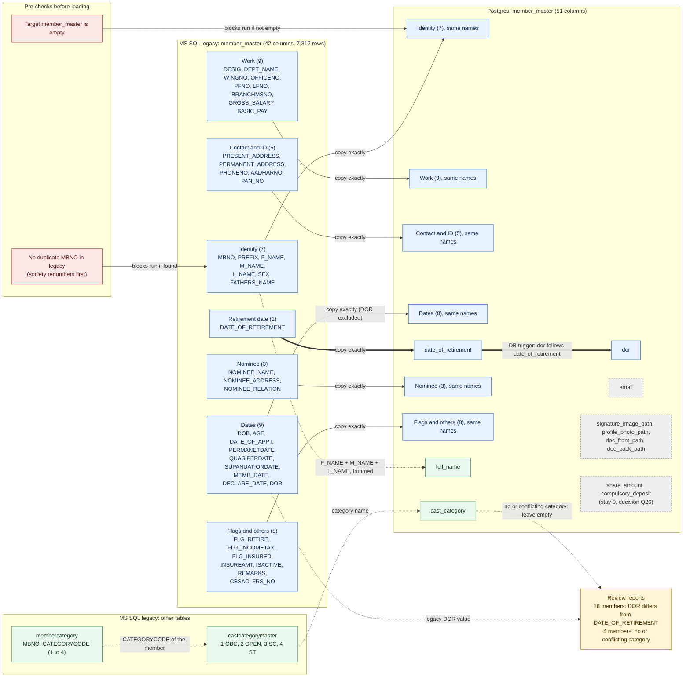

**Decision log for this diagram:** insert only, no delete/merge (13.2) · duplicates blocked, society renumbers in legacy (Option 1, 13.6) · trigger kept on · `email` and the four file paths stay empty (Q28) · `share_amount`/`compulsory_deposit` stay 0 (Q26 decided) · missing or conflicting category left empty and reported (P1) · member_master FINAL (Q79, 2026-11-12).

### 15.1 How the diagrams are kept current (log, 2026-11-11)
- Diagram page (private, owner only): https://claude.ai/artifact/7suXf2jXfeMytodGc5MgEh
- Rebuild after every decision: edit the diagram block in this file, run `node scripts/legacy-migration/build-diagrams.js`, which writes `migration-diagrams.html` (local) and `migration-diagrams.artifact.html` (the page above); the page is then republished. Both generated files are not edited by hand.
- Each next table gets its own `### Diagram: <table>` block here, and its decision log line under it.

---

## 16. TABLE 2: `membercategory` (which caste category and member type each member has)

### 16.1 Side by side
| | MS SQL (Nov dump) | Postgres today |
|---|---|---|
| Rows | 7,323 | 7,327 (test data) |
| Distinct `mbno` | 7,309 | 7,315 |
| Columns | 3: `MBNO` numeric, `CategoryCode` int (not null), `MemberType` int | the same 3, same types |
| Keys / indexes | none | none (only "not null" on `categorycode`) |
| Lookup tables it points to | `castcategorymaster` (1 OBC, 2 OPEN, 3 SC, 4 ST), `MemberTypeMaster` (1 Regular, 2 Other Nominal, 3 Co-Op Member, 4 Well Wisher Member) | same two tables exist; `castcategorymaster` row 1 is damaged in Postgres (test string), `membertypemaster` equals legacy |

No column differs: this is a **pure Type A copy**.

### 16.2 What is in the data (Nov dump)
| Check | Result |
|---|---|
| Category codes used | 1 = 21 members, 2 = 7,299, 3 = 1, 4 = 1 (all exist in `castcategorymaster`) |
| Member types used | Regular for 7,321 rows, Co-Op Member for 1 (`610033329`); none missing in `MemberTypeMaster` |
| NULL `mbno` or NULL `MemberType` | 0 |
| Exact duplicate rows (same member, category, type) | 11 (the 3 duplicate-number members account for 3 of them) |
| One member with two different categories | 1 (`940032979`: 1 and 2) |
| Category rows whose member is not in `member_master` | 3 (`610032967`, `610033065`, `940031400`) |
| Members with no category row | 3 (`610033440`, `610032999`, `940019896`) |

### 16.3 What the app does with it
- **The new backend never reads or writes `membercategory`.** I searched all backend source: the table is only mentioned by the migration scripts and the database schema files.
- The member screen has a **Member Type** dropdown (Regular and others) in the front end, but the value is not stored anywhere in the backend (`member_master` has no such column), so the screen always shows "Regular".
- The category name is stored in text form in `member_master.cast_category` (see Table 1).
- Meaning: this table is **kept for completeness and as the source for `cast_category`**. The new app does not show the member type at all. One member (`610033329`, Co-Op Member) is therefore not Regular in legacy and appears as Regular in the new app. That is a **feature gap**, not a migration error.

### 16.4 Proposed method (following P1: load as it is, report, the client fixes)
1. Load `castcategorymaster` and `membertypemaster` first (seed from legacy, 4 rows each).
2. Copy all 7,323 `membercategory` rows **exactly as they are**: including the 11 exact duplicates, the 1 member with two categories and the 3 category rows with no member. No cleaning, no unique key, same as legacy.
3. Use it as the source for `member_master.cast_category` (Table 1): one distinct category, or the same category repeated, gives the name; none or conflicting gives empty.
4. Verification: row count 7,323 equals legacy; SHA-256 over the 3 columns matches; every `categorycode` exists in `castcategorymaster`; every `membertype` exists in `membertypemaster`.
5. **Report for the client** (no blocking): the 3 members without a category, the 1 conflict, the 3 orphan rows, the 11 duplicates, and the 1 Co-Op member whose type the new app does not show.

### 16.5 Questions
| # | Question | My recommendation | Status |
|---|---|---|---|
| Q30 | Copy `membercategory` exactly, duplicates and orphans included (P1)? | **DECIDED 2026-11-11: yes, copy exactly.** | DECIDED |
| Q31 | The new app does not store a member type. Do we show it (small app change) or accept that the 1 non-Regular member looks Regular? | Accept for now, tell the client; app change is a separate ticket | OPEN |

### Diagram: membercategory (decisions up to 2026-11-11)
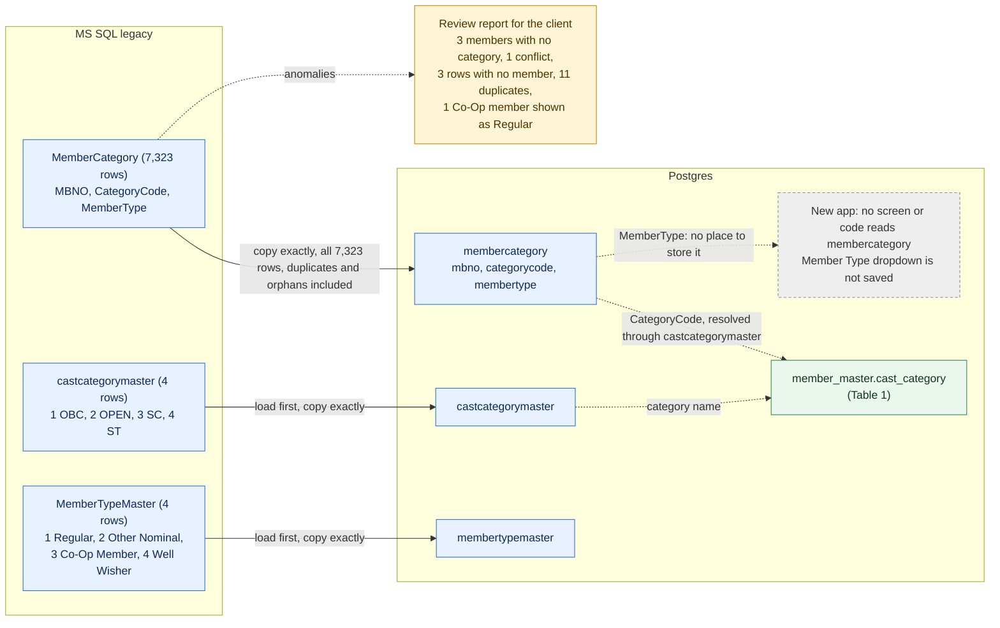

**Decision log for this diagram:** copy exactly, nothing cleaned (P1), DECIDED 2026-11-11 (Q30) · both lookup tables loaded first · used as the source of `cast_category` · member type is not shown by the new app, reported (Q31, still open; default: accept and tell the client).


---

## 17. TABLE 3: `fundsmaster` (each member's share, FRS, compulsory-deposit and other fund settings)

### 17.1 Side by side
| | MS SQL (Nov dump) | Postgres today |
|---|---|---|
| Rows / distinct `mbno` | 7,313 / 7,313 (one row per member) | 7,325 / 7,325 (test data) |
| Columns | 19 | the same 19, same names, money columns `numeric(19,4)` like legacy `money` |
| Keys / indexes | none | none |
| Relation to members | every member has exactly one row (0 members without), 4 rows have no member | no constraint |

No column differs: **pure Type A copy.**

### 17.2 What each column means (read from the legacy ledger and from the new app's Modify Member Balance screen)
| Column | Legacy meaning | Non-zero rows | What the new screen calls it |
|---|---|---:|---|
| `MBNO` | member number | 7,313 | |
| `SHAREAMT`, `SHAREOPBAL` | monthly share instalment, share opening balance (GL head L1001) | 5 / 6,517 | Shares instalment / opening balance |
| `MDAMT`, `MDOPBAL` | monthly **FRS 1** contribution (₹8 for 5,649 members, ₹2 for 78) and its opening balance (GL head L1002, ledger type `MD`) | 5,727 / 6,466 | Monthly contribution |
| `CDAMT`, `CDOPBAL` | monthly compulsory deposit (₹200 for 5,694, up to ₹5,000) and its opening balance (GL head L1004, ledger type `CD`) | 6,355 / 6,523 | Compulsory deposit |
| **`MD1_AMOUNT`, `MD1_OPBAL`** | **FRS 2 contribution: ₹17 a month for 6,688 members** and its opening balance (about ₹5,2xx each, total ₹2.59 crore; GL head L1045, ledger type `MD1`) | 6,688 / 6,450 | **"Regular Loan" instalment and opening balance** (mismatch, see 17.4) |
| `MD2_AMOUNT`, `MD2_OPBAL` | not used in legacy (all zero or NULL) | 0 | "Emergency Loan" instalment and opening balance |
| `MD3` to `MD5` (amount and opening balance, 6 columns) | not used | 0 | not shown |
| `LNEXECREC` | loan execution receipt | 0 | Loan execution receipt |
| `SUSPBAL` | suspense balance | 1 (member `940026216`, ₹7,279) | Suspense balance |

### 17.3 Data checks (Nov dump)
| Check | Result |
|---|---|
| Members without a row / duplicate rows | 0 / 0 |
| Rows with no member in `member_master` | 4: `300033033`, `610032967`, `610033065`, `940031400` (three of them are also the "category row without member" cases of Table 2: members that were removed but left their fund and category rows behind) |
| Negative opening balances | 6 members: `610032635`, `610026644`, `610025673`, `30031004`, `30023614`, `30024418` (all in `CDOPBAL`, between -₹80 and -₹2,674) |
| NULL values | only `MD1_AMOUNT` (517 rows); every other column has none |
| Values that do not fit the Postgres column | none (Postgres columns are equal or wider) |
| Opening balances against the ledger heads (information only) | sum of `CDOPBAL` ₹35,99,99,928 vs head L1004 opening ₹36,01,19,176 (difference ₹1.19 lakh); sum of `SHAREOPBAL` ₹5,41,58,205 vs L1001 ₹5,38,82,360 (difference ₹2.76 lakh); the member-level opening balances do not add up exactly to the head figures. This is legacy data, not a migration effect. |

### 17.4 Finding that matters: the new screen names MD1 and MD2 as loans
The new "Modify Member Balance" screen shows `MD1_*` as **Regular Loan** and `MD2_*` as **Emergency Loan** (backend names `rlnOpBal`/`rlnAmt`, `elnOpBal`/`elnAmt`). In legacy these columns hold **FRS 2** (MD1) and nothing (MD2). After migration, an ordinary member's screen will say "Regular Loan instalment ₹17, opening balance ₹5,195", which is wrong and could mislead staff. **The data is right; the label is not.** In Postgres today 5,426 real members already carry 17 in `md1_amount`, so the screen already shows it this way.
- Under P1 the migration copies as it is. The fix belongs in the application (rename the MD1 card to FRS 2 and hide or rename MD2), before go-live. This is a front-end and API naming change; I did not touch it (Q32).
- A second observation for the owner, not a migration matter: the year-end archive in `financial-year.service.ts` computes a member's balance as `opening balance + instalment` (for example `cdopbal + cdamt`). If the instalment is only the monthly rate, that adds the monthly amount to the balance as if it had been paid. Worth checking when the year-end window is reviewed (Q34).

### 17.5 Proposed method (P1: load as it is, report)
1. Load after `member_master` (order only; there is no database constraint).
2. Copy all 7,313 rows **exactly**: the 4 rows with no member, the 6 negative opening balances and the NULL `MD1_AMOUNT` values stay as they are (Q33).
3. No changes to meaning: `MD` stays FRS 1, `MD1` stays FRS 2.
4. Verification: row count 7,313; SHA-256 over the 19 columns; one row per `mbno`; per-column totals reported next to the ledger head opening balances (information, no block).
5. **Report for the client** (no block): the 4 rows without a member, the 6 negative balances, the 1 suspense balance, the 517 NULLs, and the head-versus-member opening balance differences.

### 17.6 Questions
| # | Question | My recommendation | Status |
|---|---|---|---|
| Q32 | The new screen labels `MD1`/`MD2` as Regular/Emergency Loan; legacy `MD1` is FRS 2. | **DECIDED 2026-11-11: rename the MD1 card to "FRS 2" (MD2 shown as "Not used"). App change by the owner before go-live; migration unchanged.** | DECIDED |
| Q33 | Copy the 517 NULL `MD1_AMOUNT` as NULL, or as 0? | **DECIDED 2026-11-11: as NULL (P1).** | DECIDED |
| Q34 | The year-end archive adds the instalment to the opening balance. Is that intended? | Owner to check when that window is reviewed; not a migration item | OPEN |

### Diagram: fundsmaster (decisions up to 2026-11-11)
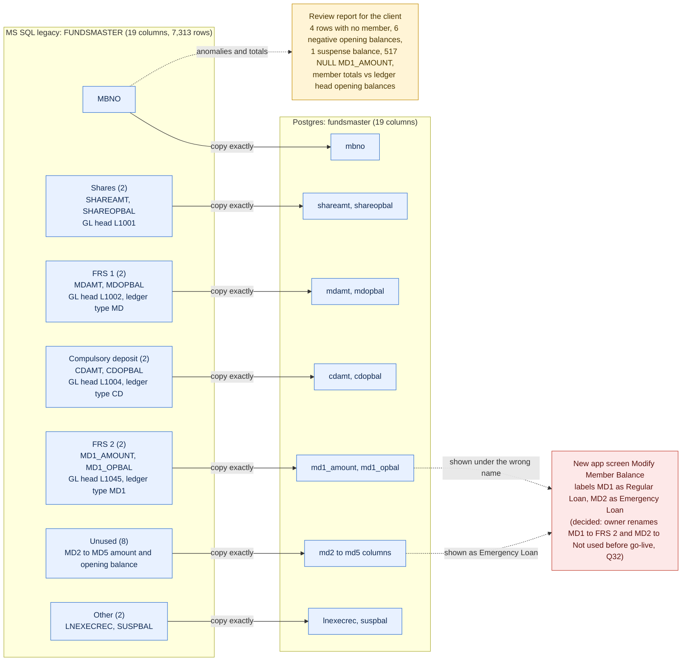

**Decision log for this diagram:** FINAL 2026-11-11: pure copy of all 19 columns and all 7,313 rows, nothing cleaned (P1) · MD1 stays FRS 2; the app label is renamed to FRS 2 by the owner (Q32) · the 517 empty MD1_AMOUNT stay NULL (Q33) · Q34 (year-end archive) is an app review for the owner, not a migration item.


### 17.7 Discussion notes on Q32 (2026-11-11, you chose "discuss first")
Evidence gathered after the first write-up:
- **The app contradicts itself about MD1.** The Member Funds entity, the DTO and the Modify Member Balance screen call `md1_*` "Regular Loan" (and `md2_*` "Emergency Loan"). But `utilities.service.ts` (line 1446 to 1451) maps `MD1` to GL head `L1045` with the comment "Monthly Deposit (FRS 2)", and `interest.service.ts` lists `MD1` as a ledger account type next to `MD`, `CD`, `SHR`. Postgres already holds 318,463 ledger rows of type `MD1` and 302,627 demand rows with an `MD1` amount (migrated legacy data). So the ledger side of the app treats MD1 as FRS 2; only the funds screen mislabels it.
- **Loans are not stored in `fundsmaster` at all.** Loan instalments and balances live in `loan_master`; the funds screen's "Regular Loan / Emergency Loan" cards edit columns that, in the migrated data, are FRS 2 and unused. Any edit made there would silently change a member's FRS 2 amount.
- **The new demand generation does not use `fundsmaster`.** `demand-generation.service.ts` builds a member's monthly demand from active loan instalments only (the code says "Add more heads (RD, shares, insurance) as needed"). The monthly share, FRS 1, FRS 2 and compulsory-deposit amounts in `fundsmaster` are used today only by the funds screen, the Saakh score and the year-end archive. Another route (the demand import of the payroll file) may carry those heads; I did not check that route in this table. So the migrated amounts are correct data, but the new app's own demand generator would not deduct them. That is an application question for the owner, outside the migration.

Options for the label (the migration is the same in every option):
1. **Rename** the card to "FRS 2" and show MD2 as "Not used" or hide it. Smallest change, matches the ledger.
2. **Hide MD1 and MD2** from the screen until the demand rules are settled.
3. **Leave it** and train staff. Not recommended: a screen that says "Regular Loan ₹17" will mislead.
Recommendation: option 1, done by the owner in the front end and the entity/DTO names, before go-live.


---

## 18. TABLE 4: `frs` (and its companion `frs_balance`): Family Relief Scheme lists

### 18.1 Side by side
| | `frs` | `frs_balance` |
|---|---|---|
| Legacy columns | `SR_NO`, `MBNO`, `PFNO`, `MBNAME` (the member name as text), `FRS` (money), `FRS_FUND` (money): 6 | `Mbno`, `Balance` (money): 2 |
| Legacy rows (Nov dump) | 6,454 (6,451 distinct `MBNO`) | 6,735 (6,735 distinct) |
| Postgres columns | the same 6 | the same 2 |
| Postgres rows today | 6,454, **identical to legacy** | 6,735, **identical to legacy** |
| Changed since the September dump? | no (same row counts) | no |

No column differs in either table: **pure Type A copies.** There are no extra Postgres columns to trace back.

### 18.2 What they are
- Both look like **one-time lists** of the Family Relief Scheme (FRS), not live tables. They have not changed since September, and `frs` contains no member numbered above `990042275`, although members now go up to `990042381`.
- `FRS_FUND` adds up to ₹2,58,76,517, which is close to the sum of the FRS 2 opening balances in `fundsmaster` (`MD1_OPBAL`, ₹2,58,62,304, difference ₹14,213). So `FRS_FUND` is a copy of each member's FRS 2 fund at some past date. `FRS` adds up to ₹1,25,50,072 (meaning not documented; probably the FRS 1 amount at that date). `frs_balance` adds up to ₹4,04,04,714.
- **`frs_balance.Mbno` is not a member number.** All 6,735 values are 4 to 6 digits and none matches a `member_master.MBNO`. They match the **PF number**: 6,001 of them equal a member's `PFNO`, and 5,715 equal `frs.PFNO`. The column is simply misnamed in legacy.
- **The new app never reads either table.** Searching all backend source finds no use of `frs` or `frs_balance`. The FRS figures the app shows come from `fundsmaster` (FRS 1 and FRS 2 amounts and opening balances, Table 3) and `member_balances.frsbalance`. `member_master.frs_no` (5,971 members have one) is the FRS membership number, copied with Table 1.

### 18.3 Data checks on `frs` (Nov dump)
| Check | Result |
|---|---|
| NULLs / negatives / zero `FRS` | 0 / 0 / 0 |
| Member numbers appearing twice | 3: `940026930`, `610030727`, `610032910` |
| Rows whose member is not in `member_master` | 33 (for example `30001231`, `610024533`, `940027043`, `990042259`) |
| Members with no `frs` row | 894 (members who joined after the list, or are not in the scheme) |
| Stored name differs from the member's first name | 23 rows (spelling or edits since) |

### 18.4 Proposed method (P1)
1. Copy **`frs`** (6,454 rows) and **`frs_balance`** (6,735 rows) exactly as they are, as **archive tables**. Same values, nothing cleaned, duplicates and orphans included. Nothing blocks the run.
2. `frs_balance` is not member-scoped (its `Mbno` is a PF number), so the member-based copy loop cannot load it. It needs a plain whole-table copy step. (Today it is in Postgres only because it was copied earlier by hand; the script does not handle it.)
3. Verification: row counts, SHA-256 over all columns.
4. **Report for the client:** the 3 repeated member numbers, the 33 rows with no member, the 23 name differences, and the note that the lists stop at member `990042275`.
5. No decision in the app is needed: it does not use them.

Alternative: **skip both** because the app never reads them. I do not recommend skipping: it costs nothing, and the society may still want the lists as a record of what the old system held.

### 18.5 Questions
| # | Question | My recommendation | Status |
|---|---|---|---|
| Q35 | Copy `frs` and `frs_balance` as they are, as archive tables (not read by the app)? | **DECIDED 2026-11-11: yes, copy both.** | DECIDED |
| Q36 | `frs_balance.Mbno` is really the PF number. Keep the legacy column name as it is (a copy), or rename it to `pfno` in the new schema? | Keep as it is (P1, no schema change); documented here | OPEN |

### Diagram: frs and frs_balance (decisions up to 2026-11-11)
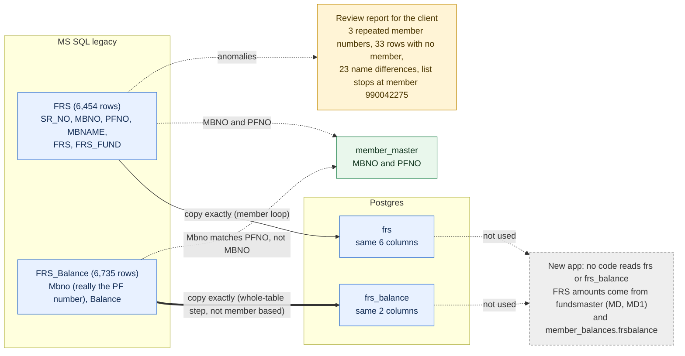

**Decision log for this diagram:** both tables copied exactly as archive tables, nothing cleaned (P1), DECIDED 2026-11-11 (Q35) · `frs_balance` needs a whole-table copy step, not the member loop · legacy column names kept (Q36, proposed, still open).


---

## 19. TABLE 5: `member_balances` (each member's balances: shares, CD, RD, FRS, loans)

**This table is not a plain copy.** The legacy copy holds old opening figures; the new app treats the same table as live balances. Read 19.3 before the method.

### 19.1 Side by side
| | MS SQL (Nov dump) | Postgres today |
|---|---|---|
| Rows / distinct `MbNo` | 6,505 / 6,505 | 6,615 / 6,614 (test data) |
| Columns | 21, all `float` except the name (text) and `Dep_Date` | the same 21 names; numbers are `numeric` or `double precision` |
| Keys / indexes | none | none (only "not null" on `mbno`), no triggers |
| Relation to members | 107 rows have no member in `member_master`; 914 members have no row | no constraint |
| Changed since the September dump? | no: same 6,505 rows | |

Columns: `SrNo`, `MbNo`, `PFNo`, `Member_Name`, `OfficeNo`, `DR_CR`, `Shares`, `Int_Rate`, `Compulsory_Deposit`, `RD_Amt`, `Dep_Date`, `IsCompound`, `LoanInt_Rate`, `RegularLoan`, `RegularInstallAmt`, `Int_Amount`, `ELoanInt_Rate`, `Emergency_Loan_Balance`, `EInstallAmt`, `EInt_Amount`, `FRSBalance`.
No column differs: by structure it is a Type A copy. By **meaning** it is not, as shown next.

### 19.2 What the legacy table really holds
- It is a **static snapshot from 2019**, not a running balance. The newest `Dep_Date` is 2019-11-29 (one junk value, 2209-04-15, member `990042087`), `SrNo` goes to 53,673 although only 6,505 rows remain, and it has not changed since September.
- Its `Shares` and `Compulsory_Deposit` are **equal to the opening balances in `fundsmaster`** (`SHAREOPBAL`, `CDOPBAL`), for example member `990042274`: both 11,430. In other words: the balances on 31-Oct-2019, the day before the ledger starts.
- `DR_CR` and `IsCompound` are always NULL; `FRSBalance` is non-zero for only 3 members.
- The legacy "current" balance of a member is therefore **opening balance + the member's movements in the ledger**, not this table. (I derived this from the data; I have not seen the old program's screen. See 19.6 for how to confirm.)

### 19.3 What the new app does with the same table
`member_balances` is read as the **current** balance by 43 backend files: the Member Balance screen (shares, compulsory deposit, RD, FRS, regular and emergency loan), loan eligibility, dividend and share month-end, notices, member status. Every posting (compulsory deposit, loan disbursement, repayment) adds to it directly (`UPDATE member_balances SET ... = ... + amount`), inserting a row when a member has none.

**So a plain copy would show every member their 2019 opening balance as if it were today's.**
Evidence from the Nov dump, per member, "opening + ledger movements" against the snapshot:
| Balance | Members where the snapshot equals opening + ledger | Members where it differs |
|---|---:|---:|
| Compulsory deposit | 549 | 5,848 |
| Shares | 2,358 | 4,034 |

Examples (compulsory deposit): member `990042274`: snapshot 11,430, ledger movement -11,430, **true balance 0** (the member withdrew); `990042273`: snapshot 1,10,473, true 2,32,748; `990042276`: snapshot 1,395, true 18,502.
Totals against the general ledger heads:
| Balance | Snapshot total | Derived total (opening + ledger) | GL head closing | Derived vs head |
|---|---:|---:|---:|---|
| Compulsory deposit (L1004) | ₹35,42,00,305 | **₹29,00,76,755** | ₹29,01,21,566 | within ₹44,811 (0.015%) |
| Shares (L1001) | ₹5,20,07,029 | **₹4,24,03,848** | ₹4,21,28,003 | within ₹2,75,845 (the same difference as in the opening balances, Table 3) |
| FRS 1 (L1002) | not in table | ₹4,62,61,345 | ₹3,35,97,321 | does **not** tie (₹1.27 crore), legacy data issue |
| FRS 2 (L1045) | not in table | ₹81,32,454 | negative head | does **not** tie, legacy data issue |
The snapshot is 22% too high for compulsory deposit and 23% for shares; the derived figures tie to the general ledger.

The current Postgres test database already behaves like this: its shares and CD for migrated members equal the legacy snapshot, and only the loan columns were rebuilt by Phase 2. That is why balances in the new screens could look stale.

### 19.4 Column by column: what to do (proposal)
| Column(s) | Kind | Proposal |
|---|---|---|
| `SrNo`, `MbNo`, `PFNo`, `Member_Name`, `OfficeNo` | A copy | Copy from the legacy row; for members with no legacy row use `member_master` values |
| `Shares` | **B derived** | `fundsmaster.shareopbal` + net of the member's ledger entries with head code `L1001` (by head code, see 19.8) |
| `Compulsory_Deposit` | **B derived** | `fundsmaster.cdopbal` + net of ledger entries with head code `L1004` (by head code, see 19.8) |
| `FRSBalance` | **B derived, meaning to decide** | The app shows it as "FRS Balance". Legacy value is useless (3 non-zero). Option: FRS 1 + FRS 2 = (`mdopbal` + ledger `MD`) + (`md1_opbal` + ledger `MD1`). These do not tie to the GL (see table), so this is a decision for you (Q38) |
| `RegularLoan`, `Emergency_Loan_Balance`, `RegularInstallAmt`, `EInstallAmt`, `Int_Amount`, `EInt_Amount`, `LoanInt_Rate`, `ELoanInt_Rate`, `Int_Rate` | A copy, then **replaced by the loan replay (Phase 2)** | Copy first; Phase 2 rewrites the loan balances from the ledger. Discussed in the loan tables |
| `RD_Amt` | A copy, meaning to decide | Legacy value looks like a **monthly RD amount** (5,838 members, about ₹281 on average) but the app shows it as a Recurring Deposit **balance**. Decision Q39: copy as it is, set to 0, or hide |
| `Dep_Date`, `DR_CR`, `IsCompound` | A copy | Copy as it is; the one junk date (2209-04-15) goes to the report |
**Rows:** build one row for **every member in `member_master`** (7,312), not only the 6,505 that have a legacy row. The 914 members without a legacy row are mostly members who joined after 2019 and have real balances in the ledger; the app would otherwise show them nothing. The 107 legacy rows with no member are kept (copied), derived the same way.
**Order:** `ledger` and `fundsmaster` first, then `member_balances` computed inside Postgres from those two tables, so it always agrees with the ledger that was actually loaded.

### 19.5 Checks after loading
1. Row count = members in `member_master` + 107 rows without a member.
2. For shares and CD: total of the derived balances equals the legacy-side total (₹4,24,03,848 and ₹29,00,76,755 on this dump) and is within the figures above of the GL heads; any larger gap stops the run.
3. Per member: derived balance equals opening + ledger, recomputed by an independent query, for all members.
4. Reported (no block): members whose balance is negative, the FRS heads that do not tie, the junk date, the 107 rows without a member.

### 19.6 Please confirm with the old program (5 minutes)
Open 3 members in the old program's balance screen and compare with this list; if the old screen shows the **derived** figure, the method is confirmed:
| Member | Snapshot CD | Derived CD (opening + ledger) |
|---|---:|---:|
| `990042274` | 11,430 | 0 |
| `990042273` | 1,10,473 | 2,32,748 |
| `990042276` | 1,395 | 18,502 |

### 19.7 Questions
| # | Question | My recommendation | Status |
|---|---|---|---|
| Q37 | Build `Shares` and `Compulsory_Deposit` from opening balance + ledger (not the 2019 snapshot), one row for every member? | Yes. Confirmed for 1 member of 3 in the old program (19.9) | CONFIRMED for CD (1 of 3 members checked) |
| Q38 | What should "FRS Balance" show: FRS 1 + FRS 2 derived from opening + ledger, or leave 0? | Derive, and report that the FRS heads do not tie to the GL | DECIDED 2026-11-11: derive |
| Q39 | `RD_Amt` looks like a monthly amount, shown as a balance in the app: copy, set to 0, or hide? | Copy as it is (P1) and rename or hide the label in the app later | DECIDED 2026-11-11: copy as it is |

### Diagram: member_balances (decisions up to 2026-11-11)
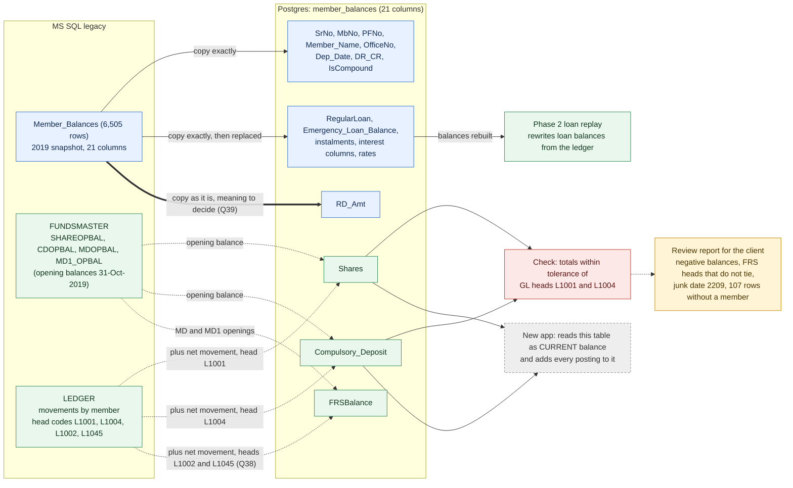

**Decision log for this diagram:** NOT a plain copy: the legacy snapshot holds 2019 opening values (Q37 confirmed in the old program for member 990042276, see 19.9) · shares and compulsory deposit derived from opening balance + ledger BY HEAD CODE, one row per member · FRS balance derived (Q38) · RD_Amt copied as it is (Q39) · loan columns copied then rebuilt by Phase 2 · Q37 confirmed (CD, 1 member) · Q38 decided: FRS balance derived (FRS 1 + FRS 2, by head code L1002 + L1045), FRS heads that do not tie reported, not blocking · Q39 decided: RD_Amt copied as it is (app label to be fixed later by the owner) · member_balances FINAL.


### 19.8 Check against the old program (your screenshots of Member Detail Ledger, 2026-11-11)
You sent the old program's Member Detail Ledger for `990042274`, `990042273` and `990042276`. What they show and what they do not:

**What they confirm**
- The old report is **ledger-driven and printed per head**: each section starts with "Opening Balance" and then lists the entries with a running balance. So the old program computes a head balance as opening + the member's entries in the ledger, which is the idea behind the proposal.
- The migrated ledger matches the old report on the sections that are visible:
  | Member | Section seen | Old report | Legacy ledger in the dump |
  |---|---|---|---|
  | `990042274` | emergency loan (`A1047`) | 5 receipts of 4,167 = 20,835 | 5 rows, 20,835 ✓ |
  | `990042274` | `E1026` interest on CD | 793 + 1,111 + 1,452 + 1,595 = 4,951 | 4 rows, 4,951 ✓ |
  | `990042273` | emergency loan (`A1047`) | payments 3,61,210, receipts 3,27,648 | 3,61,210 and 3,27,648 ✓ |
  | `990042273` | `E1026` | 68,003 (7 entries) | 7 rows, 68,003 ✓ |
  | `990042276` | emergency loan (`A1047`) | 5,000 and 5,004 | 5,000 and 5,004 ✓ |
  | `990042276` | `E1026` | 3,876 (7 entries) | 7 rows, 3,876 ✓ |

**What they do not show**
- The three screenshots are scrolled to the loan and the interest sections. **None shows the Compulsory Deposit section (`L1004`) or the Shares section (`L1001`)**, so the specific question (is the snapshot or the derived figure what the old program shows as the CD balance?) is **not answered yet**. I will not call Q37 confirmed on this evidence.

**What to look for (please scroll to these sections and send the same screenshots)**
| Member | Section `L1004-COMPULSORY DEPOSIT`: opening balance | Closing balance I expect | The 2019 snapshot would show |
|---|---:|---:|---:|
| `990042274` | 11,430 | **0** | 11,430 |
| `990042273` | 1,10,473 | **2,32,748** | 1,10,473 |
| `990042276` | 1,395 | **18,502** | 1,395 |
If the closing balances are the middle column, Q37 is confirmed.

**A correction found while doing this.** I had derived the balances from the ledger entries' `ACC_TYPE` (`CD`, `SHR`). The old report groups by **head code** (`L1004`, `L1001`), so the right rule is **by head code**. The two differ for 92 members: 90 ledger rows with head `L1024` (dividend paid) carry type `CD` (₹82,563), 2 rows with head `E1002` carry type `CD` (₹4,000), and 1 row with head `L1004` carries type `OTH` (₹12,126). Using the head code, the derived compulsory-deposit total is ₹29,00,02,318 against the general-ledger head ₹29,01,21,566: the difference is **exactly ₹1,19,248, the known gap between the members' opening balances and the head opening balance** (Table 3), with nothing else unexplained. For the three members above the figures do not change. Section 19.4 and the diagram now say "by head code". The 92 members are listed for the report.

### 19.9 Compulsory Deposit section checked in the old program (member 990042276, 2026-11-11)
You sent the `L1004-COMPULSORY DEPOSIT` section of the old Member Detail Ledger for `990042276` (From 01-Apr-2017 to 31-Mar-2027, run on 04-Nov-2026).
| Item | Old program | My derivation | Snapshot (2019) |
|---|---:|---:|---:|
| Opening balance | 1,395.00 CR | 1,395 (from fundsmaster) | 1,395 |
| Total receipts | 20,800.00 | | |
| Total payments | 3,693.00 | | |
| **Closing balance** | **18,502.00 CR** (last line 09-Oct-2026, D00797) | **18,502** | 1,395 |
Check: 1,395 + 20,800 - 3,693 = 18,502. **The old program shows the derived figure, not the 2019 snapshot.** The monthly receipts of 200 (D-numbered) and the year-end journal lines (J-numbers: interest credited, payments of 405 / 385 / 354 / 540 / 750 / 509) are ledger entries in head `L1004`, which is what the head-code rule reads.
**Result:** Q37 is confirmed for compulsory deposit on this member; the method (opening balance + ledger movements by head code, not the snapshot) is the right one. Only 1 of the 3 members was checked (the others, `990042274` and `990042273`, expected 0 and 2,32,748, are still unchecked) and the Shares section (`L1001`) was not shown; the same rule is applied to shares, and the after-load check of section 19.5 verifies every member against an independent query. Q38 (FRS balance) and Q39 (`RD_Amt`) remain open.

### 19.10 Decision Q38 (2026-11-11): FRS Balance is derived
You decided: `FRSBalance` = FRS 1 + FRS 2, derived like shares and CD, by head code: (`fundsmaster.mdopbal` + net ledger of head `L1002`) + (`md1_opbal` + net ledger of head `L1045`). It is reported, not blocking, that the FRS heads do not tie to the general ledger (FRS 1 derived ₹4,62,61,345 vs head ₹3,35,97,321; FRS 2 derived ₹81,32,454 vs a negative head): this is a legacy data issue, handled under P1. Q39 (`RD_Amt`) remains open.

### 19.11 Decision Q39 (2026-11-11): `RD_Amt` copied as it is
Copied unchanged (P1). The app label ("Recurring Deposit balance") does not match the legacy meaning (monthly amount); relabelling or hiding it in the app is an owner task outside the migration. **Table 5 `member_balances` is now FINAL:** Q37 confirmed, Q38 and Q39 decided.


---

## 20. TABLE 6: `bank_cheq_master` (cheque details of bank receipts and payments)

### 20.1 Side by side
| | MS SQL (Nov dump) | Postgres today |
|---|---|---|
| Rows | 21,547 (5,275 distinct `MBNO`) | 20,988 (test data, newest 24-Sep-2026) |
| Columns | `MBNO`, `RECEIPT_VCHR_NO`, `CODE`, `CHEQNO`, `CHEQAMT` (money), `DATES` (datetime), `Reconcile_Flag` | the same 7 (`cheqamt` numeric, `dates` timestamp) |
| Keys / triggers | none | none |
| Voucher column width | `RECEIPT_VCHR_NO` varchar(6) | widened by migration `1791590400000-WidenVoucherNumberColumns` |

No column differs: **pure Type A copy.** Nothing in Postgres needs to be derived.

### 20.2 What the data is
- One row per cheque on a bank receipt (`R`) or payment (`P`) voucher: member, voucher number, bank head `CODE` (`A1008` 18,069 rows, `A1009`-`A1013` the other banks), cheque number, amount, date. Total ₹39,84,29,803.
- `Reconcile_Flag` is `N` on **all 21,547 rows**: bank reconciliation was never used in the old program.
- Dates run from 2019 to 03-Nov-2026 (the latest dump); 434 rows (₹5,24,38,683) are newer than the current test database.
- **The new application never reads this table.** Searching all backend source finds only the migration that widens its voucher column. It is a record of cheque details only.

### 20.3 Data checks (Nov dump)
| Check | Result |
|---|---|
| Rows with `MBNO` = `0` (bank-side or non-member vouchers) | 3,773 |
| Rows whose member is not in `member_master` (excluding `0`) | 379 |
| Rows whose voucher number is not in `ledger` | 223 |
| Rows with empty cheque number or amount <= 0 | 1,068 |
| Rows dated before the ledger starts (2019-11-01) | 2 (`1900-01-01` and `2019-04-01`) |
| Exact duplicate rows | 0 |

### 20.4 Proposed method (P1)
1. Copy **all 21,547 rows exactly** as an archive table. Nothing cleaned: `MBNO = 0`, orphans, empty cheque numbers and the two old dates stay.
2. **The member-by-member copy loop cannot do this table:** 3,773 rows have `MBNO = 0` and 379 belong to no member, so a loop over members would silently drop 4,152 rows. It needs a **whole-table copy step**, like `frs_balance`.
3. Verification: row count, sum of `CHEQAMT` (₹39,84,29,803), SHA-256 over all columns.
4. Report for the client (no block): the 1,068 incomplete rows, the 223 rows without a ledger voucher, the 379 rows without a member.

### 20.5 Questions
| # | Question | My recommendation | Status |
|---|---|---|---|
| Q40 | Copy `bank_cheq_master` exactly (all 21,547 rows, via a whole-table step), even though the app does not read it? | Yes | DECIDED 2026-11-11: copy exactly |

### Diagram: bank_cheq_master (decisions up to 2026-11-11)
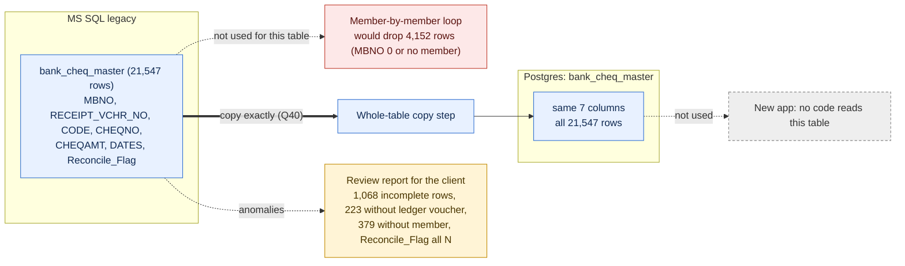

**Decision log for this diagram:** pure copy, all rows exactly, nothing cleaned (P1, Q40 decided) · needs a whole-table copy step because 4,152 rows are not member-scoped · app does not read it · Table 6 FINAL.


---

## 21. TABLE 7: `demand_master` (monthly demand per member: loan instalments, interest, deposits)

### 21.1 Side by side
| | MS SQL (Nov dump) | Postgres today |
|---|---|---|
| Rows / members | 333,877 / 6,256 | 329,168 / 6,241 (test data, includes one junk month 2099-12) |
| Columns | 52 | the same 52 (money columns `numeric`) |
| Period | Nov 2019 to Oct 2026 (2019: 10,487 rows; 2020: 60,669; ...; 2026: 29,751) | |
| Keys / triggers | none | none |
| Total demand | ₹93,61,01,455 | |

No column differs: **pure Type A copy.** Column groups: loan amount, instalment and interest for each loan type (`RLN`, `ELN`, `ALN`, `MLN`, `EDL`, `fln`), deposit amounts (`RD`, `MD`, `CD`, `SHR`, `MD1` to `MD5`) with their balances, `BankCharge`, `OTHERS`, `TotalDemand`, status (`demand_posted`, `PassFlag`), the posting voucher `RECEIPT_VCHR_NO`, and dates.

### 21.2 How the new app uses it
**This table is live in the new app**, unlike the previous two: the loan repayment, loan position, short recovery, demand report, demand import, notices and dashboard all read it, and demand generation and import write to it. So the migrated rows are what staff will see as past demands and what the loan checks read. The natural key is (`demand_for_year`, `demand_for_month`, `MBNO`): **no duplicates in the dump** (0 repeats), and 333,877 rows are unique on it.

### 21.3 Data checks (Nov dump)
| Check | Result |
|---|---|
| Duplicates on (year, month, member) | 0 |
| Rows whose member is not in `member_master` | 0 |
| Rows with a voucher number that is not in `ledger` | 0 |
| Rows posted `Y` and passed `Y` | 333,248 |
| **Rows posted `Y` but `PassFlag` `N` and no voucher** | **623** (spread over many months: 2024-01 48, 2024-04 49, 2025-01 43, 2025-05 44, and small counts in 2020 to 2025) |
| **Rows not posted at all (`N`/`N`)** | **6** (all March 2026) |
| Rows where `TotalDemand` is not the sum of its parts (difference over ₹1) | 249 (247 in January 2020, 1 in 2021, 1 in 2024); in the first examples the stored total is lower than the sum of the parts |

### 21.4 Proposed method (P1)
1. Copy **all 333,877 rows exactly**, member by member (every row belongs to a member, so the loop is safe here). Nothing recalculated, `TotalDemand` kept as stored.
2. Verification: row count, sum of `TotalDemand` (₹93,61,01,455), SHA-256 over all columns.
3. Report for the client (no block): the 629 rows that were never passed (623 + 6), and the 249 rows whose total differs from the parts.
4. Whether Phase 2 (loan replay) reads or rewrites this table is checked when the loan tables are discussed; this table is copied as the legacy truth first.

### 21.5 Questions
| # | Question | My recommendation | Status |
|---|---|---|---|
| Q41 | Copy `demand_master` exactly, all 333,877 rows? | Yes | DECIDED 2026-11-11: copy exactly |
| Q42 | The 629 rows that were posted-but-not-passed or not posted (listed in the report): keep them as they are, or ask the society first what they are? | Keep as they are (P1), and show the list to the society; the new app may show them as pending demand | DECIDED 2026-11-11: keep and report |

### Diagram: demand_master (decisions up to 2026-11-11)
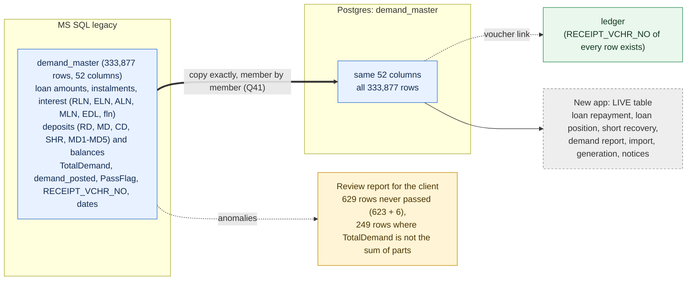

**Decision log for this diagram:** pure copy, all rows exactly, nothing recalculated (P1, Q41 decided) · safe in the member loop: no row without a member, no duplicates · 629 never-passed rows kept and reported (Q42 decided) · Phase 2 interaction to be checked with the loan tables · Table 7 FINAL.


---

## 22. TABLE 8: `demand_masterdelete` (demand rows removed from `demand_master`, kept as history)

### 22.1 Side by side
| | MS SQL (Nov dump) | Postgres today |
|---|---|---|
| Rows / members | 572,163 / 7,680 | 561,033 / 7,639 (test data, newest 16-Sep-2026) |
| Columns | 39: the `demand_master` columns without `LOANCASENO`, `fln_*`, `FromDate`, `UpToDate` and `MD1` to `MD5`, plus `DeletedOn` (datetime) | the same 39 |
| Keys / triggers | none | none |
| Total demand | ₹158,74,10,831 | |

No column differs: **pure Type A copy.**

### 22.2 What it is
- When a demand is regenerated or deleted in the old program, the old rows are moved here with the time of deletion in `DeletedOn`. It is a history table. 572,163 rows were removed on many different days between 30-Nov-2019 (34,842 rows) and 30-Oct-2026.
- **96% of the rows (550,704) have a live twin** in `demand_master` for the same member, year and month: they are the superseded versions of demands that were regenerated. Only 21,459 rows are for member-months that have no live row.
- Status mix: 552,427 never posted (`N`/`N`), 15,032 posted but not passed, 4,704 posted and passed. Only 661 of the rows with a voucher number still have that voucher in `ledger` (the others were reversed).
- **The new application never reads this table.** Searching all backend source finds only the migration that widens its voucher column. It is not part of any live calculation.

### 22.3 Data checks (Nov dump)
| Check | Result |
|---|---|
| Rows whose member is not in `member_master` | 8,080 |
| Rows with a live twin in `demand_master` (same member, year, month) | 550,704 |
| Members | 7,680 (more than the 6,256 in `demand_master`: includes members who left) |

### 22.4 Proposed method (P1)
1. Copy **all 572,163 rows exactly** as an archive table, nothing cleaned.
2. **Whole-table copy step**, not the member loop: 8,080 rows belong to no member in `member_master`, so a member-by-member loop would drop them.
3. Verification: row count, sum of `TotalDemand` (₹158,74,10,831), SHA-256 over all columns, comparing `DeletedOn` as the same wall-clock time (the stored type has no time zone).
4. Report for the client: the 8,080 rows without a member (informational).
5. Alternative: skip it because nothing reads it. I do not recommend skipping: it is the only record of which demands were removed and when.

### 22.5 Questions
| # | Question | My recommendation | Status |
|---|---|---|---|
| Q43 | Copy `demand_masterdelete` exactly (all 572,163 rows, whole-table step) as a history table? | Yes | DECIDED 2026-11-11: copy exactly |

### Diagram: demand_masterdelete (decisions up to 2026-11-11)
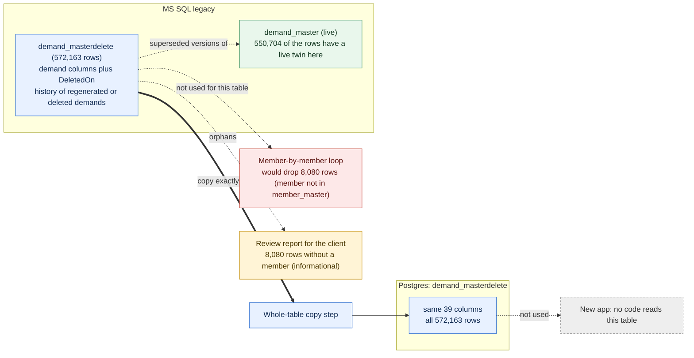

**Decision log for this diagram:** pure copy, all rows exactly, history table (P1, Q43 decided) · whole-table copy step because 8,080 rows have no member · app does not read it · Table 8 FINAL.


---

## 23. TABLE 9: `ledger` (every accounting entry: the heart of the system)

### 23.1 Side by side
| | MS SQL (Nov dump) | Postgres today |
|---|---|---|
| Rows | 1,597,229 | 1,576,773 (test data) |
| Columns | 16: `TRANS_NO`, `TRANS_DATE`, `TRANS_TYPE`, `CODE`, `MBNO`, `ACC_NO`, `ACC_TYPE`, `TRANS_AMT` (money), `RECEIPT_VCHR_NO`, `VCHR_TYPE`, `MODEOFPAY`, `PL_BALANCE` (money), `NARRATION`, `USERNAME`, `Cust_Bank_Name`, `LedgerId` | the same 16 (money as `numeric`) |
| Keys / defaults | none | none: no primary key, no sequence on `ledgerid` or `trans_no`; indexes on member, date and voucher only |
| Period | 31-Mar-2019 to 03-Nov-2026 | test data, includes 105 rows dated after 03-Nov-2026 (junk) |

No column differs: **pure Type A copy.** Nothing is derived. (`ledger_data`, a small side table of 4,733 rows with 9 identical columns, is discussed with the other small tables.)

### 23.2 What it is and how the new app uses it
- One row per debit or credit on a head (`CODE`) for a member (`MBNO`, `0` for entries that are not a member's), grouped into vouchers (`RECEIPT_VCHR_NO`: `D` demand, `J` journal, `P` payment, `R` receipt; 74,194 vouchers). 176,469 debit rows and 1,420,760 credit rows.
- `LedgerId` is unique (1,597,229 distinct values, highest 1,730,945, gaps from deletions). `TRANS_NO` is **not** unique: it is the entry-group number (37,763 distinct values over 1.6 million rows).
- **The new app computes the next numbers as `MAX(trans_no) + 1` and `MAX(ledgerid) + 1` over this table** (opening a savings account, financial year close). So the migrated `LedgerId` and `TRANS_NO` must be kept exactly: new postings continue after the highest legacy values, and no sequence has to be reset.
- Everything reads this table: balances, GL, day book, cash book, member ledger, interest, the loan replay (Phase 2). It is the source for `member_balances` (Table 5).

### 23.3 Data checks (Nov dump)
| Check | Result |
|---|---|
| Duplicate `LedgerId` | 0 |
| `TRANS_TYPE` other than `DR` / `CR` | 0 |
| `CODE` not in `headmaster` | 0 |
| Rows with `MBNO` = 0 | 15,415 |
| Rows whose member is not in `member_master` (174 members) | 4,382 |
| Rows dated before 01-Nov-2019 (before the ledger "starts") | 8 (voucher `J06039`, 31-Mar-2019) |
| Rows with amount 0 (none negative) | 2,940 |
| Total debits / credits | ₹483,84,66,152 / ₹483,87,08,196: **credits exceed debits by ₹2,42,044** |
| Vouchers where debits ≠ credits | 20 |

The 20 unbalanced vouchers: `D00640` (676 rows, June 2024 demand voucher, short by ₹2,174), `J06039` (31-Mar-2019, ₹2,471), `J09999` (₹17,090), `R49161` (Nov 2023, ₹2,61,393), `R46362` (₹15,000), `R49174` (₹14,260), `R54446` (₹5,454), `R45108` (₹200), and 12 single-row payments (`P18942` to `P18947`, `P19107`, `P19109`, `P21931` to `P21935`) between ₹2,669 and ₹9,894. They are legacy entries as they stand; the old program carried them the same way.

### 23.4 Proposed method (P1)
1. Copy **all 1,597,229 rows exactly**: every column, including `LedgerId`, `TRANS_NO`, `PL_BALANCE`, `USERNAME`. Nothing renumbered, nothing balanced, nothing cleaned.
2. **The member loop is not enough:** 15,415 rows with `MBNO` = 0 plus 4,382 rows of members not in `member_master` (19,797 rows, 1.24%, among them the general-ledger-only entries) would be left behind. Use a **whole-table copy** (in date or `LedgerId` order, in batches), not the per-member loop.
3. The target is empty, so there is no delete step and no re-run risk; the script refuses to run if `ledger` already has rows.
4. Verification: row count; total debits and credits (₹483,84,66,152 and ₹483,87,08,196); per head (`CODE`) totals; per voucher count; SHA-256 over all columns in `LedgerId` order; highest `LedgerId` and `TRANS_NO`.
5. Report for the client (no block): the 20 unbalanced vouchers and the overall ₹2,42,044 difference, the 8 rows of 31-Mar-2019, the 2,940 zero-amount rows, the 4,382 rows of 174 members that are not in `member_master`.
6. Indexes (member, date, voucher) are created after the load, for speed.

### 23.5 Questions
| # | Question | My recommendation | Status |
|---|---|---|---|
| Q44 | Copy `ledger` exactly (all 1,597,229 rows, whole-table, `LedgerId` and `TRANS_NO` kept as they are, unbalanced vouchers included)? | Yes | DECIDED 2026-11-11: copy exactly |
| Q45 | The 174 members that appear in the ledger but not in `member_master` (4,382 rows): list for the society, nothing else? | Yes (P1: report only). They are likely members whose master record was removed | DECIDED 2026-11-11: report only |

### Diagram: ledger (decisions up to 2026-11-11)
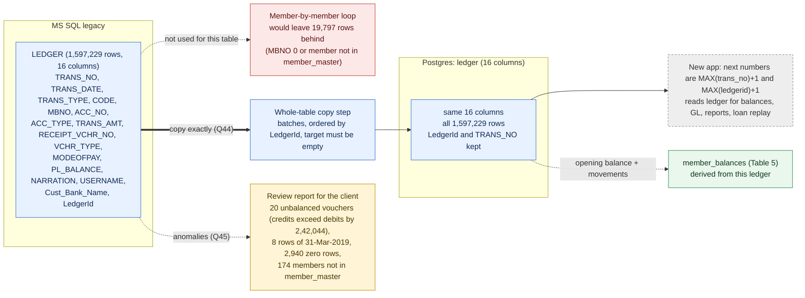

**Decision log for this diagram:** pure copy, every row and every id exactly, nothing renumbered or balanced (P1, Q44 decided) · whole-table step because 19,797 rows are not member-scoped · unbalanced vouchers and members without a master record reported only (Q45 decided) · Table 9 FINAL.


---

## 24. TABLE 10: `ledger_data` (a one-time working list of 4,733 members)

### 24.1 Side by side
| | MS SQL (Nov dump) | Postgres today |
|---|---|---|
| Rows / members | 4,733 / 4,733 (one row per member, no repeats) | 4,733, identical sum |
| Columns | 9: `MBNO`, `PFNO`, `NAME`, `I1005_DR`, `L1004_CR`, `L1024_DR`, `L1004CR`, `L1004_DR`, `L1003_CR` | the same 9 |
| Keys / triggers | none | none |

No column differs: **pure Type A copy.**

### 24.2 What it is
- A working table the old program (or a staff member) filled once, with per-member amounts for four journal lines: `I1005_DR` = `L1004_CR` (₹2,07,49,794 each, interest credited to compulsory deposit), `L1024_DR` = `L1004CR` (₹28,69,144, dividend), `L1004_DR` = `L1003_CR` (₹16,74,420, a transfer of ₹354 per member). Each pair is a debit and the matching credit, so the table is the **input of a year-end journal**, not accounting data itself. The journal's results are already in `ledger` (Table 9).
- **The new app never reads it** (no backend file references `ledger_data`).
- 35 rows belong to members not in `member_master`.

### 24.3 Proposed method (P1)
Copy all 4,733 rows exactly, as an archive. The member loop would drop the 35 rows without a member; use the same whole-table step as the other archive tables. Verification: row count and the six column totals above, SHA-256. Report: the 35 rows without a member.

### 24.4 Question
| # | Question | My recommendation | Status |
|---|---|---|---|
| Q46 | Copy `ledger_data` exactly (4,733 rows, whole-table step)? | Yes | DECIDED 2026-11-11: copy exactly |

### Diagram: ledger_data (decisions up to 2026-11-11)
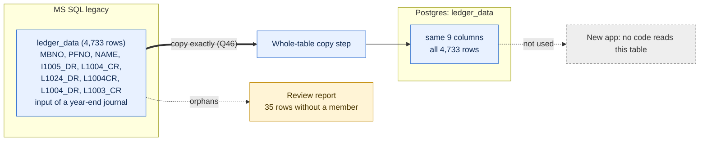

**Decision log for this diagram:** pure copy, archive, whole-table step (P1, Q46 decided) · app does not read it · Table 10 FINAL.


---

## 25. Register: behaviour differences between the old program and the new app

**Purpose (you asked for this on 2026-11-11):** while checking tables we keep finding places where the new app behaves differently from the old program. This section is the single place where they are noted. **Nothing here is decided and nothing is changed.** At the end of the migration discussion we review every row and decide per row: **keep the new behaviour** (the app does it better or deliberately differently), **adopt the old behaviour** (the app is missing something the society needs), or **a third way**. Every later table adds its rows here (the next free id is shown below the table).

How to read: *Old* = what the legacy data or the old screens show; *New* = what the current backend and front end do (from code, or from Postgres where stated); *Evidence* = the section in this file; *Status* = **Verified** (seen in code, data or your screenshots) or **To verify** (a reasonable reading, not yet confirmed). The "Decision at review" column only names the choice; no recommendation is given until the review.

| Id | Area | Old program | New app | Evidence | Status | Decision at review |
|---|---|---|---|---|---|---|
| B1 | Member balances (shares, compulsory deposit, FRS) | Not a stored running figure: the balance of a head is its opening balance plus the member's ledger entries (the old Member Detail Ledger prints "Opening Balance" then entries with a running balance; your screenshots of 990042276 end at 18,502) | `member_balances` is a stored live balance read by 43 files; every posting adds to it directly. If it drifts from the ledger, nothing re-derives it | 19.2, 19.3, 19.9 | Verified | Keep the stored balance (with a reconcile check against the ledger), or compute from the ledger like the old program |
| B2 | MD1 / MD2 labels | MD1 is FRS 2 (head `L1045`, "Monthly Deposit FRS 2"); MD2 to MD5 unused | Member Funds screen, DTO and entity call `md1_*` "Regular Loan" and `md2_*` "Emergency Loan"; the ledger side (`utilities.service.ts`) still treats `MD1` as FRS 2. Editing the "Regular Loan" card changes FRS 2 | 17.7 | Verified | Rename to FRS 2 (you already chose this for the card), hide MD2 |
| B3 | Monthly demand contents | `demand_master` rows carry loan instalment and interest **plus** deposit amounts: MD, CD, SHR, MD1 (example: CD 200 and MD 8 on a row with no loan). Total demand includes them | `demand-generation.service.ts` builds a member's demand from active loan instalments only (code comment: "Add more heads (RD, shares, insurance) as needed"). Whether the payroll-file demand import carries the deposit heads was not checked | 17.7, 21, 45 | Verified for generation; To verify for import | Does the society still need CD, FRS and share deductions inside the monthly demand? |
| B4 | `RD_Amt` meaning | A monthly RD instalment amount (5,838 members, about ₹281) | Shown as a Recurring Deposit **balance** | 19.4, 19.11 | Verified | Relabel or hide in the app |
| B5 | Date of retirement | `dor` and `date_of_retirement` are independent columns; the 18 members where they differ keep both values | A database trigger forces `dor` = `date_of_retirement` on every insert or update | 11, 13 (Q16) | Verified | Keep the trigger and accept 18 corrected values, or drop the trigger |
| B6 | Caste category of a member | Held in `membercategory` + `castcategorymaster`, not on the member row | `member_master.cast_category` is a text column on the member, checked by a constraint | 11, 16 | Verified | Keep (needs the derivation rule from Q25 to Q27) |
| B7 | FRS lists | `frs` (6,454 rows) and `frs_balance` (6,735 rows) hold the FRS member list and balances | No code reads either table; FRS amounts come from `fundsmaster` and `member_balances.frsbalance`. The lists end at member `990042275` | 18 | Verified | Is the FRS member list still a society need? If yes, the app must maintain it |
| B8 | Cheque details of bank vouchers | `bank_cheq_master` stores cheque number, amount and date per bank receipt or payment voucher, with a reconcile flag (always `N`) | No code reads or writes this table. Whether the new bank voucher screens store the cheque number elsewhere was not checked | 20 | To verify | Does the society need cheque numbers kept and bank reconciliation? |
| B9 | History of removed demands | Regenerating or deleting a demand moves the old rows to `demand_masterdelete` with the time (`DeletedOn`): 572,163 rows kept | No code reads or writes it, so a deleted or regenerated demand in the new app may leave no history (the delete path was not checked) | 22, 45 | To verify | Keep a history of removed demands: yes or no |
| B10 | Year-end journal input list | `ledger_data` holds per-member amounts (interest on CD, dividend, the 354 transfer) used for a year-end journal | Not used; the new year-end flow is in `financial-year.service.ts` and does not read this table | 24 | To verify | Confirm the new year-end covers the same journal lines |
| B11 | Unbalanced vouchers | 20 vouchers where debits and credits differ (credits exceed debits by ₹2,42,044 in total), including a 676-row demand voucher | Whether the new posting code refuses an unbalanced voucher was not checked | 23.3 | To verify | Should the app block unbalanced vouchers? |
| B12 | Zero-amount ledger lines | 2,940 ledger rows with amount 0 (for example the 0.00 receipt lines on the year-end journal in your screenshots) | Not checked whether the new posting writes zero lines | 23.3 | To verify | Keep or skip zero lines |
| B13 | Ledger numbering | `LedgerId` and `TRANS_NO` are plain numbers with gaps; no keys | The new app takes `MAX + 1` of each at posting time; Postgres has no sequence, key or unique index on them, so two postings at the same instant could take the same number | 23.2 | Verified for the code; concurrency risk To verify | Add a sequence or unique index later (app change), or keep |
| B14 | Demands posted but never passed | 623 rows posted `Y` / passed `N` and 6 never posted (March 2026) stay in `demand_master` | The new app may list them as pending demand | 21.3 | To verify | What staff should do with them |
| B15 | Ledger without member master | 174 member numbers appear in the ledger but not in `member_master` (4,382 rows) | New member screens need a master row | 23.3 | Verified | Report only (decided, Q45); is deleting a member that has entries allowed in the new app? |
| B16 | Loan interest work list | `loan_product` holds per member and loan head (ALN, RLN, ELN) an `Interest` figure (₹23.18 crore in total, 562 negative) with opening, debit, credit and closing columns always 0 | Not read by the app; loan interest is computed by the loan services from `loan_master` and the ledger | 26 | To verify | What the figure was used for in the old loan reports, and whether the society needs it |
| B17 | Loan balance upkeep | `loan_master.BALANCE` equals `LOAN_AMT` in 20,193 of 20,207 rows: it was not reduced by repayments; the loan balance comes from the ledger | `loan_master.balance` is updated by every posting and read as the live balance (same pattern as B1) | 27 | Verified | Keep the stored balance with a reconcile check, or derive from the ledger |
| B18 | Loan rule columns | A loan carries only `RATE` and `PenalRate` | New columns per loan: grace days, short-payment penalty parameters, payment model, interest method, delay months, consolidation link, payroll-lag fields | 27.1 | Verified (columns exist with defaults) | Confirm the defaults are the rules wanted on old loans (Q49) |
| B19 | History of loan changes | `loan_masterhistory` keeps saved earlier versions of loan rows (13,867 rows; 599 loans exist only there) | No code reads or writes it; whether the new app keeps a history of loan changes (top-up, consolidation, re-agreement) somewhere else was not checked | 28, 45 | To verify | Keep a history of loan changes in the new app: yes or no |
| B20 | Number counters | Voucher numbers are a letter plus a running number (`D00797`, `J32983`, `P27316`, `R58796`) from one counter row (`voucher_master`); loan case and member numbers are plain numbers (highest loan case 21,233) | **Three numbering schemes in one app** (corrected in section 35): `voucher_master` letters (savings, interest, journal, pass step), `sequence_master` `VOUCHER_NO` with prefix `VCH` that restarts every year (voucher, compulsory deposit, dividend, member, re-agreement screens), and other prefixes in the ledger (`G08...`); plus `sequence_master` counters for `LOAN_CASE`, `MEMBER_NO` (per-prefix keys) and `REAGREEMENT_NO`. Generators skip numbers already used, but the counters start from test values | 23, 29, 35 | Verified (code and test ledger) | Counters set above legacy maxima at load; owner decides whether one numbering scheme (the old letters) should be kept |
| B21 | Loan application extras | An application has amounts, dates, three guarantors, sanctioned and paid flags | Adds application kind (NEW or REAGREEMENT), re-agreement link, per-application rate and penal rate with override reason and user, and a pass flag | 29.1 | Verified (columns exist) | Confirm old loans take the defaults (Q51) |
| B22 | Daily loan balance snapshots | `loan_balance_history` holds daily per-member loan snapshots, run for about 34 days in January 2020 and then stopped; 28% of rows do not add up | No code reads it; loan balances are the live `loan_master.balance` | 30, 45 | Verified (data and code search) | Is a daily balance snapshot (for audit or reports) needed in the new app? |
| B23 | Detailed loan repayment record | Repayments exist only as ledger entries; instalment-by-instalment detail is not stored | The app keeps its own `loan_repayment_ledger` (principal, interest, source DEMAND or CASH per payment) and refuses a payment on a loan it counts as fully repaid. The migration has to build it by replay (144,883 rows in the test run) | 31 | Verified | Keep (it must be built at load), and decide how the 26 refused members are handled (Q56) |
| B24 | Interest income heads | One income head `I1002` INTT FROM MEMBER takes all member loan interest | Interest now posts to two child heads, `I1013` (regular loan) and `I1014` (emergency loan), created by an app migration; `I1002` stays as the parent and old history is not moved | 32 | Verified (migration ES-46) | Keep the split (reports must add the children to the parent) or return to one head |
| B25 | Year-end carry-forward vs lifetime reports | Balances are `op_bal` (31-Oct-2019) plus the whole ledger; no year-end was ever run (`YEAREND_HEAD` empty) | Reports use the whole ledger, but the year-end transfer uses one year of ledger and then rolls `op_bal` forward: wrong archive and double counting at the first real year-end | 33.3, 45 | Verified in code, not tested | Owner to settle the model before 31-Mar-2027 |
| B26 | Closed financial years | A year is just a date range; no closed state | `closed_at` on a year blocks posting dates inside it and blocks a second transfer or close | 33.2 | Verified (code) | Close legacy years 1 to 8 after audit, or leave open |
| B27 | Closed days | `getworkingdate` records each day with a day-end flag; whether the old program refused postings on a closed day was not checked | The app refuses any posting dated on a day with flag `Y` (ES-458) and always posts on the pending working date, ignoring the date typed on screen | 34.3 | Verified (code); old behaviour To verify | Keep the lock; decide whether back-dated corrections need a controlled way to reopen a day |
| B28 | Year-end archive tables | `BANKOPBAL` holds the 31-Oct-2019 balances per head (130 rows); `YEAREND_HEAD` is empty | The year-end transfer writes `yearend_head` and a duplicate copy into `bankopbal`; nothing reads `bankopbal`; opening balances come from `headmaster.op_bal` | 4.7, 36 | Verified (code) | Keep both archives, or drop the duplicate |
| B29 | Passwords and login | Short stored passwords (4 to 9 characters, none hashed) | Login has three tiers: a super-admin emergency password that works for any user, bcrypt, and a legacy tier that compares typed text with the stored value as it is. Migrated passwords are not copied | 37.3 | Verified (code) | Review the emergency-password tier before go-live; set every password through the app |
| B30 | User roles | 9 role levels, but all 27 users are Administrator | 13 role levels with role-based rights (role governance) | 37.2 | Verified | Society assigns roles per user before passwords are issued |
| B31 | Guarantor records | `suretymaster` has one row per member (amount and two guarantor halves); the real guarantors are on the loan application | `suretymaster` gets a `loancaseno` so each loan case has its own row; legacy rows stay untagged until the first edit | 38 | Verified (migration comment) | Keep the per-case model |
| B32 | Daily cash book source | The old Cash Book routine filled a working table (`tblcashbook`, no date) and printed from it; the history is in the ledger | The new Cash Book 2 and Day-End opening balance read `tblcashbook` only, with a date, rows written at pass time; there is no fallback to the ledger for history | 39 | Verified (code) | Q68: derive history from the ledger, or one opening row, or accept empty |
| B33 | Cash Book 2 rows and opening balance | The printed Cash Book lists every ledger line of the day except the cash-in-hand head (credit = receipt, debit = payment; cash or transfer by mode, journals count as transfer), and shows opening = head opening + movement since 1 April of the date year, then closing = opening + receipts cash - payments cash | The new report lists only the credit lines of receipt vouchers and the debit lines of payment vouchers (balancing leg and journals skipped) and its opening is the sum of ALL earlier rows, so it cannot reproduce the ledger cash in hand from rows alone | 39.7 | Verified (printouts and code) | Keep the new rows, or print every line like the old report; change the opening to be computed from the ledger (app change, owner) |
| B34 | Caste category names | Four categories: OBC, OPEN, SC, ST (members point to them through `membercategory`) | Members carry the name as text; members created in the app use `General` and `GEN` besides `OBC`; the app migration seeds `General` on demand | 40 | Verified (data and migration) | Is `General` the same as `OPEN`? Choose one label for the dropdown |
| B35 | Loan rule parameters | Business rules carry maximum amounts, rates, instalments, guarantor counts; one penal rate for regular loans | Adds penal rates for emergency and ALN loans, grace days and a short-payment percentage and divisor per loan type (11 columns) | 42.2 | Verified | The society states the values to use at go-live (Q75) |
| B36 | Which rule row is current | Rule versions have a serial number; the old program presumably took the highest | The app takes the latest `APPDATE` only; legacy has 976 dates shared by more than one row, including the latest (19-Nov-2025, two different rows) | 42.2 | Verified (code and data) | Order by date then serial number (app change), or rely on the new go-live row (Q75) |
| B37 | History of changes (triggers) | A trigger on `loan_master` saves the old row at every update (`loan_masterhistory`) and a trigger on `demand_master` saves every deleted demand row (`demand_masterdelete`) | No such triggers in the new app; neither history table is written | 45 | Verified (legacy trigger text; new code search) | Keep the history behaviour in the new app (triggers or application code): yes or no |

**Next free id: B38.** Rows are added as each remaining table is discussed (loan tables, the tables that need care, the small tables).

### 25.1 Notes on how this register was built
- It records differences **found while checking migration data**; it is not a full comparison of the two programs and is not exhaustive.
- Your earlier standing instruction (do not use the old program as the standard of correct behaviour) still applies at the review: the question per row is whether the **society needs** the behaviour, not whether the old program did it. The register exists so each such point is decided on purpose and not lost.


---

## 26. TABLE 11: `loan_product` (despite its name, a per-member working list, not a product catalogue)

### 26.1 Side by side
| | MS SQL (Nov dump) | Postgres today |
|---|---|---|
| Rows / members | 10,543 / 6,236 | 10,572 / 6,238 (test data) |
| Columns | 9: `Id`, `MBNo`, `OpBal`, `TotDr`, `TotCr`, `CloseBal`, `Amount` (money), `Interest` (money), `HeadType` | the same 9 (all `numeric`) |
| Keys / triggers | none (`Id` is unique: 10,543 distinct values, 123,555 to 278,521) | none |

No column differs: **pure Type A copy.**

### 26.2 What it really holds
- **It is not a list of loan products.** One row is a member and a loan head (`HeadType`: `ALN` 6,096 rows, `RLN` 4,446, `ELN` 1). There are no product names, rates or terms.
- `OpBal`, `TotDr`, `TotCr`, `CloseBal` and `Amount` are **zero in every row**. Only `Interest` carries a value: 3,464 rows are non-zero (total ₹23,17,94,663), and 562 of them are negative (for example -1). The meaning of `Interest` is not documented anywhere I can see; the layout (opening, debits, credits, closing, interest per member and loan head) looks like the work table of an old interest or loan-statement routine that was only ever filled with interest.
- **The new app never reads it.** No backend file references `loan_product`.
- Where the figures come from for the live loans: `loan_master` and the loan replay (next tables), not from here.

### 26.3 Data checks (Nov dump)
| Check | Result |
|---|---|
| Rows with any non-zero in `OpBal`, `TotDr`, `TotCr`, `CloseBal`, `Amount` | 0 |
| Rows with non-zero `Interest` / negative `Interest` | 3,464 / 562 |
| Rows whose member is not in `member_master` | 192 |
| (Member, head) pairs that appear twice | 2 |
| Rows where `OpBal + TotDr - TotCr` is not `CloseBal` | 0 (all zero) |

### 26.4 Proposed method (P1)
Copy all 10,543 rows exactly, as an archive table, through a whole-table step (192 rows have no member, so the member loop would drop them). Verification: row count, sum of `Interest` (₹23,17,94,663), SHA-256. Report only: the 192 rows without a member, the 2 repeated pairs, the 562 negative interest values.

### 26.5 Question
| # | Question | My recommendation | Status |
|---|---|---|---|
| Q47 | Copy `loan_product` exactly (10,543 rows, whole-table step) as an archive? Do you know what the `Interest` column meant? | Copy; the meaning is for the society to tell, if anyone remembers | DECIDED 2026-11-11: copy exactly |

### Diagram: loan_product (decisions up to 2026-11-11)
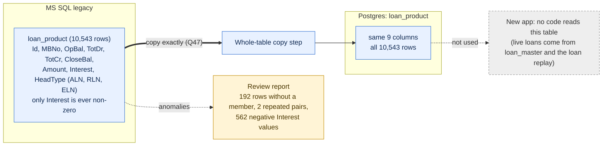

**Decision log for this diagram:** pure copy, archive, whole-table step (P1, Q47 decided) · not a product catalogue despite the name · app does not read it · Table 11 FINAL.


---

## 27. TABLE 12: `loan_master` (one row per loan; the table the new app keeps live)

### 27.1 Side by side
| | MS SQL (Nov dump) | Postgres today |
|---|---|---|
| Rows / members | 20,207 / 6,701 | 20,122 (test data, already rebuilt by Phase 2) |
| Columns | **13**: `MBNO`, `LOANTYPE`, `LOANCASENO`, `LOAN_AMT`, `PAYMENT_DATE`, `RATE`, `NO_OF_INSTAL`, `INSTAL_AMT`, `BALANCE`, `OPENBALANCE`, `PURPOSE`, `Intt_Amount`, `PenalRate` | **23**: the same 13 plus 10 new columns |
| Keys / triggers | none | none |
| Loan types | `ALN` 14,371 rows, `RLN` 5,826, `ELN` 10 | |

**Type A (13 columns):** identical names and meaning, copied as they are.

**The 10 extra Postgres columns** (nothing for them exists in the legacy table or any other legacy table I know):
| Column | Default | Kind | What fills it |
|---|---|---|---|
| `gracedays` | 0 | C new feature | default |
| `smpenalpct`, `smpenaldiv` | 1 and 4 | C new feature | default (short-payment penalty parameters of the new app) |
| `loan_payment_model` | `SEPARATE_INTEREST` | C new feature | default |
| `loan_interest_method` | `REDUCING_BALANCE` | C new feature | default |
| `consolidated_into_loancaseno` | null | B derived | set by Phase 2 when a loan is folded into a later one (4,549 rows in the test DB) |
| `delay_months` | null | B derived | set by Phase 2 (11,692 test rows have a value) |
| `payroll_lag_watch_until`, `payroll_lag_old_principal`, `payroll_lag_old_interest` | null | B derived | set by Phase 2 for loans on a payroll-lag watch (4,511 test rows) |

### 27.2 What the legacy table really holds
- **`BALANCE` was never kept up to date in the old data.** It equals `LOAN_AMT` in **20,193 of 20,207 rows**; the 14 others are loans with a negative opening balance (for example `-5,375`; 136 rows in all have a negative `LOAN_AMT` and `BALANCE`). Total `LOAN_AMT` ₹159,83,56,103 against total `BALANCE` ₹159,82,80,758. So repayments did not reduce it; the old program took the true balance from the ledger.
- 11,579 rows are loans from before the ledger starts (`PAYMENT_DATE` before 01-Nov-2019); 11,581 carry the purpose "Opening Balance" (the loan opening figure of 31-Oct-2019, in `OPENBALANCE`). 8,628 rows are loans paid out from November 2019 on.
- 7,341 rows have `LOAN_AMT` = 0. 12,729 rows (4,414 members) have a positive `BALANCE`, which is **not** the number of live loans: the test database after the Phase 2 rebuild shows 4,550 loans with a balance.
- `LOANCASENO` is not unique: 4,508 case numbers are used by more than one row, so a loan is only identified by the triple (`MBNO`, `LOANTYPE`, `LOANCASENO`), which has **no duplicates** in the dump (0 repeats). The Phase 2 script already uses the triple.
- 11,189 loans have no row in `loan_pending` (the application record), mostly opening loans.
- 188 rows belong to members not in `member_master`.

### 27.3 How the new app uses it
Live: repayment, disbursement, early closure, consolidation, re-agreement and the position panel read and update `loan_master.balance` directly on every posting (`UPDATE loan_master SET balance = ... `). So after the load the stored balance must be **correct**, because the app adds to it from then on. A copy of the legacy `BALANCE` would show every loan at its sanctioned amount.

### 27.4 Proposed method
1. **Step 1 (copy):** the 13 legacy columns, all 20,207 rows, exactly as they are. The 5 defaulted columns get their defaults. Nothing else touched. Whole-table copy (188 rows have no member, so the member loop would drop them).
2. **Step 2 (rebuild):** the Phase 2 loan replay rewrites `balance`, `loan_amt` top-ups, `no_of_instal`, `instal_amt`, `delay_months`, the consolidation link and the payroll-lag columns **from the ledger**, member by member, as it does today. Its design (non-atomic per member, about 1,300 members "to confirm" or "manual", 30 to 31 failed members) is discussed after the four loan tables, because it also depends on `loan_masterhistory`, `loan_pending` and `loan_balance_history`.
3. Verification after step 1: row count, sum of `LOAN_AMT` (₹159,83,56,103), SHA-256 over the 13 legacy columns. After step 2: per member, the sum of `loan_master.balance` equals the ledger balance of the loan heads (the replay already reports `MEMBER_LOAN_BALANCES_RECONCILED`).
4. Report for the client (no block): the 188 rows without a member, the 136 negative balances, the 7,341 rows with `LOAN_AMT` 0, the 1,142 loans with a balance and no instalment amount, the 1 loan whose balance exceeds its amount, the 361 rows with a penal rate.

### 27.5 Questions
| # | Question | My recommendation | Status |
|---|---|---|---|
| Q48 | Load `loan_master` in two steps: copy the 13 legacy columns exactly, then let the Phase 2 replay rebuild the balances from the ledger? | Yes. The legacy `BALANCE` is not usable | DECIDED 2026-11-11: yes |
| Q49 | The 5 new-feature columns (`gracedays` 0, `smpenalpct` 1, `smpenaldiv` 4, `loan_payment_model` SEPARATE_INTEREST, `loan_interest_method` REDUCING_BALANCE): load every old loan with these defaults? | Yes, but please confirm that these defaults are the rules the society wants on old loans (they come from the app, not from the old data) | DECIDED 2026-11-11: yes |

### Diagram: loan_master (decisions up to 2026-11-11)
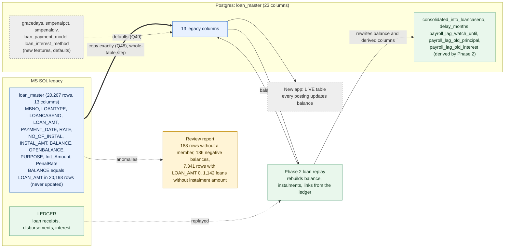

**Decision log for this diagram:** 13 legacy columns copied exactly, whole-table step (Q48 decided) · legacy BALANCE is not maintained, so Phase 2 rebuilds the balance from the ledger · 5 new-feature columns take app defaults (Q49 decided) · 5 derived columns filled by Phase 2 · Table 12 FINAL.


---

## 28. TABLE 13: `loan_masterhistory` (earlier versions of loan rows)

### 28.1 Side by side
| | MS SQL (Nov dump) | Postgres today |
|---|---|---|
| Rows / members | 13,867 / 3,227 | 13,623 / 3,128 (test data) |
| Columns | 14: the 13 columns of `loan_master` plus `RowId` | the same 14 |
| Keys / triggers | none (`RowId` is unique: 13,867 distinct values, 1 to 13,873) | none |
| Loan types | `ALN` 11,923, `RLN` 1,944 | |

No column differs: **pure Type A copy.** None of the 10 extra columns of the live `loan_master` (Table 12) exist here.

### 28.2 What it is
- A history of loan rows: when a loan changed in the old program (for example a top-up or a re-agreement), a copy of the row was kept here. 1,317 loans (member + type + case number) appear more than once, i.e. have several saved versions. The newest rows are from 03-Nov-2026 (loans sanctioned that day).
- 13,268 of the rows belong to a loan that still exists in `loan_master`; **599 rows belong to loans no longer in `loan_master`** (closed or removed loans: the only record of them).
- As in `loan_master`, `BALANCE` equals `LOAN_AMT` in nearly all rows (13,845 of 13,867): the saved figure is the sanctioned amount, not a running balance. 1,004 rows have `LOAN_AMT` 0; 3,491 are "Opening Balance" rows.
- 113 rows belong to members not in `member_master`.
- **The new application never reads it.** No backend file (including the Phase 2 script) references `loan_masterhistory`. It is an archive.

### 28.3 Proposed method (P1)
Copy all 13,867 rows exactly, as an archive, through a whole-table step (the 113 rows without a member would be dropped by the member loop). Verification: row count, sum of `LOAN_AMT` (₹179,52,01,014.47), SHA-256 over all columns, highest `RowId` 13,873. Report only: the 113 rows without a member, the 599 loans that are only in the history.

### 28.4 Question
| # | Question | My recommendation | Status |
|---|---|---|---|
| Q50 | Copy `loan_masterhistory` exactly (13,867 rows, whole-table step) as an archive? | Yes | DECIDED 2026-11-11: copy exactly |

### Diagram: loan_masterhistory (decisions up to 2026-11-11)
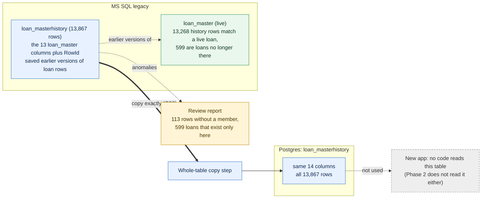

**Decision log for this diagram:** pure copy, archive, whole-table step (P1, Q50 decided) · app and Phase 2 do not read it · Table 13 FINAL.


---

## 29. TABLE 14: `loan_pending` (loan applications: applied, sanctioned, paid)

### 29.1 Side by side
| | MS SQL (Nov dump) | Postgres today |
|---|---|---|
| Rows / members | 19,217 / 5,960 | 19,187 (test data, newest case 889288) |
| Columns | **15**: `LOANCASENO`, `MBNO`, `LOANTYPE`, `APPLIED_AMT`, `SANCTIONED_AMT`, `APP_DATE`, `SANCTIONED_DATE`, `NO_OF_INSTAL`, `G1MBNO`, `G2MBNO`, `G3MBNO` (three guarantors), `PURPOSE`, `FLG_SANCTIONED`, `FLG_PAID`, `FORM_NUMBER` | **22**: the same 15 plus 7 new columns |
| Keys / triggers | none; (`MBNO`, `LOANTYPE`, `LOANCASENO`) has no repeats | none |

**Type A (15 columns):** same names and meaning.

**The 7 extra Postgres columns** (none exists in any legacy table):
| Column | Default | Kind | Meaning in the new app |
|---|---|---|---|
| `application_kind` | `NEW` | C new feature | `NEW` or `REAGREEMENT` (loan restructure feature) |
| `reagreement_id` | null | C new feature | link to a re-agreement record |
| `rate`, `penalrate` | null | C new feature | interest and penal rate chosen on this application |
| `rate_override_reason`, `rate_override_by` | null | C new feature | who changed the rate and why |
| `pass_flag` | `N` | C new feature | approval flag of the new Pass flow; the loan module code I searched does not read it for this table (**to verify**) |

### 29.2 What the legacy table holds
- Almost every row is a finished loan: **19,211 rows are sanctioned and paid**, **1 is sanctioned but not paid** (`ELN`, case 21055, member 610033240, ₹10,000, 23-Sep-2026; it already has a `loan_master` row, so the "not paid" flag looks like a missed update). The new app shows the status from these two flags (`DISBURSED` when paid, `SANCTIONED` when only sanctioned, otherwise `PENDING`).
- 10,601 rows are dated before the ledger starts (opening loans). 6,716 rows have `APPLIED_AMT` 0 and `SANCTIONED_AMT` 0 (the opening-balance loans, entered without an application). 352 rows name at least one guarantor. `FORM_NUMBER` is filled in only 1 row.
- Highest case number: **21,233** (the new app's counter table `sequence_master` currently says 889,288 in the test database, see B20).
- 10,199 sanctioned-and-paid applications have **no matching row in `loan_master`** (closed or removed loans; their trace is in `loan_masterhistory`, Table 13). The other way round, 11,189 loans in `loan_master` have no application row.
- 191 rows belong to members not in `member_master`.
- **One clearly wrong figure:** case 11379, member 940030896, `APPLIED_AMT` ₹37,944 but `SANCTIONED_AMT` ₹79,16,37,94,475 (about ₹7,916 crore). It makes the total sanctioned amount (₹8,073 crore) meaningless; without it the total is about ₹157 crore, close to the applied total of ₹157.4 crore.

### 29.3 How the new app uses it
Live: loan application, sanction, surety, re-agreement, loan list and status, the dashboard and the loan reports all read and write it, and the case number generator checks both `loan_master` and `loan_pending` before handing out a new number.

### 29.4 Proposed method (P1)
1. Copy the 15 legacy columns of all 19,217 rows exactly (whole-table step: 191 rows have no member). The 7 new columns take their defaults, so every old row becomes `application_kind` = `NEW`, `pass_flag` = `N`, no rate, no override.
2. Do **not** correct the ₹79,16,37,94,475 or the unpaid flag of case 21055 (P1): report them for the society.
3. Verification: row count, SHA-256 over the 15 legacy columns, highest `LOANCASENO` 21,233.
4. Report: the 191 rows without a member, the junk sanctioned amount, the one sanctioned-but-unpaid loan.
5. The case-number counter must start above the legacy maximum: handled with the other counters (B20).

### 29.5 Questions
| # | Question | My recommendation | Status |
|---|---|---|---|
| Q51 | Copy `loan_pending` as above (15 columns exactly, whole-table step, new columns at their defaults)? | Yes | DECIDED 2026-11-11: yes |
| Q52 | Case 11379 (sanctioned ₹79,16,37,94,475 against ₹37,944 applied) and case 21055 (sanctioned, flagged not paid): copy as they are and report them? | Yes (P1); the society corrects them, or you fix them by a database update later | DECIDED 2026-11-11: yes |

### Diagram: loan_pending (decisions up to 2026-11-11)
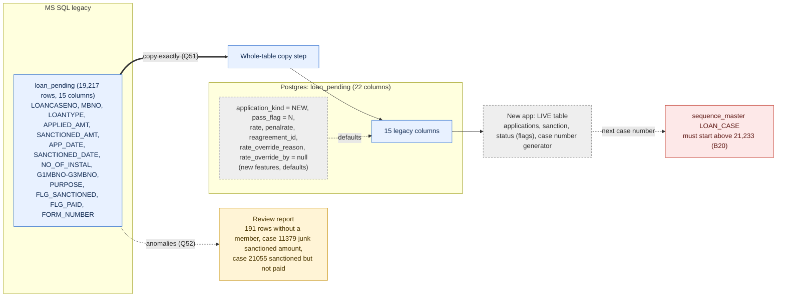

**Decision log for this diagram:** 15 legacy columns copied exactly, whole-table step (Q51 decided) · 7 new-feature columns at defaults (Q51 decided) · junk sanctioned amount and unpaid flag kept and reported (Q52 decided) · case-number counter to start above 21,233 (B20) · Table 14 FINAL.


---

## 30. TABLE 15: `loan_balance_history` (daily loan balance snapshots, mostly January 2020)

### 30.1 Side by side
| | MS SQL (Nov dump) | Postgres today |
|---|---|---|
| Rows / members | 189,011 / 6,096 | 189,010 / 6,097 (test data) |
| Columns | 8: `mbno` (int), `headtype`, `opbal`, `debit`, `credit`, `balance`, `bal_date`, `intrate` | the same 8 |
| Keys / triggers | none; (`mbno`, `headtype`, `bal_date`) has no repeats | none |

No column differs: **pure Type A copy.**

### 30.2 What it holds
- **Daily snapshots of each member's loan balance per head** (`ALN` 188,976 rows, `ELN` 31, `RLN` 4). 189,007 rows are from **January 2020** (a run of 34 daily dates, about 6,000 members each) and **4 rows from 1 and 2 November 2026** (for example member 610032549, RLN, balance 134,573: probably a test or a restarted job). Nothing in between: the snapshot job ran for a few weeks and stopped.
- The figures are not consistent: 52,133 rows (28%) have `opbal + debit - credit` different from `balance`; 13,390 rows have a negative balance; only 319 rows show any debit or credit at all.
- 3,100 rows belong to members not in `member_master`.
- **The new application never reads it.** No backend file references `loan_balance_history`.

### 30.3 Proposed method (P1)
Copy all 189,011 rows exactly, as an archive, through a whole-table step (the member loop would drop the 3,100 orphan rows). Verification: row count, sum of `balance` (₹327,52,93,858), SHA-256. Report only: the 3,100 rows without a member, the 52,133 rows that do not add up, the 4 rows of November 2026. Because the snapshots are not consistent they are **not used as a source of truth** for any loan balance (the Phase 2 replay rebuilds balances from the ledger).

### 30.4 Question
| # | Question | My recommendation | Status |
|---|---|---|---|
| Q53 | Copy `loan_balance_history` exactly (189,011 rows, whole-table step) as an archive, never used as a source for balances? | Yes | DECIDED 2026-11-11: copy exactly |

### Diagram: loan_balance_history (decisions up to 2026-11-11)
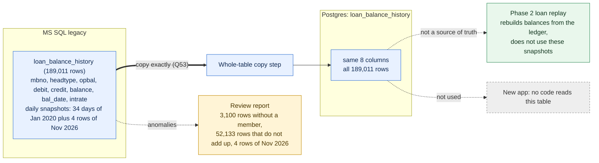

**Decision log for this diagram:** pure copy, archive, whole-table step (P1, Q53 decided) · inconsistent snapshots, never a source for balances · app does not read it · Table 15 FINAL.


---

## 31. PHASE 2: the loan replay (what it does, what the last run left, what to decide)

All 15 Phase 1 tables are now decided (Tables 1 to 15). The copied tables give the new database the legacy ledger and loan rows. **Phase 2 turns them into live balances.** This section records what the script does today, measured in the test database, and what has to be decided before it is part of the final run. Nothing was run or changed for this section.

### 31.1 What the script does (read from `src/scripts/phase2/bulk_ledger_replay.ts`)
- For each member who has loans, it reads that member's legacy `LOAN_MASTER` rows and legacy `LEDGER` entries (through `sqlcmd` against the legacy database, so **the legacy database must be reachable during the run**) and replays every repayment through the app's own `LoanRepaymentService.recordLoanRepayment`, so a migrated loan behaves exactly like one entered live.
- It **writes**: `loan_master` (balance, loan amount top-ups, instalments, `delay_months`, the consolidation link, the payroll-lag fields), a **new table `loan_repayment_ledger`** (one row per replayed repayment: the app's own detailed loan record, no legacy source), the loan columns of `member_balances`, and its own progress table `legacy_replay_batch_log`. It does **not** write `ledger`, `demand_master`, `loan_pending` or `loan_masterhistory` (this also answers the open question in Table 7: Phase 2 leaves `demand_master` alone).
- **Safety model:** dry run by default; a real run needs `DRY_RUN=false` and `CONFIRM_LIVE_RUN=yes-i-mean-it`; **each member runs in its own database transaction** (a member fully migrates or fully rolls back, never half); a finished member is skipped on re-run (`legacy_replay_batch_log`); a run can be limited to a member list file. It is atomic per member, not across the whole run.
- It identifies a loan by (member, case number) always together, never by case number alone.

### 31.2 What the last run in the test database left (`legacy_replay_batch_log`)
| Measure | Result |
|---|---|
| Members finished (`done`) | 3,619 (14,584 loan cases, 134,746 repayments replayed, 4,558 consolidation steps) |
| Members failed | 26 (the errors I looked at say "Loan NNNN is already fully repaid": the app refuses a payment on a loan it already counts as fully repaid) |
| Rows written to `loan_repayment_ledger` | 144,883 for 3,668 members |
| Finished members with no flag at all | 224 |
| Finished members with at least one flag | 3,395 (3,305 with a flag other than "INFO") |
| Flags by kind (members affected) | unattributed credits 1,153 · case-level notes 2,360 · schedule version not built 1,540 · overpayment 466 · mixed 184 · consolidation 79 + 49 + 24 · manual correction applied 2 · ledger does not match after replay 1 · ledger owes a balance with no open case 1 |
The meaning of each flag kind has to be reviewed per kind (a work item, not done here). The numbers show the main point: **the replay is complete for most members but a large group ends with a flag that a person has to look at.**

### 31.3 Why it matters for the plan
- `loan_master.balance` and `member_balances` loan columns are what the new app shows and adds to. They are only correct after Phase 2 (Table 12, Q48).
- A member who failed or is flagged keeps a balance that may differ from what the ledger says. Under P1 only things that **corrupt transactions** block the run; everything else goes to the review report.

### 31.4 Proposed run order for the final load
1. Load the copied tables (Tables 1 to 15) in the order already agreed: member tables, `ledger` and `fundsmaster`, then `member_balances` (computed from them), loans, the whole-table archive tables.
2. Set the number counters above the legacy maxima (B20: loan case 21,233, member numbers, vouchers).
3. Check that the loaded `ledger` and `loan_master` equal the legacy source (row counts and hashes, from the table sections) **before** Phase 2, because the script reads the legacy database directly and writes into the loaded copy.
4. Phase 2 dry run on all members; review the plan; then the real run in batches from a pinned member list; repeat for failed members only.
5. After Phase 2: per member, the sum of `loan_master.balance` per head equals the ledger balance of the loan heads (the script's own `MEMBER_LOAN_BALANCES_RECONCILED` check), and the sum over all members is recomputed independently.
6. Review report to the client: flagged members by kind, failed members, plus every report line from Tables 1 to 15.

### 31.5 Questions
| # | Question | My recommendation | Status |
|---|---|---|---|
| Q54 | Keep Phase 2 reading the legacy database directly (already tested over the whole test run), with a before-run check that the loaded `ledger` and `loan_master` equal the legacy ones? Or change it to read the Postgres copies so the load no longer needs the legacy database? | Keep it as it is and add the check. A code change to a tested script is more risk than the check | DECIDED 2026-11-11: yes |
| Q55 | Which Phase 2 outcomes **block** the run and which only go to the review report? | Block only: a member whose rollback or error leaves loan balances unreconciled (`failed`), `LEDGER_MISMATCH_AFTER_REPLAY`, `LEDGER_OWES_NO_OPEN_CASE`. Everything else (unattributed credits, overpayments, schedule not built, mixed, consolidation notes) is reported (P1) | DECIDED 2026-11-11: yes |
| Q56 | The 26 failed members ("already fully repaid"): handle one by one after a dry run, using the existing manual-correction file, and leave them in the report if a correction is not clear? | Yes, one by one; no automatic override of the app's guard | DECIDED 2026-11-11: yes |

### Diagram: Phase 2 loan replay and the final load order (decisions up to 2026-11-11)
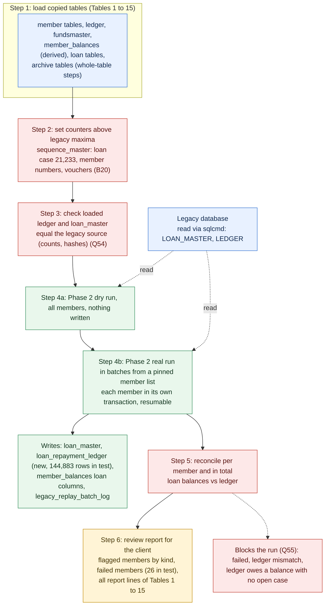

**Decision log for this diagram:** all 15 Phase 1 tables decided · Phase 2 writes loan_master, loan_repayment_ledger, member_balances loan columns and the batch log, never ledger, demand_master, loan_pending or loan_masterhistory · run order proposed (Q54 to Q56 decided) · counters set before Phase 2 (B20).


---

## 32. TABLE 16: `headmaster` (chart of accounts) — first of the tables that need care

Re-measured on the November dump (the section 4.1 figures were from the September dump). Tables 1 to 15 are the tables the loop copies; from here on the tables are not plain copies, or are not copies at all.

### 32.1 Side by side
| | MS SQL (Nov dump) | Postgres today |
|---|---|---|
| Rows | 151 | 154 (test data) |
| Columns | 8: `CODE`, `PARENT_CODE`, `HPOSITION`, `HEAD_NAME`, `INTEREST`, `HeadType`, `OP_BAL` (money), `PFLAG` | the same 8 (`op_bal` numeric) |
| Keys | none; 0 repeated codes | none |
| Comparison head by head | | **145 identical; 6 differ in `PFLAG` only; 0 legacy heads missing; 3 Postgres-only** |

No column differs: by structure a Type A copy. The three differences are data:

| Head(s) | Legacy | Postgres | Kind |
|---|---|---|---|
| `A1048` ELECTION ADVANCE, `A1050` FFD UNION BANK, `A1051` CURRENT ACCOUNT CENTRAL BANK, `A1052` CENTRAL BANK FFD, `A1053` CURRENT ACCOUNT PUNJAB & SINDH BANK, `A1054` FFD PUNJAB & SINDH BANK | `PFLAG` blank | `PFLAG` = `A` | the app fixed a missing classification |
| `I1013` INTT FROM MEMBER - REGULAR LOAN, `I1014` INTT FROM MEMBER - EMERGENCY LOAN | not present | present (parent `I1002`, interest marker `RLN` / `ALN`) | C new feature, **created by an app migration** (`AddLoanInterestChildHeads`, ES-46) |
| a row with an empty code and name `x` | not present | present | junk left by a test, not to be carried |

### 32.2 Why the blank `PFLAG` matters (not only cosmetic)
- The app decides whether a head is debit-normal or credit-normal from `PFLAG` (`balance-direction.ts`: only `A` and `E` are debit-normal; **anything else, including blank, is treated as credit-normal**). Year-end closing and head balances use it.
- Four of the six heads carry ledger entries (`A1050` 2 entries, `A1051` 9, `A1052` 2, `A1054` 3; entries totalling ₹17,23,07,452). With a blank flag their closing balance would be computed with the **wrong sign**. `A1048` and `A1053` have no entries.
- So loading the legacy blank flags as they are would corrupt balances; this is the one kind of problem P1 does block.

### 32.3 Other facts
- Opening balances `OP_BAL` are what the new app uses as the opening (reports take `headmaster.op_bal` plus the ledger). They balance: assets ₹82,48,15,219 against liabilities ₹82,48,15,218 (₹1 apart, inherited rounding), expenses ₹2,98,64,080 = income ₹2,98,64,080 (₹2.99 crore). This is the 31-Oct-2019 position.
- Every `CODE` used in the legacy ledger exists in `headmaster` (121 heads used, 0 missing; 30 heads never used).
- One head (`M1000`, the society name) has the parent `ROOT`, which is not in the table: it is the top of the tree. One head has no `HeadType` (`M1000`). 21 heads carry a `HPOSITION`.
- `headmaster` is read by 24 backend files; it is core to every report.

### 32.4 Proposed method
1. **Load the 151 legacy heads** with every column as in legacy, **except** `PFLAG` of the 6 heads above, which is set to `A` (their codes start with `A`, they are assets by name and by the app's own data). This is the only change, logged in the review report.
2. **Insert only missing codes** (`ON CONFLICT (code) DO NOTHING`): the app's migration creates `I1013` and `I1014` on any new database, so they must be kept as they are and not duplicated or overwritten.
3. **Do not carry the junk row** with the empty code (it is a test artefact of the current database, it will not exist in the production database).
4. Pre-flight check on the dump (before the run): every ledger `CODE` exists in `headmaster`; per-type `OP_BAL` sums as above; no blank `PFLAG` remains after the load.
5. Verification after loading: 153 rows (151 + `I1013` + `I1014`), `OP_BAL` of every legacy head equals the dump, and A = L (within ₹1), E = I.

### 32.5 Questions
| # | Question | My recommendation | Status |
|---|---|---|---|
| Q57 | Load the 151 legacy heads as they are, with the 6 blank `PFLAG` set to `A`, insert only missing codes (keeping the app's `I1013` / `I1014`), and leave out the junk `x` row? | Yes | DECIDED 2026-11-11: yes |
| Q58 | The ₹1 difference between opening assets and liabilities (inherited legacy rounding): keep it as it is (P1) and report it? | Yes | DECIDED 2026-11-11: yes |

### Diagram: headmaster (decisions up to 2026-11-11)
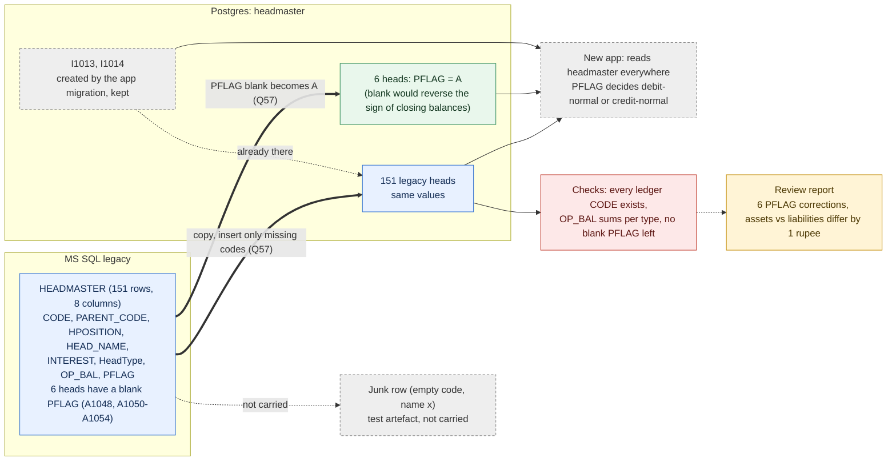

**Decision log for this diagram:** 151 legacy heads loaded as they are, insert only missing codes (Q57 decided) · the 6 blank PFLAG become A because the app treats blank as credit-normal (Q57 decided) · I1013 and I1014 come from the app migration and are kept · junk row not carried · opening-balance rounding of 1 rupee kept and reported (Q58 decided) · Table 16 FINAL.


---

## 33. TABLE 17: `yearend` (financial years) and `yearend_head` (closing balances archive)

Re-measured on the November dump (section 4.4 was written on the September dump). **This table exposes a design conflict between how reports compute balances and how the app's year-end carry-forward works (33.3). It is not a migration bug, but the migration must not make it worse.**

### 33.1 Side by side
| | MS SQL (Nov dump) | Postgres today |
|---|---|---|
| `yearend` rows | 8: year codes **1, 3, 4, 5, 6, 7, 8, 9** (there is no year 2) | 2 test rows (year 1 = 2026-04-01 to 2027-03-31, year 2 = 2027-03-31 to 2028-03-30 by user `demo-setup`) |
| `yearend` columns | 4: `YEARCODE`, `START_DATE`, `END_DATE`, `USERNAME` | 5: the same 4 plus **`closed_at`** (C new feature) |
| `yearend_head` | exists, **0 rows** | 906 test rows (151 for year 1, 755 with no year code) |
| Keys | none | none |

The legacy years: year 1 = 01-Nov-2019 to 31-Mar-2020 (five months, the start of the data), year 3 = Apr 2020 to Mar 2021, then one year each up to **year 9 = 01-Apr-2026 to 31-Mar-2027, the current year** (user `ADMIN` on all). Dates are plain midnight dates. The Postgres test rows store some dates with a 18:30 time (a time-zone shift) and use the same codes for different periods (year 1 in the test database is 2026, in legacy it is 2019), so the test rows cannot be mixed with the legacy ones.

**Type A:** the 4 legacy columns. **Type C:** `closed_at`. `yearend_head`: legacy has no data, so there is nothing to carry; the 906 test rows are not legacy data.

### 33.2 How the app uses it
- The current year, the dividend and share calculations, group insurance and loan eligibility read `yearend` for the year dates.
- A year with `closed_at` set **blocks posting into that period** (`posting-date.ts`: a date inside a closed year is refused) and cannot be transferred or closed again.
- The year-end screens write `yearend_head` / `yearend_member` / `bankopbal` (archive) and then carry balances forward (33.3).

### 33.3 The design conflict (found while reading `financial-year.service.ts` and `head-balances.sql.ts`)
| | How it works today | Evidence |
|---|---|---|
| Reports and balances (Head screen, Balance Sheet, ...) | closing balance = `headmaster.op_bal` + **the whole ledger** up to the date, no financial-year filter | `head-balances.sql.ts` (ES-48): "lifetime ledger movement" |
| Year-end transfer for a year | closing balance = `headmaster.op_bal` + **only the ledger of that year** | `initiateTransfer`: ledger filtered by the year's start and end |
| P&L year-end | sets `headmaster.op_bal` of every asset / liability / reserve head to that closing balance, adds the profit to `L1006`, zeroes income and expense heads, creates the next year, closes this one | `performPLYearEndProcess`, steps 3 to 7 |
After migration `headmaster.op_bal` holds the **31-Oct-2019** opening balance (Table 16) and the ledger holds seven years. Consequences if the app's year-end were run for year 9 as it is today:
1. The transfer computes closing = 2019 opening + year-9 ledger only, so it **misses six years of movement**: the archived closing balances would be wrong.
2. The carry-forward would write that wrong figure into `op_bal`; and because reports then add the **whole** ledger again on top of the new `op_bal`, balances would be **double counted** after a real year-end.
This is the model of the app, not something the data causes: it only shows once a year-end is run on a database whose ledger spans several years. **Not tested** (no year-end was run); read from the code. It does not affect any report before the first year-end, which is due 31-Mar-2027.

### 33.4 Proposed method
1. **Load the 8 legacy years** as they are: year codes 1, 3 to 9 (the gap at 2 stays), dates and user as in legacy.
2. **`closed_at` stays empty for all 8** (legacy has no closed state). Marking years closed would block back-dated postings into them; that is a decision for the society after audit.
3. **Do not carry** the 2 test year rows or the 906 `yearend_head` test rows (they belong to test runs).
4. **Keep `headmaster.op_bal` at the 31-Oct-2019 values** (Table 16, decided) so all reports, which use the whole ledger, stay correct on day one.
5. **Hand the 33.3 conflict to the owner** as an app item to be settled **before the first real year-end (31-Mar-2027)**; until then the Year-End screens must not be run on the migrated database. (Not changed here.)
6. Verification: 8 rows, dates equal the dump, no row with `closed_at`, the year containing today's date is year 9.

### 33.5 Questions
| # | Question | My recommendation | Status |
|---|---|---|---|
| Q59 | Load the 8 legacy years as they are (codes 1, 3 to 9, `closed_at` empty), leaving out the test years and the 906 test `yearend_head` rows? | Yes | DECIDED 2026-11-11: yes |
| Q60 | Keep `headmaster.op_bal` at 31-Oct-2019 and report the year-end conflict (33.3) to the owner as an app item for before 31-Mar-2027? (The alternative, rolling `op_bal` to 31-Mar-2026 at load, would double count in today's reports.) | Yes | DECIDED 2026-11-11: yes |

### Diagram: yearend (decisions up to 2026-11-11)
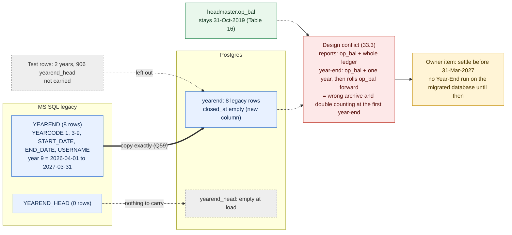

**Decision log for this diagram:** 8 legacy years loaded as they are, closed_at empty, test rows not carried (Q59 decided) · op_bal stays at 31-Oct-2019 and the year-end design conflict goes to the owner before 31-Mar-2027 (Q60 decided) · Table 17 FINAL.


---

## 34. TABLE 18: `getworkingdate` (the day-end log: which days are closed, which day is open)

Re-measured on the November dump (section 4.5 used the September dump).

### 34.1 Side by side
| | MS SQL (Nov dump) | Postgres today |
|---|---|---|
| Rows | 2,358 (2,357 distinct dates) | 12 (test days, 13 to 24 Aug 2026) |
| Columns | 6: `WORKING_DATE`, `PAYMENT_VOUCHER`, `RECEIPT_VOUCHER`, `JOURNAL_VOUCHER` (small ints: the day's voucher counts), `DAYEND_FLAG`, `UPDATEGL_FLAG` | the same 6 |
| Keys / triggers | none | none |
| Period | 01-Nov-2019 to 04-Nov-2026 | |

No column differs: **Type A copy.** Postgres has no extra column.

### 34.2 What the legacy rows say
- **2,357 days are closed** (`DAYEND_FLAG` and `UPDATEGL_FLAG` both `Y`) and **one day is open: 04-Nov-2026** (`N` / `N`, no vouchers yet). That open day is the "current working date" at the moment of the dump. The last closed day, 03-Nov-2026, had 27 payment, 15 receipt and 0 journal vouchers.
- 220 of the days have no ledger entry (holidays).
- One date appears twice: **24-Sep-2021** (2 rows).
- One ledger date has no row: **31-Mar-2019** (the 8 year-start journal rows of voucher `J06039`).

### 34.3 How the new app uses it (`posting-date.ts`, `day-end.service.ts`)
- **A day with `DAYEND_FLAG` = `Y` is closed: nothing can be posted on that date** (rule ES-458; before it every posting screen accepted any date).
- A date with **no row stays open**: the code says migrated history before Day-End was used, and days not reached yet, are not blocked.
- Postings are dated with **the current pending working date** (the row with flag `N`); the frontend date is ignored. Day-End closes that day (`Y`) and inserts the next day's row.
- The genesis row can be created only when the table is empty.

### 34.4 Proposed method
1. **Load all 2,358 rows as they are**, including the open day 04-Nov-2026 and the repeated 24-Sep-2021 row (P1; report both). Dates are plain midnight dates. Nothing is invented for days without a row.
2. **Do not carry the 12 test days.**
3. The result: all history stays closed as in legacy; the new app continues from the open working date of the dump.
4. **Cut-over rule (Q62):** because postings take the pending working date, the dump must be as close to go-live as possible. If the dump is days or weeks old when users start, every post carries the old working date until Day-End is run for each missing day. Use a final dump taken at the moment legacy is frozen, load it, and open for users the same day.
5. Verification: 2,358 rows, 2,357 with `Y`, one open day equal to the dump's last date, no test day.

### 34.5 Questions
| # | Question | My recommendation | Status |
|---|---|---|---|
| Q61 | Load the 2,358 legacy rows as they are (open day 04-Nov-2026 and the repeated 24-Sep-2021 row included), leaving out the 12 test days? | Yes | DECIDED 2026-11-11: yes |
| Q62 | Cut-over rule: freeze legacy, take the final dump, load it and go live the same day, so the open working date equals the go-live date? | Yes | DECIDED 2026-11-11: yes |

### Diagram: getworkingdate (decisions up to 2026-11-11)
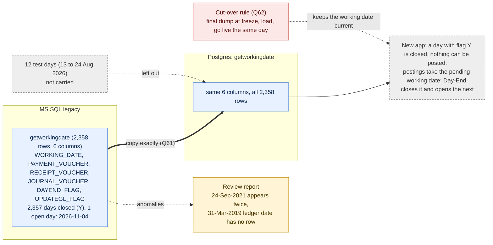

**Decision log for this diagram:** all 2,358 legacy rows loaded as they are, test days left out (Q61 decided) · cut-over rule: freeze, final dump, load and go live the same day (Q62 decided) · Table 18 FINAL.


---

## 35. TABLE 19: `voucher_master` (the running voucher counters)

Re-measured on the November dump (section 4.6 used the September dump). This table also **corrects register row B20**: voucher numbers in the new app do not come from one counter (35.3).

### 35.1 Side by side
| | MS SQL (Nov dump) | Postgres today |
|---|---|---|
| Rows | 1 | 1 (test values) |
| Columns | 4: `P_VCHR_NO`, `R_VCHR_NO`, `J_VCHR_NO`, `D_VCHR_NO` (text, letter + 5 digits) | the same 4 |
| Values | **P27334, R58815, J34395, D00801** | P26212, R58421, J34247, D01204 |

No column differs: **Type A copy** of one row.

### 35.2 What the numbers are
Highest voucher number actually present in the legacy ledger, per letter, against the counter:
| Letter | Highest in ledger | Counter (legacy) | Counter minus ledger |
|---|---|---|---|
| P payment | P27332 | P27334 | 2 |
| R receipt | R58811 | R58815 | 4 |
| J journal | J34394 | J34395 | 1 |
| D demand | D00800 | D00801 | 1 |
The legacy counters are **at or above** every ledger number, so the first new voucher is a free number (the app adds 1 to the counter, and skips numbers already used). The gap of 1 to 4 is numbers issued but not in the ledger (the cause was not checked).

### 35.3 How the new app numbers vouchers (correction of B20)
Two counters are in use, and a third scheme appears in the ledger:
- **`voucher_master`** (this table): the helper `generateVoucherNo` reads the highest value, adds 1 and writes it back with a row lock. Used by savings opening, group insurance, interest, journal transfer, member balance transfer and the receipt number of the pass step. Numbers look like `R58816`.
- **`sequence_master` key `VOUCHER_NO`** with prefix `VCH`, restarting every year: used by the voucher, compulsory deposit, dividend, member and re-agreement screens. Numbers look like `VCH101`.
- The test ledger already shows all three families side by side: 100 rows `VCH…`, 61 `R58…`, 27 `P26…`, 4 `J34…`, 4 `G08…` and 40 rows with no voucher number in recent days.
Both generators skip numbers that already exist. **If `voucher_master` were empty, the first new voucher would be `P00001`** (a duplicate of a legacy number), because the sync migration (`SyncVoucherCounters`, ES-56) only *raises* an existing row. So the table must exist with exactly one row.

### 35.4 Proposed method
1. **Load the single legacy row as it is** (P27334, R58815, J34395, D00801). It must be the only row.
2. Pre-flight and post-load check: each counter is **at or above** the highest number of its letter in the loaded `ledger`; if not, raise the counter to that number (the same rule as the ES-56 migration; never lower a counter).
3. Do not carry the test row. The `sequence_master` counters are handled with the other new tables (B20).
4. Whether new vouchers should keep the legacy letters and numbering is an **owner decision** (the app mixes two schemes today); nothing is changed here.

### 35.5 Question
| # | Question | My recommendation | Status |
|---|---|---|---|
| Q63 | Load `voucher_master` as one row with the legacy counters, never lower than the highest ledger number of each letter? | Yes | DECIDED 2026-11-11: yes |

### Diagram: voucher_master (decisions up to 2026-11-11)
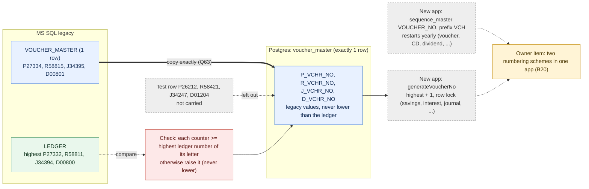

**Decision log for this diagram:** one legacy row loaded as it is, counters never lower than the ledger (Q63 decided) · test row not carried · two numbering schemes in the app recorded as an owner item (B20 corrected) · Table 19 FINAL.


---

## 36. TABLE 20: `bankopbal` (the 31-Oct-2019 opening balances per head, kept as an archive)

The full investigation is in section 4.7 (done on the November dump, with its corrections). This section turns it into a decision.

### 36.1 Side by side
| | MS SQL (Nov dump) | Postgres today |
|---|---|---|
| Rows | 130 (`TrfId` 1 to 130, all `FyCode` 1) | 151 (test data: a copy of the test year-end archive `yearend_head`) |
| Columns | 5: `TrfId` (int), `FyCode` (int), `HeadCode`, `ParentCode`, `ClosingBalance` (money) | the same 5 (`closingbalance` numeric) |

No column differs: **Type A copy.**

### 36.2 What it is, and the checks I added on the Nov dump
- The 130 rows are the balances of each head on **31-Oct-2019**, the day before the ledger starts (head `A1001` is even named `CASH IN HAND-31-10-2019`). `FyCode` 1 is legacy year 1 (01-Nov-2019), consistent with Table 17.
- Every `HeadCode` exists in `headmaster` (0 missing); for every row `ClosingBalance` equals the absolute `OP_BAL` of the same head within ₹0.50 (0 rows differ beyond that), so it is the same opening position as `headmaster.op_bal` (Table 16), stored with paise and with the income side negative.
- **The new app only writes this table** (the year-end transfer adds a "backward compatibility" copy of `yearend_head`); **nothing in the app reads it**. Opening balances in reports come from `headmaster.op_bal` plus the ledger.
- The next year-end transfer deletes only rows of its own `FyCode` and numbers its rows from `MAX(TrfId) + 1`, so legacy rows with `FyCode` 1 and `TrfId` up to 130 do not clash with it.
- The current Postgres rows are test data (a year-end run on test balances) and are not legacy.

### 36.3 Proposed method (P1)
1. Copy the **130 legacy rows exactly** as an archive: `TrfId`, `FyCode`, heads, paise, income sign as in legacy.
2. **Do not use it as the source of opening balances.** `headmaster.op_bal` stays the source (Table 16).
3. Do not carry the 151 test rows.
4. Verification: 130 rows, sum of `ClosingBalance` per head type equals the dump, every head exists in `headmaster`.

### 36.4 Question
| # | Question | My recommendation | Status |
|---|---|---|---|
| Q64 | Copy the 130 legacy `bankopbal` rows exactly as an archive (not used for opening balances), and leave out the 151 test rows? | Yes | DECIDED 2026-11-11: copy exactly |

### Diagram: bankopbal (decisions up to 2026-11-11)
```mermaid
flowchart LR
  subgraph LEG["MS SQL legacy"]
    LB["BANKOPBAL (130 rows)<br/>TrfId, FyCode 1, HeadCode, ParentCode, ClosingBalance<br/>balances at 31-Oct-2019"]
    LH["HEADMASTER.OP_BAL<br/>same opening position (Table 16)"]
  end
  subgraph PG["Postgres: bankopbal"]
    PB["same 5 columns, 130 legacy rows (archive)"]
  end
  TST["151 test rows<br/>(copy of a test year-end)<br/>not carried"]
  APP["New app: writes this table at year-end,<br/>never reads it; opening balances come from headmaster.op_bal"]
  LB ==>|"copy exactly (Q64)"| PB
  TST -.->|"left out"| PB
  LB -.->|"equals within 0.50"| LH
  PB -.->|"not used"| APP
  classDef copy fill:#e8f1ff,stroke:#2f6fd0,color:#102a52;
  classDef derived fill:#e9f7ec,stroke:#2e8b57,color:#12361f;
  classDef newcol fill:#eeeeee,stroke:#888,color:#333,stroke-dasharray:4 3;
  class LB,PB copy;
  class LH derived;
  class TST,APP newcol;
```

**Decision log for this diagram:** pure copy of the 130 rows as an archive (P1, Q64 decided) · opening balances stay in headmaster.op_bal · test rows not carried · Table 20 FINAL.


---

## 37. TABLE 21: `usermaster` (the users) and `userinfo` (login host log): NOT MIGRATED (decision 37.6)

Re-measured on the November dump (section 4.2 used the September dump). **No password value was displayed or copied while preparing this section**: only lengths, patterns and counts were looked at.

### 37.1 Side by side
| | MS SQL (Nov dump) | Postgres today |
|---|---|---|
| `usermaster` rows | 27 (user ids 1, 26 to 36, 40 to 46, 48 to 55) | 41 (test accounts: ids 26 to 71) |
| Columns | 9: `USERID`, `SUSERNAME`, `SPASSWORD`, `USERLEVELID`, `ENABLE_DISABLE`, `DATE_OF_CREATION`, `DATE_OF_DISABLE_ENABLE`, `LOGIN_STATUS`, `Pass_transaction_flag` | **24**: the same 9 plus 15 new |
| `userinfo` | 1 row (user 26, host name, abnormal-status flag `N`) | 39 rows |

**Type A (9 columns):** same meaning. **Type C, the 15 new columns** (nothing in legacy): `email`, `first_name`, `last_name`, `avatar`, `permissions`, `updated_at`, `force_logout_at`, and the two-factor group `totp_secret_enc`, `totp_enabled`, `totp_last_step`, `totp_enrolled_at`, `totp_failed_count`, `totp_locked_until`, `totp_verified_at`, `totp_required`.

### 37.2 What the legacy users look like
- **All 27 users are level 1, ADMINISTRATOR.** The role list has nine levels (`SYSTEM`, `ADMINISTRATOR`, `BRANCH MANAGER`, `OFFICER`, `PASSING OFFICER`, `CLERK`, `AUDITOR`, `CASHIER`, `USER`) and the new app has 13, but no legacy user was given a lower role.
- All 27 are enabled (`E`). Created 2002 (`admin`), 2019-04-01 (18 users), 2021 (4), 2026 (4, including three that look like test accounts: `TEST`, `SAHARE2`, `TEST1`). One user (`onkar`) still shows `LOGIN_STATUS` = `Y` (a stale session flag).
- `Pass_transaction_flag` = `Y` for 22, `N` for 5 (permission to run the Pass step).
- The ledger's `USERNAME` column carries `machine/user/userid` text (for example `Administrator/CHANCHAL/28`, `Administrator/admin/1`); 61 distinct values. **Keeping each legacy `USERID` unchanged keeps this attribution meaningful.**
- Test database: ids 53 and above are test accounts and collide with legacy ids 53 to 55 (different people). Legacy-only: `admin` (1), `TEST` (53), `SAHARE2` (54), `TEST1` (55); the test database has `TEST1` under id 53.

### 37.3 Passwords: why they are not copied
- **None of the 27 legacy passwords is a bcrypt hash.** They are short stored values (4 to 9 characters; 22 are letters only, 5 contain symbols, none has a digit): the old program's own stored form.
- The new login (`user-master.entity.ts`, `validatePassword`) has three tiers: a super-admin emergency password; a bcrypt check; and a "legacy" tier that compares the typed text with the stored text **as it is** (letters-only or specially coded values only). So a copied legacy password would only log in if the person types the stored text itself, which is not what they know. Anything else is rejected.
- Copying weak stored passwords into the new system would also carry the weakness over.
- The test database holds a mix (some users already re-hashed to bcrypt, some still in the old form).

### 37.4 Proposed method
1. **Load the 27 users** with `USERID`, `SUSERNAME`, `USERLEVELID`, `ENABLE_DISABLE`, both dates and `Pass_transaction_flag` as in legacy.
2. **Do not copy `SPASSWORD`.** Store a value the app always rejects, so nobody can log in until a password is set through the app's own reset (which stores bcrypt). The **first working login is `admin` (id 1)**, set by the installer or owner before go-live; then the society sets the rest.
3. `LOGIN_STATUS` is loaded as `N` for everyone (a stale session flag, not history); reported.
4. The 15 new columns take their defaults (empty, two-factor off).
5. **Roles stay as in legacy (all Administrator)** (P1). Report to the society: assign proper roles to each user and disable the three test accounts (`TEST`, `SAHARE2`, `TEST1`) before passwords are issued.
6. **Do not carry** the 41 test accounts, and do not carry `userinfo` (login host log; 1 legacy row, a leftover of one machine).
7. Verification: 27 rows, same ids and names as the dump, no legacy password value present, every `USERLEVELID` exists in `userlevelmaster`.

### 37.5 Questions
| # | Question | My recommendation | Status |
|---|---|---|---|
| Q65 | Load the 27 users with legacy ids, names, roles, flags and dates, but **without their passwords** (rejected placeholder, reset through the app), `LOGIN_STATUS` set to `N`, no test accounts, no `userinfo`? | Yes | CLOSED 2026-11-11: users are created fresh in production, table not migrated |
| Q66 | Keep every legacy user as ADMINISTRATOR at load (as legacy) and give the society a list to assign proper roles and disable test accounts before issuing passwords? | Yes (P1); roles are the society's decision, not the migration's | CLOSED 2026-11-11: users are created fresh in production, table not migrated |

### 37.6 DECISION (2026-11-11): the user tables are NOT migrated
You decided: **users, passwords, roles, levels and everything related to users are created fresh in production, so these tables are left out of the migration.** This closes Q65 and Q66 (not needed), Q10 and Q15 (section 5), and sections 4.2 and 4.3.

**In scope of this decision (not migrated, nothing loaded, nothing to verify):** `usermaster` (27 users), `userinfo` (1 row), `userrights` (2,242 rows), `userleveldefaultrights` (144 rows).
**Stay as the app has them (decided earlier in 3B, keep Postgres):** `userlevelmaster` (the role list) and `menumaster` (the menu list): these are the app's own configuration, not user data. If you also want these two created fresh, tell me.

What this means for the rest of the plan:
1. **Go-live checklist item:** after the load, the owner creates the first administrator, then every user with role and password through the app. Until then nobody can log in.
2. **Historical attribution is unaffected:** the legacy ledger keeps its own `USERNAME` text (for example `Administrator/CHANCHAL/28`); no table links to `usermaster`, so nothing breaks by leaving it out.
3. **Recommendation (no question needed unless you object):** when the new users are created, start their user ids **above 55** (the highest legacy id), so an id inside an old ledger text (`.../28`) never means a different person in the new system. The id counter of `usermaster` is the app's own; I will add this to the go-live checklist and not change any code.
4. Register rows B29 (login tiers, emergency password) and B30 (roles) stay: they are about the new app, not about legacy users. The 27 legacy users and the passwords were never used by the migration.

### Diagram: usermaster (decisions up to 2026-11-11)
```mermaid
flowchart LR
  subgraph LEG["MS SQL legacy"]
    LU["USERMASTER (27), USERINFO (1),<br/>USERRIGHTS (2,242), USERLEVELDEFAULTRIGHTS (144)"]
  end
  subgraph PG["Postgres (production, fresh)"]
    PU["user tables: created by the owner at go-live<br/>users, passwords, roles, levels, rights"]
    CFG["userlevelmaster, menumaster<br/>the app's own configuration (kept as the app has them)"]
  end
  LED["Legacy ledger USERNAME text<br/>(for example Administrator/CHANCHAL/28)<br/>kept as text, no link to users"]
  GO["Go-live checklist<br/>create first admin, then all users;<br/>start new user ids above 55"]
  LU -.->|"NOT migrated (decision 2026-11-11)"| PU
  PU --> GO
  LED -.->|"unaffected"| GO
  classDef copy fill:#e8f1ff,stroke:#2f6fd0,color:#102a52;
  classDef newcol fill:#eeeeee,stroke:#888,color:#333,stroke-dasharray:4 3;
  classDef rpt fill:#fff4d6,stroke:#c28a00,color:#4a3600;
  class LU,LED copy;
  class PU,CFG newcol;
  class GO rpt;
```

**Decision log for this diagram:** user tables (usermaster, userinfo, userrights, userleveldefaultrights) NOT migrated: users, roles and passwords are created fresh in production (decided 2026-11-11) · Q65, Q66, Q10, Q15 closed · userlevelmaster and menumaster stay as the app has them · go-live checklist item added.


---

## 38. TABLE 22: `suretymaster` (guarantor amounts per member)

Re-measured on the November dump (section 4.8 had the same 6 rows).

### 38.1 Side by side
| | MS SQL (Nov dump) | Postgres today |
|---|---|---|
| Rows | 6 | 5 (test rows: members 9999962473 and four others, guarantor `1999999998`, all amounts 0) |
| Columns | 7: `mbno`, `Amount`, `G1MBNO`, `G2MBNO`, `G1Amt`, `G2Amt`, `AddFlag` | the same 7 plus **`loancaseno`** (C new feature, nullable) |
| Keys | none (one row per member) | none |

**Type A (7 columns).** **Type C: `loancaseno`.** The app added it because a member with two loan cases had one guarantor row that was silently overwritten (migration `AddSuretymasterLoanCaseNo`). The migration comment is explicit: **a null `loancaseno` means "legacy row, not yet tagged to a case", and `loan-surety.service` claims such a row on the first edit.** So loading legacy rows with `loancaseno` empty is the intended path.

### 38.2 What the 6 legacy rows hold
| `mbno` | `Amount` | `G1Amt` | `G2Amt` | `G1MBNO` / `G2MBNO` | Loan cases in `loan_pending` |
|---|---:|---:|---:|---|---:|
| 990040173 | -8,459 | -4,230 | -4,230 | 0 / 0 | 0 |
| 610032893 | -47 | -24 | -24 | 0 / 0 | 1 |
| 610032139 | -338 | -169 | -169 | 0 / 0 | 0 |
| 610032323 | 7,175 | 3,588 | 3,588 | 0 / 0 | 1 |
| 30032967 | -175 | -88 | -88 | 0 / 0 | 2 |
| 940026218 | -7,091 | -3,546 | -3,546 | 0 / 0 | 1 |
- All six members exist in `member_master`. `AddFlag` is `N` on all.
- **No guarantor member is named** (`G1MBNO` and `G2MBNO` are 0 everywhere), and each amount is split in two equal halves (`G1Amt` = `G2Amt` = half of `Amount`). Five of the six amounts are negative: the meaning (a residual or shortfall of a surety amount) is not documented anywhere I can see. Two of the members have no loan case at all.
- The real guarantors of loans are in `loan_pending` (`G1MBNO` to `G3MBNO`, Table 14); none of the loans of these six members names one there either.
- Used by the app: the loan application and "Change Loan Surety" screens write and update it; the Saakh score code refers to it.

### 38.3 Proposed method (P1)
1. Copy the **6 legacy rows exactly** (negative amounts and zero guarantors included), `loancaseno` empty so the app claims them on the first edit.
2. Do not carry the 5 test rows.
3. Report for the society: the 6 rows, including that two members have no loan and five amounts are negative. No block.
4. Verification: 6 rows, the three sums (`Amount` -8,935; `G1Amt` -4,469; `G2Amt` -4,469) equal the dump.

### 38.4 Question
| # | Question | My recommendation | Status |
|---|---|---|---|
| Q67 | Copy the 6 `suretymaster` rows exactly with `loancaseno` empty, leave out the 5 test rows? | Yes | DECIDED 2026-11-11: copy exactly |

### Diagram: suretymaster (decisions up to 2026-11-11)
```mermaid
flowchart LR
  subgraph LEG["MS SQL legacy"]
    LS["SURETYMASTER (6 rows, 7 columns)<br/>mbno, Amount, G1MBNO, G2MBNO, G1Amt, G2Amt, AddFlag<br/>no guarantor named, 5 amounts negative"]
  end
  subgraph PG["Postgres: suretymaster (8 columns)"]
    P7["7 legacy columns, 6 rows as they are"]
    LC["loancaseno = empty<br/>(new column; the app claims the row on first edit)"]
  end
  TST["5 test rows<br/>not carried"]
  APP["New app: loan application and Change Loan Surety<br/>write it, Saakh score reads it"]
  LP["loan_pending G1MBNO-G3MBNO<br/>real guarantors per loan (Table 14)"]
  LS ==>|"copy exactly (Q67)"| P7
  LC -.->|"empty on legacy rows"| P7
  TST -.->|"left out"| P7
  P7 --> APP
  LP -.->|"guarantors live here"| APP
  classDef copy fill:#e8f1ff,stroke:#2f6fd0,color:#102a52;
  classDef derived fill:#e9f7ec,stroke:#2e8b57,color:#12361f;
  classDef newcol fill:#eeeeee,stroke:#888,color:#333,stroke-dasharray:4 3;
  class LS,P7 copy;
  class LP derived;
  class LC,TST,APP newcol;
```

**Decision log for this diagram:** 6 legacy rows copied exactly, loancaseno left empty by design (Q67 decided) · 5 test rows not carried · Table 22 FINAL.


---

## 39. TABLE 23: `tblcashbook` (the daily cash book: **a table with no legacy history; a gap to decide**)

Re-measured on the November dump (section 4.9 said "do not copy, the app regenerates it from the ledger"; the code shows that is **not true for the history**, so that proposal is replaced by this section).

### 39.1 Side by side
| | MS SQL (Nov dump) | Postgres today |
|---|---|---|
| Rows | 444 (41 heads; heads repeat in groups) | 855 (test data, 88 posting days from Jan 2025 to Nov 2026) |
| Columns | 6: `HeadCode`, `HeadName` (nvarchar), `rcash`, `rtransfer`, `pcash`, `ptransfer` | the same 6 plus **4 new**: `trans_date`, `voucher_no`, `voucher_id`, `username` |
| Total | receipts cash 16,83,563 / transfer 6,81,12,764; payments cash 96,15,467 / transfer 7,82,12,764 | |

**Type A (6 columns), Type C (4 new columns).** The legacy table has **no date and no voucher**: it is a working table that the old Cash Book routine filled, then printed from, so the 444 rows are the leftovers of one or a few runs, not a history. (The sums above are not a cash position.)

### 39.2 How the new app uses it
- **`tblcashbook` is the source of the daily Cash Book 2 report and of the Day-End opening balance.** `getCashBook2Daily(date)` reads the rows of that `trans_date` by head, and its **opening balance is the sum of all earlier rows** (`rcash + rtransfer - pcash - ptransfer`, `trans_date` before the day). Day-End's opening balance, today's credits and today's debits read the same table.
- The rows are **written by the app when a voucher is passed** (`pass-transaction.service.ts` for the pass step; the member-transfer, group-insurance and re-agreement code also refer to the table), one set per posting, dated with the posting.
- **Consequence for the migration:** after loading, `tblcashbook` has no row for any date before go-live. Cash Book 2 for an old date would be empty, and for a day after go-live its opening balance would be **0 instead of the real cash and bank position**. The same for the Day-End screen. (Other cash-book reports may read the ledger instead; I did not check each one.)
- The ledger holds the full information: 117,598 receipt and payment voucher lines (`VCHR_TYPE` `R` and `P`) with `MODEOFPAY` `C` (cash: 31,912 receipt and 29,718 payment lines) or `B` (bank/transfer: 7,215 and 48,753), plus 1,221,936 demand (`D`) lines, all `B`.

### 39.3 Options
| Option | What it does | Cost / risk |
|---|---|---|
| 1. Do not carry anything (the proposal of 4.9) | `tblcashbook` starts empty at go-live | Cash Book 2 and the Day-End opening balance are wrong from day one (opening 0). Not acceptable for daily use |
| 2. **Derive the history from the ledger** at load | One group of rows per date and head from the receipt/payment (and demand) vouchers, cash vs transfer from `MODEOFPAY`, `voucher_no` from the voucher | Gives true history and the right opening balance. Needs a rule agreed and **checked against the old program's printed Cash Book for 3 or 4 dates** before it is trusted |
| 3. One opening row at go-live | A single row dated the day before go-live that carries the cash and the bank/transfer position | Cheap and safe, correct opening balance from day one; no history for old dates |

My recommendation: **option 2 if the old Cash Book printouts can be supplied for the check, otherwise option 3 now and option 2 later.** In both, the 444 legacy rows are not carried (no date, working data), and the 855 test rows are not carried.

### 39.4 Proposed method (option 2 outline, for discussion before any build)
1. Build rows from `ledger` for vouchers of type `R`, `P` (and `D` if the old report counts them: to be confirmed on the printouts), by `TRANS_DATE` and `CODE`, split by `MODEOFPAY` into cash and transfer, receipts from `CR` lines and payments from `DR` lines of the non-cash side as the old report prints them (rule to be fixed on the printouts).
2. Compare per date against the old program's printed Cash Book (you supply 3 or 4 dates, one old, one recent, one with a demand voucher).
3. After loading: the day-before-go-live closing equals the cash in hand plus the bank positions of the ledger.

### 39.5 Question
| # | Question | My recommendation | Status |
|---|---|---|---|
| Q68 | `tblcashbook` has no legacy history and the app needs it for Cash Book 2 and the Day-End opening balance. Choose: option 1 (empty), option 2 (derive from the ledger, checked on old printouts), or option 3 (one opening row)? Can you provide old Cash Book printouts for 3 or 4 dates? | Option 2 if you can supply the printouts; otherwise option 3 now | DECIDED 2026-11-11: option 2, derive from the ledger (rule to be checked on old Cash Book printouts) |

### Diagram: tblcashbook (decisions up to 2026-11-11)
```mermaid
flowchart LR
  subgraph LEG["MS SQL legacy"]
    LC["tblcashbook (444 rows, 6 columns)<br/>working table of the old Cash Book routine<br/>no date, no voucher"]
    LL["LEDGER<br/>R and P voucher lines, MODEOFPAY C or B,<br/>demand vouchers D"]
  end
  subgraph PG["Postgres: tblcashbook (10 columns)"]
    P6["6 legacy columns"]
    P4["trans_date, voucher_no, voucher_id, username<br/>(new, written when a voucher is passed)"]
  end
  APP["New app: Cash Book 2 daily and Day-End opening balance<br/>read ONLY this table;<br/>opening = sum of all earlier rows"]
  GAP["Gap: no rows before go-live<br/>opening balance 0, old dates empty"]
  OPT["Options (Q68): 1 empty, 2 derive from the ledger<br/>(check on old printouts), 3 one opening row"]
  LC -.->|"not carried (no date, working data)"| P6
  LL -.->|"option 2: derive rows"| P4
  P6 --> APP
  P4 --> APP
  APP -.-> GAP
  GAP --> OPT
  classDef copy fill:#e8f1ff,stroke:#2f6fd0,color:#102a52;
  classDef derived fill:#e9f7ec,stroke:#2e8b57,color:#12361f;
  classDef newcol fill:#eeeeee,stroke:#888,color:#333,stroke-dasharray:4 3;
  classDef check fill:#fde8e8,stroke:#c0392b,color:#5b1410;
  classDef rpt fill:#fff4d6,stroke:#c28a00,color:#4a3600;
  class LC,P6 copy;
  class LL derived;
  class P4,APP newcol;
  class GAP check;
  class OPT rpt;
```

**Decision log for this diagram:** the 444 legacy rows and the 855 test rows are not carried (no date, working data) · the app needs history or an opening row for Cash Book 2 and the Day-End opening balance (Q68 decided: option 2, derive from the ledger; rule to be fixed on old printouts, Q69 pending) · replaces the "do not copy, regenerated" proposal of section 4.9.


### 39.6 DECISION (2026-11-11): option 2, derive the daily cash book from the ledger. First test of the rule, and what I need from you
You chose **option 2** (Q68 decided). Before building anything I tested the obvious rule on the November dump. The result says the rule must be **taught by the old program's own printouts**, not guessed.

**The rule the new app itself uses** when it passes a receipt or payment voucher (`pass-transaction.service.ts`): for a RECEIPT voucher take the credit lines (receipt side), for a PAYMENT voucher the debit lines; the amount goes to `rcash` or `pcash` when `MODEOFPAY` is `C`, otherwise to `rtransfer` or `ptransfer`; the balancing leg (the cash or bank line) is skipped; one row per line, with the head, date and voucher. I applied the same rule to the legacy ledger (`R` and `D` vouchers as receipts, `P` as payments, journals ignored).

**Sanity test (cumulative from 01-Nov-2019 to 03-Nov-2026):**
| Measure | By the rule | Cash-in-hand head `A1001` in the ledger itself |
|---|---:|---:|
| Cash receipts minus cash payments | -₹56,34,749 | -₹67,40,431 (cash debits 18,15,56,817 minus credits 18,82,97,248) |
| Transfer receipts minus transfer payments | **-₹72,10,25,884** | (the six bank heads move by smaller, mixed amounts) |
Two findings:
1. **The legacy ledger's own cash-in-hand head ends negative** (opening ₹1,78,940, net movement -₹67,40,431, so about -₹65.6 lakh). That is a legacy data fact; it goes to the review report (no block, P1).
2. **The "transfer" side cannot be a bank balance by this rule:** demand-voucher receipts, loan payments and journal-based movements do not net the way the cash book assumes (the minus 72 crore shows the rule counts payments that the old report did not, or misses receipts it did). So the rule for the transfer side, for demand (`D`) vouchers and for journal-type vouchers is **not yet known**.

**What the new report needs to be right (from the code):** its opening balance for a date is the sum of all earlier rows. For that to equal the real position, the derived rows must also include an **opening row dated 31-Oct-2019** carrying the opening cash in hand (`A1001` ₹1,78,940) and the opening bank balances (the six bank heads `A1008` to `A1013`: ₹1,12,89,821; ₹24,733; ₹11,44,983; ₹18,40,042; ₹3,66,206; ₹8,15,409).

**Figures to compare with your old Cash Book printouts** (by the plain rule; where they differ from the printout, the printout wins and I adjust the rule):
| Date | Receipts cash | Receipts transfer | Payments cash | Payments transfer |
|---|---:|---:|---:|---:|
| 01-Nov-2019 | 1,88,722 | 4,23,990 | 60,530 | 12,04,356 |
| 31-Mar-2022 | 110 | 96,449 | 5,216 | 2,56,449 |
| 09-Oct-2026 (a demand voucher day) | 49,975 | 1,09,41,176 | 3,04,352 | 10,26,031 |
| 03-Nov-2026 (last day) | 1,39,345 | 9,638 | 92,697 | 16,32,305 |

**What I need from you (Q69):** the old program's **Cash Book (head-wise, daily) printout or screenshot for these four dates**, showing the opening balance, each head's receipt and payment columns (cash and transfer) and the closing balance. With them I fix the rule (which vouchers count, how demand vouchers and journals are treated, where the opening balance comes from), build the derivation, and prove it date by date.

| # | Question | My recommendation | Status |
|---|---|---|---|
| Q69 | Please supply the old Cash Book printout for 01-Nov-2019, 31-Mar-2022, 09-Oct-2026 and 03-Nov-2026 so the derivation rule can be fixed and checked. | Yes (nothing is built before this) | CLOSED 2026-11-11 (see 39.7: three printouts received, rule proven; the plain rule of 39.6 is superseded) |


### 39.7 Printouts received (2026-11-11): the old Cash Book rule is now proven on three dates
You sent the old Cash Book for **01-Nov-2019, 31-Mar-2023 (instead of 31-Mar-2022) and 09-Oct-2026** (not 03-Nov-2026; three dates are enough for the rule). Q69 is closed.

**The old report's body rule (reverse-engineered, then checked head by head and in total):**
- Take **every ledger line of the date except the cash-in-hand head `A1001`** (all voucher types: receipt, payment, demand and journal).
- A **credit (`CR`) line is a Receipt**, a **debit (`DR`) line is a Payment**.
- `MODEOFPAY` = `C` goes to the **Cash** column; anything else (`B` bank, `J` journal) goes to the **Transfer** column.
- One row per head, with the four amounts summed.
Example (01-Nov-2019, head `I1002 INTT FROM MEMBER`): cash receipt 26,422 (receipt voucher, cash) and transfer receipt 178,191 = 68,990 (receipt, bank) + 79,201 (payment voucher, credit line) + 30,000 (journal credit): exactly the printed figures.

**Proof (ledger by this rule against your printouts):**
| Date | Heads printed / by rule | Receipt cash | Receipt transfer | Payment cash | Payment transfer | Result |
|---|---|---:|---:|---:|---:|---|
| 01-Nov-2019 | 13 / 13 | 1,88,722 | 12,51,446 | 60,530 | 12,34,356 | every head row and every total equal |
| 31-Mar-2023 | (32 by rule) | 2,51,583 | 4,71,94,650 | 12,229 | 4,71,94,650 | totals equal; rows checked on screen |
| 09-Oct-2026 | 12 / 12 | 49,975 | 1,19,50,119 | 3,04,352 | 1,19,50,119 | every head row and every total equal |
My earlier "plain rule" (section 39.6) was wrong because it kept only the receipt and payment voucher lines and ignored the bank and journal lines that the old report prints. 39.6 is superseded by this rule.

**The old report's cash balance block** shows three columns, "Cash In Hand", "Saving", "Clearing" (the last two are 0 on every printout): `Total = opening + total credit` (receipts cash), `Closing = Total - total debit` (payments cash). Transfers are not part of the balance. The **opening** printed is: 178,940 on 01-Nov-2019 and on 31-Mar-2023 (the headmaster opening of `A1001`, nothing added), and **-23,57,356 on 09-Oct-2026**. That last figure equals the `A1001` opening 1,78,940 plus the cash movement from **01-Apr-2026** to the day before, to the rupee. So the old opening is "head opening + movement since 1 April of the date's year": on 31-Mar-2023 it shows no movement, which fits a start taken as 1 April of the **calendar year of the date** (a quirk for January to March dates). One data point only; I do not copy this quirk (see below).

**What the new report does differently (new findings):**
1. **Body for new vouchers (new app code):** the pass step writes rows only for the credit lines of a receipt voucher and the debit lines of a payment voucher (it skips the cash or bank balancing leg and journals). The old report listed every line. So for new vouchers the new Cash Book 2 and the old one show different rows (register B33).
2. **Opening:** the new report's opening balance is the **sum of all earlier rows** (cash and transfer), not "opening + this year's movement". With the old rule applied to the whole history, that sum does **not** equal the ledger's cash in hand: before 09-Oct-2026 the rows give cash -39,20,162 (including the 1,78,940 opening) against the ledger's `A1001` balance of -23,82,701, because some cash-mode lines have their other leg on a head other than `A1001`. The transfer sum is +17,81,976 (it would be about 0 if everything balanced). So **the cumulative opening of the new report cannot reproduce the real cash in hand from rows alone.**

**Proposed method (option 2, as you chose):**
1. **Derive the rows from the ledger with the proven body rule**, one row per date and head, from 01-Nov-2019 to the last day (23,632 rows on this dump), `voucher_no` and `voucher_id` empty, `username` empty.
2. **One opening row dated 31-Oct-2019** sized so that **the opening cash on the first live day equals the ledger's cash in hand** (and the opening transfer is 0). On the numbers of this dump the row is a cash payment of ₹4,53,599 and a transfer receipt of ₹3,88,024 (recomputed on the final dump). The first live day then opens at the true figure (the legacy ledger's `A1001` ends negative, about -₹65.6 lakh).
3. **Old dates:** the body of Cash Book 2 equals the old printout; the **opening and closing balances for old dates follow the new report's own formula**, so they will differ from the old printouts (for example 09-Oct-2026: old opening -23,57,356 and closing -26,11,733). If the society needs old dates to show the old figures, or the true cash, the **report's opening formula has to be changed in the app** (owner item B33: compute the opening from the ledger instead of summing earlier rows). Nothing is changed in the app here.
4. Verification on the final dump: row count and totals per date equal the ledger rule; the three printed dates equal your printouts in body and totals; the opening cash of the first live day equals the ledger `A1001` balance.

| # | Question | My recommendation | Status |
|---|---|---|---|
| Q69 | Old Cash Book printouts for four dates | received three (01-Nov-2019, 31-Mar-2023, 09-Oct-2026), enough to prove the rule | CLOSED 2026-11-11 |
| Q70 | Derive the rows with the proven rule, add the opening row so the first live day opens at the ledger's cash in hand, and accept that opening and closing balances of old dates follow the new report's formula (owner may change the report later)? | Yes | DECIDED 2026-11-11: yes, as proposed |

### Diagram: tblcashbook derivation (rule proven on 3 printouts, 2026-11-11)
```mermaid
flowchart LR
  subgraph LEG["MS SQL legacy ledger"]
    LL["every line of the date except A1001<br/>CR = receipt, DR = payment<br/>MODEOFPAY C = cash, else transfer<br/>(all voucher types incl. journal)"]
  end
  RULE["Old Cash Book rule<br/>proven on 01-Nov-2019, 31-Mar-2023, 09-Oct-2026<br/>(heads and totals equal)"]
  subgraph PG["Postgres: tblcashbook"]
    ROWS["derived rows: one per date and head<br/>23,632 rows on this dump"]
    OPEN["opening row 31-Oct-2019<br/>sized so the first live day opens at the ledger cash in hand"]
  end
  APP["New Cash Book 2 and Day-End opening<br/>opening = sum of all earlier rows"]
  OWN["Owner item B33: old dates show new-formula openings;<br/>change the report to compute openings from the ledger if needed"]
  LL --> RULE --> ROWS
  OPEN --> APP
  ROWS --> APP
  APP -.-> OWN
  classDef copy fill:#e8f1ff,stroke:#2f6fd0,color:#102a52;
  classDef derived fill:#e9f7ec,stroke:#2e8b57,color:#12361f;
  classDef newcol fill:#eeeeee,stroke:#888,color:#333,stroke-dasharray:4 3;
  classDef check fill:#fde8e8,stroke:#c0392b,color:#5b1410;
  classDef rpt fill:#fff4d6,stroke:#c28a00,color:#4a3600;
  class LL copy;
  class RULE,ROWS,OPEN derived;
  class APP newcol;
  class OWN rpt;
```

**Decision log for this diagram:** option 2 chosen (Q68) · body rule proven on three printouts (Q69 closed) · rows derived per date and head, opening row sized to the ledger cash in hand (Q70 decided) · opening and closing of old dates follow the new report formula, owner item B33 · Table 23 FINAL.


---

## 40. TABLE 24: `castcategorymaster` (the caste category list)

This answers **Q27** (repair the table in Postgres) in the context of a fresh production database.

### 40.1 Side by side
| | MS SQL (Nov dump) | Postgres today |
|---|---|---|
| Rows | 4: `1 OBC`, `2 OPEN`, `3 SC`, `4 ST` | 6 (test data) |
| Columns | 2: `ID` (int), `CastCategory` | the same 2 |
| Keys | none | **primary key on `id`** and a **unique index on the lower-case trimmed name** (added by the app migration `AddCastCategoryConstraints`) |

No column differs: **Type A copy.** The Postgres test rows are not usable: row 1 holds a script-injection test string (``) where legacy has `OBC`, and ids 5 and 6 are `General` and a second `OBC` (a duplicate by name, which the unique index would refuse on a clean load).

### 40.2 How it is used
- The Member Master "Cast Category" dropdown and the Cast Category admin screen read it. Members carry the category **by name** in `member_master.cast_category` (Table 1), not by id.
- The migration that creates the key and the index also seeds `General` and `OBC`, but **only when members already carry those names at that moment**: on a fresh production database (no members yet when migrations run) it seeds nothing, so the legacy rows are the only content.
- The legacy member categories come from `membercategory` (Table 2) pointing at these four ids; the derived `cast_category` of a migrated member is therefore one of `OBC`, `OPEN`, `SC`, `ST`.

### 40.3 Proposed method (P1)
1. Load the **4 legacy rows exactly** (ids 1 to 4). They satisfy the key and the unique name index.
2. Do not carry the 6 test rows (the injection string, `General`, the second `OBC`).
3. `General` is not added: the legacy name for the open category is `OPEN`. If the society wants the label `General` it renames or adds it on the Cast Category screen. (The 18 test members that carry `General` or `GEN` are test data.)
4. Verification: 4 rows equal to the dump; every non-empty derived `cast_category` of the loaded members exists in this table.

### 40.4 Question
| # | Question | My recommendation | Status |
|---|---|---|---|
| Q71 | Load the 4 legacy `castcategorymaster` rows exactly (ids 1 to 4), no test rows, no `General`? (This also answers Q27.) | Yes | DECIDED 2026-11-11: yes |

### Diagram: castcategorymaster (decisions up to 2026-11-11)
```mermaid
flowchart LR
  subgraph LEG["MS SQL legacy"]
    LC["castcategorymaster (4 rows)<br/>1 OBC, 2 OPEN, 3 SC, 4 ST"]
    LM["membercategory (Table 2)<br/>member to category id"]
  end
  subgraph PG["Postgres: castcategorymaster"]
    PC["same 2 columns, 4 legacy rows<br/>primary key and unique name index satisfied"]
  end
  TST["6 test rows: script-injection string,<br/>General, second OBC<br/>not carried"]
  MM["member_master.cast_category (Table 1)<br/>derived name: OBC, OPEN, SC or ST"]
  UI["Member Master dropdown and Cast Category screen"]
  LC ==>|"copy exactly (Q71)"| PC
  TST -.->|"left out"| PC
  LM -.->|"id to name"| MM
  PC -.->|"names"| MM
  PC --> UI
  classDef copy fill:#e8f1ff,stroke:#2f6fd0,color:#102a52;
  classDef derived fill:#e9f7ec,stroke:#2e8b57,color:#12361f;
  classDef newcol fill:#eeeeee,stroke:#888,color:#333,stroke-dasharray:4 3;
  class LC,LM,PC copy;
  class MM derived;
  class TST,UI newcol;
```

**Decision log for this diagram:** 4 legacy rows loaded exactly, ids 1 to 4 (Q71 decided; answers Q27) · test rows, `General` and the duplicate `OBC` not carried · Table 24 FINAL.


---

## 41. TABLES 25 to 29: five small tables (`demandprintorder`, `demand_receipt`, `accountbalance`, `balancesheet`, `logintime`)

Re-measured on the November dump (section 4.11 had the first look). All five have the same columns in both databases (**Type A**); the question is only whether each is worth carrying.

### 41.1 Side by side
| Table | Legacy rows | Postgres today | Used by the new app? | What it is |
|---|---:|---:|---|---|
| `demandprintorder` | 6 | 0 | **Yes**: the Demand Print Order screen reads it (sorted by `printorder`) and rewrites it (delete and insert) | The order and column mapping of the heads on the printed demand statement: loan instalment (`A1002`), interest (`I1002`), emergency loan (`A1047`), compulsory deposit (`L1004`), FRS 1 (`L1002`), FRS 2 (`L1045`), print orders 1 to 6 |
| `demand_receipt` | 11 | 0 | No code references it | Staged demand-receipt lines for two members on 11-Oct-2024 (₹28,043 in all), all `PASS_FLAG` `N`, no voucher number: never passed |
| `accountbalance` | 146 | 0 | No: the day book reads `headmaster`; its own comment says this table "is mostly empty" | A report snapshot of head balances; only 56 rows have any movement; the snapshot is stale and its closing balances sum to 0 |
| `balancesheet` | 151 | 141 (test) | Only as a **live result**: the Build Tree screen rebuilds it from the ledger on demand (ES-48); every reader computes live | A snapshot of the head tree with balances (56 rows with movement); stale in legacy |
| `logintime` | 24,338 (01-Apr-2019 to 04-Nov-2026, 27 users) | 4,354 (test) | Yes, written at every login and read to close the session | The login and logout log of the old users; times are text |

### 41.2 Proposed method (P1)
1. **`demandprintorder`: load the 6 rows exactly.** The printed demand statement and the screen use this order and mapping from day one.
2. **`demand_receipt`: load the 11 rows exactly** as an archive (nothing reads them; 11 never-passed lines of 2024; reported).
3. **`accountbalance` and `balancesheet`: not carried.** Both are stale snapshots; the app computes head balances live from `headmaster` and the ledger and rebuilds `balancesheet` through Build Tree. Loading old numbers would only put a stale picture next to the live one.
4. **`logintime`: not carried**, in line with your decision that user data is created fresh: it is the login log of users that will not exist in the new system (27 users, ids up to 55). The history stays in the legacy database. (If you want it as an archive, it can be loaded as it is; new user ids start above 55, so no clash.)
5. Postgres test rows (`balancesheet` 141, `logintime` 4,354) are not carried.

### 41.3 Questions
| # | Question | My recommendation | Status |
|---|---|---|---|
| Q72 | Load `demandprintorder` (6 rows) and `demand_receipt` (11 rows) exactly? | Yes | DECIDED 2026-11-12: yes |
| Q73 | Do not carry `accountbalance`, `balancesheet` (stale snapshots) and `logintime` (login log of users that will not exist)? | Yes | DECIDED 2026-11-12: yes |

### Diagram: small tables (decisions up to 2026-11-11)
```mermaid
flowchart LR
  subgraph LEG["MS SQL legacy"]
    DP["demandprintorder (6)"]
    DR["demand_receipt (11, never passed)"]
    AB["accountbalance (146, stale snapshot)"]
    BS["balancesheet (151, stale snapshot)"]
    LT["logintime (24,338, old users)"]
  end
  subgraph PG["Postgres"]
    P1["demandprintorder: 6 rows<br/>used by the Demand Print Order screen"]
    P2["demand_receipt: 11 rows (archive)"]
  end
  LIVE["Computed live by the app:<br/>head balances from headmaster + ledger,<br/>balancesheet via Build Tree"]
  USR["User data created fresh in production<br/>(decision 2026-11-11)"]
  DP ==>|"copy exactly (Q72)"| P1
  DR ==>|"copy exactly (Q72)"| P2
  AB -.->|"not carried (Q73)"| LIVE
  BS -.->|"not carried (Q73)"| LIVE
  LT -.->|"not carried (Q73)"| USR
  classDef copy fill:#e8f1ff,stroke:#2f6fd0,color:#102a52;
  classDef newcol fill:#eeeeee,stroke:#888,color:#333,stroke-dasharray:4 3;
  classDef rpt fill:#fff4d6,stroke:#c28a00,color:#4a3600;
  class DP,DR,AB,BS,LT,P1,P2 copy;
  class LIVE,USR newcol;
```

**Decision log for this diagram:** `demandprintorder` and `demand_receipt` copied exactly (Q72 decided) · `accountbalance`, `balancesheet` (stale snapshots, computed live) and `logintime` (user data) not carried (Q73 decided) · Tables 25 to 29 FINAL.


---

## 42. Sign-off of the remaining groups, the business rules table, the production-database question, and the old question register

Written 2026-11-12. All tables of groups A and D have a decision. This section closes group B, C, E, F, G and the first register (Q1 to Q20), and raises the questions that remain.

### 42.1 Group B: nine configuration tables, identical to legacy (checked row by row today)
Section 3B said "nothing to copy because Postgres already holds them". That was true of the **test** database. In a **fresh production database** no migration or seed creates their rows (I searched the migrations and seed scripts: only `headmaster` gets two rows, `menumaster` and `busrules` are touched by code), so **they must be loaded from legacy**. Compared today, every legacy row exists identically in Postgres:
| Table | Rows | What it holds |
|---|---:|---|
| `society_details` | 1 | society name and address (used on the print headers) |
| `wingmast` | 1 | wing master |
| `division_master` | 6 | divisions |
| `membertypemaster` | 4 | member types |
| `parameter_setting` | 11 | program parameters |
| `headtype` | 20 | head types |
| `crybsnew` | 105 | balance-sheet layout |
| `crplhor1` | 41 | profit and loss layout |
| `bank_passbook_page_setting` | 2 | passbook page layout |
Method: load the legacy rows exactly (whole-table step, insert only what is missing). No test rows exist to drop.

### 42.2 `busrules` (business rules): needs a decision from the society
- **What it is:** a history of rule versions, one row per change (`SRNO`, `APPDATE`): maximum loan amounts, rates, instalments, guarantor counts, minimum shares and deposits, demand options. Legacy has **4,025 rows** from 2003 to 19-Nov-2025 (1,137 different dates, 976 of them used by more than one row), up to `SRNO` 4032. The app uses the **latest by `APPDATE`** (`ORDER BY appdate DESC LIMIT 1`, in the loan, eligibility, rate and penal code).
- **Two findings:**
  1. On the latest date, **19-Nov-2025, there are two rows** (`SRNO` 4031 and 4032) and they differ (`ALNMAXNOINST` 80 against 100). The app orders by date only, so which one it reads is **not defined**; the old program presumably used `SRNO`.
  2. Postgres has **11 columns the legacy table does not**: penal rates for emergency and ALN loans (`elnpenalrate`, `alnpenalrate`), grace days (`rlngracedays`, `elngracedays`, `alngracedays`), and the short-payment percentage and divisor for the three loan types (`rlnsmpct`, `elnsmpct`, `alnsmpct`, `rlnsmdiv`, `elnsmdiv`, `alnsmdiv`). They are empty on every legacy row (no default).
- **The test values are not the society's values:** the newest test rows (October 2026) carry penal rate 15, grace 15 days, short-payment 1 and 4, while the legacy regular-loan penal rate is 3. Those test values came from development, not from the society.
- **Proposal:** (1) load all **4,025 legacy rows exactly** (the 11 new columns empty); (2) add **one new current row** dated the go-live date, copied from `SRNO` 4032 with the 11 new columns filled with **the society's agreed values**. That row is unambiguously the latest, removes the 19-Nov-2025 tie, and gives the new penalty features real values. I need the society's values for the 11 columns (Q75).

### 42.3 Group F (about 110 tables new in the app) and app configuration
No legacy equivalent: they start empty by design (mobile, two-factor, support, notifications, loan schedules and re-agreements, RD, FD, savings and so on), as listed in Appendix A. Two groups of them need **content, not just structure**, before the first login:
- **App configuration with seeded content in the test database:** `menumaster` (141 menus), `userlevelmaster` (13 roles), `sequence_master` (counters, B20), `system_configs` / `system_settings`, the app's penalty defaults. I found no seed that creates them in an empty database, so **how the production database is built decides how they get there** (Q76).
- User-related tables (users, rights, login log) are created fresh by you (decision 37.6).

### 42.4 Group C (21 tables), group E (46 temp and backup tables), group G (53 tables with an identical, empty Postgres table)
- **C:** report scratch or snapshot tables the app never reads: **not carried**, they stay in the legacy database.
- **E:** `_ledger_...`, `ledger_`, `member_master_temp`, `tmp*` and so on: **not carried**. The one large one, **`_LEDGER_20072023` (972,902 rows)**, I re-checked: it is **not a pre-2019 archive** (as Q8 assumed) but a **backup copy of the ledger as of 20-Jul-2023** (dates 31-Mar-2019 to 19-Jul-2023). The current ledger holds the same period (972,884 rows); **82 ids exist only in the backup** (entries deleted after the backup). Nothing in it is needed, so it is not carried.
- **G:** same table, empty in legacy: nothing to load.
- Legacy objects: 98 stored procedures, 10 views and 4 triggers are **not migrated**; whether any holds a business rule the app lacks is a separate read-only review (the old Q19), still to do.

### 42.5 What is still open from the first register (Q1 to Q20), reconciled
| Q | Subject | Now |
|---|---|---|
| Q1 | source of the new dump | answered: full restore as `EMP_Espat_Society_dan`, data to 03-Nov-2026 |
| Q2 | freeze legacy while loading | answered by Q62: freeze, final dump, load, go live the same day (the legacy ledger is stable but `bank_cheq_master` moved between my three readings, 21,558 / 21,547 / 21,555, and two sessions are connected, so the old program is probably still in use) |
| Q3 | master tables: who wins | replaced by the per-table decisions above (headmaster Q57, busrules 42.2, group B 42.1) |
| Q4 | wipe Postgres test data | **moot**: production is a fresh database (premise 2026-11-11) |
| Q5 | orphan member ids | leave and list them (P1), as decided for the ledger (Q45) |
| Q6 | ignore the 46 temp tables | yes (42.4) |
| Q7 | who signs off the flagged loan members | answered in principle by Q55 and Q56; the society reviews the report |
| Q8 | pre-2019 archive | corrected in 42.4: it is a 2023 backup; not needed |
| Q9 | voucher counters | answered by Q63 |
| Q10, Q15 | users, rights | closed (user tables not migrated) |
| Q11 to Q14 | financial years, working dates, `bankopbal`, `suretymaster` | answered by Q59, Q61, Q64, Q67 |
| Q16 | `dor` and the retirement trigger | open, part of the `member_master` confirmations |
| Q17 | decimal casting of money columns | yes (the real script already does it) |
| Q18 | failed Phase 2 members | answered by Q56 |
| Q19 | stored procedures, views, triggers | open: a read-only review is still to do |
| Q20 | which Postgres test members may be deleted | **moot** (fresh database) |

### 42.6 Questions
| # | Question | My recommendation | Status |
|---|---|---|---|
| Q74 | Load the nine identical configuration tables of 42.1 exactly from legacy, and leave groups C, E and G, the 98 procedures, 10 views and 4 triggers out (including the `_LEDGER_20072023` backup)? | Yes | DECIDED 2026-11-12: yes |
| Q75 | `busrules`: load the 4,025 legacy rows exactly, plus one new current row at go-live (copy of `SRNO` 4032 with the society's values for the 11 new columns)? **Please give me the society's values**: penal rate for emergency and ALN loans, grace days for the three loan types, short-payment percentage and divisor for the three loan types. | Yes; values needed from you | DECIDED in principle 2026-11-12; the society values for the 11 new columns are still needed |
| Q76 | How will the production database be built: (a) the app's migrations on an empty database, or (b) a restore of a prepared template database? In (a) I add a seed step for menus, roles, counters, system configuration and the app's defaults; in (b) the template already holds them and the load only fills legacy data. | Tell me which; (b) is simpler and safer if a clean template exists | DECIDED 2026-11-12: (b) a prepared template database (section 43) |

### Diagram: production load, other groups (decisions up to 2026-11-12)
```mermaid
flowchart LR
  subgraph LEG["MS SQL legacy"]
    GB["Group B config (9 tables, identical to the test DB)"]
    BR["busrules (4,025 versions, last 2025-11-19)"]
    CE["Groups C, E, G, 98 procedures, 10 views, 4 triggers<br/>incl. _LEDGER_20072023 (2023 backup)"]
  end
  subgraph PG["Production Postgres (fresh)"]
    P1["9 config tables loaded exactly"]
    P2["busrules: 4,025 rows + 1 new current row<br/>with the society's values for 11 new columns"]
    P3["App configuration: menus, roles, counters, system config<br/>built by migrations + seed, or a template (Q76)"]
    P4["Group F tables: new in the app, start empty"]
  end
  SOC["Society: values for the 11 new rule columns (Q75)"]
  GB ==>|"load exactly (Q74)"| P1
  BR ==>|"load exactly (Q75)"| P2
  SOC -.-> P2
  CE -.->|"not carried, stay in the legacy DB"| P4
  classDef copy fill:#e8f1ff,stroke:#2f6fd0,color:#102a52;
  classDef derived fill:#e9f7ec,stroke:#2e8b57,color:#12361f;
  classDef newcol fill:#eeeeee,stroke:#888,color:#333,stroke-dasharray:4 3;
  classDef rpt fill:#fff4d6,stroke:#c28a00,color:#4a3600;
  class GB,BR,P1 copy;
  class P2 derived;
  class CE,P3,P4 newcol;
  class SOC rpt;
```

**Decision log for this diagram:** Group B config tables loaded exactly from legacy because a fresh production database has no source for them (Q74, proposed) · busrules loaded exactly plus one new current row with the society's values for the new columns (Q75, proposed; values needed) · production database build method decides how app configuration gets there (Q76, open) · groups C, E, G and legacy objects not carried · first register (Q1 to Q20) reconciled in 42.5.


---

## 43. The production database is a TEMPLATE (Q76 = b): what the template must hold, and the gaps this exposed

Decisions of 2026-11-12: **Q74 yes** (nine config tables loaded exactly; groups C, E, G and legacy objects not carried), **Q75 yes in principle** (load the 4,025 `busrules` rows plus one go-live row; **the society's values for the 11 new columns are still needed**), **Q76 = (b)**: production is a restore of a prepared template database, and the migration only fills legacy data into it.

### 43.1 What "template" means here
A template database = **the schema at the exact code version being shipped** (all tables, keys, indexes, triggers, and the `migrations` table listing the applied migrations, so later releases apply only newer ones) **+ the app's own configuration rows, and nothing else**. Every data table is empty. I measured the test database (233 tables, 127 of them empty). The 106 non-empty ones fall in the groups below; the template is built by keeping the configuration group and leaving the rest empty.

### 43.2 Specification of the template (from the test database, exact counts)
| Group | Tables (rows in the test database) | In the template | Filled by |
|---|---|---|---|
| **1. Loaded from legacy by the migration** (decided, Tables 1 to 29 and 42.1, 42.2) | `member_master`, `membercategory`, `fundsmaster`, `frs`, `frs_balance`, `member_balances` (derived), `ledger`, `ledger_data`, `bank_cheq_master`, `demand_master`, `demand_masterdelete`, `demand_receipt`, `demandprintorder`, `loan_master`, `loan_masterhistory`, `loan_pending`, `loan_product`, `loan_balance_history`, `suretymaster`, `headmaster`, `yearend`, `getworkingdate`, `voucher_master`, `bankopbal`, `tblcashbook` (derived), `castcategorymaster`, `busrules`, `society_details`, `wingmast`, `division_master`, `membertypemaster`, `parameter_setting`, `headtype`, `crybsnew`, `crplhor1`, `bank_passbook_page_setting` | **empty** (the two interest heads `I1013` and `I1014` may come with the schema; the load inserts only what is missing) | the migration |
| **2. Derived at load from legacy** (new finding, 43.3) | `office_master` (21 test rows), `wing_master` (18), `designation_master` (1), `share_monthly_balance` (18,354) | **empty** | the migration |
| **3. Written by Phase 2** | `loan_repayment_ledger` (144,883), `loan_schedule_versions` (9,110), `loan_rb_schedule` (1,900), `loan_payment_flags` (13), `legacy_replay_batch_log` (3,645), `loan_reagreements`, `loan_reagreement_documents`, `loan_reagreement_log` (test) | **empty** | Phase 2 |
| **4. App configuration, kept in the template** | `menumaster` (141), `userlevelmaster` (13), `system_configs` (89), `system_settings` (19), `alert_settings` (10), `mobile_setting` (5), `mobile_feature_flag` (12), `mobile_app_version` (2), `report_head_order` (153), `head_master` (20), `bank_saving_detail_product` (10), `interestmaster` (5), `interest_rates` (1), `migrations` (6), `sequence_master` (9 keys) | **filled**, each row reviewed once before the template is frozen (they hold values set during development) | the template |
| **5. Runtime logs and test data, must be EMPTY** | `service_log*` (about 2.6 million rows), `backup_log`, `ai_chat_logs`, `day_end_processes`, `dividend_master` (5,144), `fdmaster`, `fd_nominee`, `loan_nominee`, `rd_*`, `sbmaster`, `interestpaid`, `notification_logs`, `support_queries`, `system_notifications` (472) and `system_notification_reads`, `terms_acceptances`, `twofa_audit`, `revoked_tokens`, `onboarding_progress`, `user_onboarding`, `user_preferences`, `user_recovery_codes`, `transactions` (350), `vouchers` (299), `yearend_member` (96,077), `yearend_head`, `member_funds_audit`, `member_dor_backup_es99`, `mobile_audit_log`, `report_schedule_header`, **`license_keys` (9)**, `loan_monthly_balance` | **empty** | the app, at run time |
| **6. User tables** | `usermaster`, `userrights`, `userleveldefaultrights`, `userinfo`, `logintime` | **empty** (decision 37.6: you create users) | you, at go-live |
Notes: `license_keys` must be empty so the vendor issues the production licence; `sequence_master` keeps its keys but the counters are set above the legacy maxima at load (B20); the `migrations` list must match the code shipped.

### 43.3 Gaps this exposed (three tables the app fills over time, and one master that has a legacy source)
1. **`share_monthly_balance` (dividend).** The dividend calculation sums each month's closing share balance of the financial year (`share_monthly_balance`, "Total Product"); the app takes these snapshots only at month-end, from now on. The legacy ledger holds the share history, but **the table would be empty at go-live**: the dividend of FY 2026-27 would be computed on the months after go-live only (the preview shows `monthsFound` against `monthsExpected`). **It must be backfilled at load**: for every member and every month-end from Nov 2019 to the last loaded month, `fundsmaster.shareopbal` plus the net movement of head `L1001` up to that month-end (the same head-code rule as Table 5). The legacy ledger's year-end dividend history stays as it is.
2. **`loan_monthly_balance`:** only its own month-end job reads it; **no backfill needed**.
3. **`office_master`, `wing_master`, `designation_master`:** these are the app's names for the legacy `DIVISION_MASTER` (6 offices: `OFFICENO`, `DIVNO`, `NAME`, `ADDRESS`, `CITY`), `WingMast` (1 wing: `BHILAI`) and `designation_master` (empty in legacy). The test copies are hand-built and contain test rows (office 1 holds a script-injection string; wing `QA WING 326`). In production they must be **derived from the loaded legacy rows**: `office_master` from `division_master` (6 rows, `division` = `DIVNO` as text), `wing_master` from `wingmast` (1 row), `designation_master` stays empty.
4. **`sequence_master`:** counters for loan case, member numbers, vouchers, re-agreements: set after the load (B20).

### 43.4 Questions
| # | Question | My recommendation | Status |
|---|---|---|---|
| Q74 | Nine config tables loaded exactly; C, E, G and legacy objects not carried | | DECIDED 2026-11-12: yes |
| Q75 | `busrules`: 4,025 legacy rows plus one go-live row | | DECIDED in principle 2026-11-12; **society's values for the 11 new columns still needed** |
| Q76 | Production database build | | DECIDED 2026-11-12: (b) a prepared template database |
| Q77 | Backfill `share_monthly_balance` at load for every month-end from Nov 2019 (needed for the FY 2026-27 dividend; earlier years re-runnable), derived from `fundsmaster` and head `L1001`? | Yes, all months (cheap: about 84 months x the members holding shares) | DECIDED 2026-11-12: yes |
| Q78 | Derive `office_master` from `division_master` (6 offices) and `wing_master` from `wingmast` (1 wing) at load, leave `designation_master` empty, and leave all test rows out? | Yes | DECIDED 2026-11-12: yes |

### Diagram: the template and the load (decisions up to 2026-11-12)
```mermaid
flowchart TB
  subgraph TPL["Production template database (restored first)"]
    SCH["Schema at the shipped code version<br/>+ migrations table"]
    CFG["App configuration rows (group 4)<br/>menus, roles, system config, report order ..."]
    EMP["All data tables empty<br/>incl. license_keys, user tables, logs"]
  end
  subgraph LOAD["Migration fills the template"]
    L1["Group 1: legacy tables (exact copies)"]
    L2["Group 2: derived at load<br/>office_master, wing_master, share_monthly_balance"]
    L3["Group 3: Phase 2 loan replay<br/>loan_repayment_ledger, schedules, flags"]
    CNT["sequence_master counters set above legacy maxima"]
  end
  GO["Go-live: create users, issue licence,<br/>society's busrules values (Q75)"]
  SCH --> CFG --> EMP
  EMP --> L1 --> L2 --> L3 --> CNT --> GO
  classDef copy fill:#e8f1ff,stroke:#2f6fd0,color:#102a52;
  classDef derived fill:#e9f7ec,stroke:#2e8b57,color:#12361f;
  classDef newcol fill:#eeeeee,stroke:#888,color:#333,stroke-dasharray:4 3;
  classDef rpt fill:#fff4d6,stroke:#c28a00,color:#4a3600;
  class L1 copy;
  class L2,L3,CNT derived;
  class SCH,CFG,EMP newcol;
  class GO rpt;
```

**Decision log for this diagram:** production is built from a template (Q76 = b) that holds the schema and the app configuration only, every data table empty · groups 1 to 3 filled by the migration · office/wing masters and the monthly share snapshots derived at load (Q77, Q78 proposed) · license keys and users left for go-live · the society's busrules values still needed (Q75).


---

## 44. THE RUN SHEET: the whole migration in order (plan of record, 2026-11-12)

Everything decided in sections 11 to 43 in one place: what is done, in which order, what is checked, what stops the run, what is only reported. Q77 and Q78 are decided (yes). Numbers marked "dump" are reference values from the 03-Nov-2026 dump; **the final run uses its own baseline measured on the frozen dump**.

### 44.1 Before the day (pre-flight, no writes)
1. **Freeze legacy** (cut-over rule, Q62): nobody works in the old program; no session on the legacy database (today two are connected and `bank_cheq_master` moved between readings). Take the **final dump** and restore it read-only as `EMP_Espat_Society_dan`.
2. **Baseline:** record for every table in scope the row count, key sums and a SHA-256 over all columns (the numbers each table section lists). This is the reference for every later check.
3. **Legacy checks:** dump date (`max(ledger.trans_date)`); no schema drift (every legacy column of every table in scope exists in the template); **every `ledger.code` exists in `headmaster`**; voucher counters at or above the highest ledger number per letter; **no duplicate member numbers** (blocks while any remains: today `990042294`, `990042301`, `990042302`, to be renumbered by the society in legacy first).
4. **Restore the template** (Q76 = b) as production `EMP_Espat_Society` and assert: the `migrations` list equals the shipped code, the configuration rows of group 4 (43.2) are present, **every data table is empty** (the script refuses to run otherwise: no delete step exists).
5. Full `pg_dump` of the template before any write.

### 44.2 The load, in order (each step: method, check, stop or report)
| Step | What | Method (decision) | Check | Stops the run? |
|---|---|---|---|---|
| 1 | `castcategorymaster` (4), `headtype` (20), `society_details` (1), `wingmast` (1), `division_master` (6), `membertypemaster` (4), `parameter_setting` (11), `crybsnew` (105), `crplhor1` (41), `bank_passbook_page_setting` (2), `demandprintorder` (6) | exact copy, insert missing only (Q71, Q74, Q72) | row-by-row equal | yes if a row differs |
| 2 | `headmaster` (151 + `I1013`, `I1014`) | legacy heads as they are, **6 blank `PFLAG` set to `A`**, insert missing only (Q57) | `OP_BAL` per head equals dump; A = L within 1 rupee; E = I; no blank `PFLAG` | yes if a ledger code is missing or `OP_BAL` differs |
| 3 | `yearend` (8), `getworkingdate` (2,358), `bankopbal` (130), `voucher_master` (1), `busrules` (4,025 + 1 go-live row) | legacy rows exactly; `closed_at` empty; counters never below the ledger; go-live row with the society's values (Q59, Q61, Q64, Q63, Q75) | counts and hashes; first open working day = dump's last day | yes |
| 4 | `office_master` (from `division_master`, 6), `wing_master` (from `wingmast`, 1), `designation_master` empty | derived at load (Q78) | 6 and 1 rows, no test rows | yes |
| 5 | `member_master` (7,312) | insert only, 42 legacy columns, `full_name` computed, `cast_category` derived from `membercategory` + `castcategorymaster` (empty and reported if none or conflicting), trigger on, email and file paths empty | count, SHA-256 of the 42 columns; the 18 `dor` cases reported | yes if a member is missing or a legacy column differs |
| 6 | `membercategory` (7,323), `fundsmaster` (7,313), `frs` (6,454), `frs_balance` (6,735), `suretymaster` (6, `loancaseno` empty) | exact copy (Q30, Q33, Q35, Q67); whole-table steps where rows are not member-scoped | counts and hashes | yes |
| 7 | **`ledger`** (1,597,229) and `ledger_data` (4,733) | whole-table copy in batches ordered by `LedgerId`, `LedgerId` and `TRANS_NO` kept (Q44, Q46) | count; total debits and credits; per-head totals; per-voucher count; hash in `LedgerId` order; highest ids | yes |
| 8 | `loan_master` (20,207), `loan_pending` (19,217), `loan_masterhistory` (13,867), `loan_product` (10,543), `loan_balance_history` (189,011) | 13 and 15 legacy columns exactly, new-feature columns at app defaults (Q48, Q49, Q51, Q50, Q47, Q53) | counts, sums, hashes | yes |
| 9 | `demand_master` (333,877), `demand_masterdelete` (572,163), `demand_receipt` (11), `bank_cheq_master` | exact copies (Q41, Q43, Q72, Q40) | counts, `TotalDemand` sums, hashes | yes |
| 10 | **`member_balances`** (one row per member, 7,312, plus 107 legacy rows with no member) | `Shares` and `Compulsory_Deposit` = `fundsmaster` opening + net ledger **by head code** (`L1001`, `L1004`); `FRSBalance` = (`mdopbal` + `L1002`) + (`md1_opbal` + `L1045`); `RD_Amt` and loan columns copied (loan columns rebuilt in step 14) (Q37, Q38, Q39) | totals per head within the agreed tolerance of the GL; per member recomputed by an independent query | yes if outside tolerance |
| 11 | **`share_monthly_balance`** | every month-end from Nov 2019 to the last loaded month: `fundsmaster.shareopbal` + net `L1001` to that month-end (Q77) | sum for the last month equals `member_balances.Shares` total | yes |
| 12 | **`tblcashbook`** | one row per date and head from 01-Nov-2019 with the proven Cash Book rule, plus the opening row of 31-Oct-2019 sized so the first live day opens at the ledger cash in hand (Q68, Q70) | the three printed dates equal your printouts; opening of the first live day equals the ledger `A1001` balance | yes |
| 13 | Counters | `sequence_master`: loan case above 21,233, member numbers above the highest, vouchers per scheme (B20); `voucher_master` already set | no counter below any used number | yes |
| 14 | **Phase 2 loan replay** | equality check of loaded `ledger` and `loan_master` against legacy; dry run on all members; real run in batches from a pinned member list; each member in its own transaction; resumable (Q54, Q55, Q56) | per member and in total: `loan_master` balances equal the ledger loan heads | yes only for `failed`, `LEDGER_MISMATCH_AFTER_REPLAY`, `LEDGER_OWES_NO_OPEN_CASE`; all other flags are reported |
| 15 | Post-load verification suite (44.3) and the **review report** (every report line of every table) | | | |

### 44.3 Post-load verification suite (all must pass before go-live)
- Every table of steps 1 to 14: row count and hash equal the baseline.
- **Trial balance:** per head `headmaster.op_bal` + ledger equals the legacy computation; the opening A = L (within 1 rupee) and E = I; debit and credit totals equal the dump (today credits exceed debits by ₹2,42,044, reported).
- **Cash in hand** (`A1001`) on the last loaded day equals the dump's ledger figure (today about -₹65.6 lakh, reported).
- Loan balances: per member and in total as in step 14; the number of loans with a balance equals the Phase 2 result.
- Cash Book for the three printed dates equals your printouts.
- A smoke test through the app: login of the first administrator, a member search, a member ledger, a loan position, Cash Book 2 and a balance sheet for the last loaded date.

### 44.4 Go-live checklist (not part of the load)
1. **Cut-over the same day** as the final dump (Q62): working date open = go-live date.
2. Create the **first administrator**, then every user, role and password through the app; **start new user ids above 55** (decision 37.6).
3. **Issue the production licence** (`license_keys` is empty in the template).
4. Confirm the **society's `busrules` values** are in the go-live row (Q75).
5. **Do not run the Year-End screens** on the migrated database until the owner settles the year-end model (B25, due before 31-Mar-2027).
6. Hand the owner the **register of behaviour differences** (section 25) and the **review report** to the society.

### 44.5 What is still open before the real run
**Blockers (nothing runs until these are done):**
- The three **duplicate member numbers** renumbered by the society in legacy.
- The **society's values for the 11 new `busrules` columns** (Q75).
- The **confirmations of 44.6** below.
- The read-only **review of the 98 legacy stored procedures, 10 views and 4 triggers** for business rules the app does not have (old Q19): still to do.
**Script work (migration scripts only, no app change):** one runner with the order above; the empty-target guard; the whole-table copy step; the derived loads (member_balances, share_monthly_balance, tblcashbook, office/wing masters, headmaster PFLAG fix, counters); the equality check before Phase 2; the baseline and verification suite; the review-report generator. The existing Phase 1 member loop (delete then insert, per member) is replaced by insert-only into an empty target.

### 44.6 Standing confirmations (my recommendations; one answer closes all)
| # | Item | My recommendation |
|---|---|---|
| Q79 | (a) `member_master` is loaded **insert-only** (no delete, no merge). (b) `share_amount` and `compulsory_deposit` on the member row stay 0 (the real balances are in `member_balances`) (Q26). (c) A member with no or conflicting category keeps an empty `cast_category` and is reported (Q25). (d) The 18 members whose `date_of_retirement` differs keep it (the trigger copies it to `dor`) (Q16). (e) Email, photos, signature and ID images stay empty (Q28). (f) The member type is not shown in the new app; the one non-Regular member looks Regular and is told to the client (Q31). (g) `frs_balance.Mbno` keeps its legacy name (Q36). (h) Money columns are cast from float to exact decimal (Q17). (i) Orphan members' rows are loaded and listed, no member record is created (Q5). (j) The society signs off the flagged loan members from the review report after go-live (Q7). | Yes to all | DECIDED 2026-11-12: yes to all ten items; closes Q5, Q7, Q16, Q17, Q25, Q26, Q28, Q31, Q36 |

### Diagram: the run, end to end (plan of record, 2026-11-12)
```mermaid
flowchart TB
  PRE["Pre-flight: freeze legacy, final dump, baseline,<br/>checks (codes, drift, duplicate members), restore template, pg_dump"]
  S1["1-4 Reference and master data<br/>config tables, headmaster (PFLAG fix), years, days, voucher counters, busrules + go-live row, office/wing"]
  S5["5-6 Members<br/>member_master (insert only), categories, funds, frs, surety"]
  S7["7 Ledger (whole table, ids kept)"]
  S8["8-9 Loans and demands<br/>loan tables (defaults), demand tables, cheques"]
  S10["10-13 Derived<br/>member_balances by head code, share_monthly_balance,<br/>tblcashbook + opening row, counters"]
  S14["14 Phase 2 loan replay<br/>equality check, dry run, batches, reconcile"]
  VER["15 Verification suite + review report"]
  GO["Go-live: first admin, users (ids above 55), licence,<br/>society busrules values, no Year-End run (B25)"]
  PRE --> S1 --> S5 --> S7 --> S8 --> S10 --> S14 --> VER --> GO
  classDef copy fill:#e8f1ff,stroke:#2f6fd0,color:#102a52;
  classDef derived fill:#e9f7ec,stroke:#2e8b57,color:#12361f;
  classDef check fill:#fde8e8,stroke:#c0392b,color:#5b1410;
  classDef rpt fill:#fff4d6,stroke:#c28a00,color:#4a3600;
  class S1,S5,S7,S8 copy;
  class S10,S14 derived;
  class PRE,VER check;
  class GO rpt;
```

**Decision log for this diagram:** run order and checks for all decided tables consolidated (Q77, Q78 decided yes) · blockers: three duplicate members renumbered, the society's busrules values, the confirmations of 44.6 (Q79), the stored-procedure review · script work listed in 44.5 · question pending: Q79.


---

## 45. Review of the legacy stored procedures, views and triggers (old Q19), read-only, 2026-11-12

Q79 is decided (yes to all ten items); with it `member_master` is **FINAL** (insert-only, `share_amount` and `compulsory_deposit` stay 0, empty or conflicting category reported, `date_of_retirement` kept, email and files empty) and Q5, Q7, Q16, Q17, Q25, Q26, Q28, Q31 and Q36 are closed. This section answers the last open check of the run sheet. **Only definitions were read; nothing was executed.**

### 45.1 What the legacy database contains
- **115 objects** in the legacy database: 98 stored procedures, 10 views, 4 triggers and 3 helper functions.
- **38 are Microsoft diagram and source-control helpers** (`dt_*`, `sp_*diagram*`, `fn_diagramobjects`): not business logic.
- **18 procedures are encrypted** (their text cannot be read, by anyone): `Pr_AnnualStatementList`, `Pr_AnnualStatementTFCard`, `Pr_BackupBankDatabase`, `Pr_BankRDMatCal`, `Pr_CalculateHeadBalance`, `PR_CalculateInterestDividendOLD`, `PR_CalculateMemberTFInterest`, `PR_CalculateTFInterest`, `Pr_DemandDispatch`, `Pr_DemandGenerate_1`, `Pr_DemandGenerateRD`, `Pr_FinancialYearBalance`, `Pr_FinHeadBalance`, `PR_InterestPostingold`, `Pr_LoanDepositBalanceWingwise`, `Pr_MemberHeadCreditDebit`, `Pr_RptTFIntPaid`, `Pr_ValidateGuarrantyAmount`. Their names say report, old version or term-fund interest (the term-fund data is empty in legacy); the working versions of demand generation and balances are readable (below). **Unreadable, accepted.**
- The rest: calculation and report procedures (loan, FD and RD interest, dividend, demand generation, head and member balances, passbook, jotting reports), 10 report views and 4 triggers.

### 45.2 Findings that confirm earlier decisions (no change to the run sheet)
| Object | What it does | Confirms |
|---|---|---|
| Trigger `Trg_InsertDemand` on `demand_master` (fires on **DELETE**) | copies each deleted demand row, with the deletion time from the working date, into `demand_masterdelete` | Table 8: that table is the history of **deleted** demand rows (not of regenerated ones) |
| Trigger `Trg_LoanMaster` on `loan_master` (fires on **UPDATE**) | copies the row as it was before the update into `loan_masterhistory` | Table 13: a history of every change to a loan row; for the 599 loans whose live row no longer exists, the history keeps their earlier versions. The new app has no such trigger (B19) |
| Procedure `PR_LOANINTERESTCALCULATION_DAILY` | for each loan, **balance = `OPENBALANCE` + the member's ledger movements of that loan type** (credit reduces), day by day, and writes the result to `loan_balance_history` (deleting the old rows of that head type first) | Tables 12, 15 and Phase 2: the old program never used `loan_master.BALANCE`; the ledger-driven rebuild is the old logic; `loan_balance_history` is the leftover output of one interest run (January 2020) |
| Procedure `PR_CalculateDividend` | opening share balance from `fundsmaster` plus each month's movement, month by month, then interest = balance x rate x months / 1200 | Q77: the old dividend also works from **monthly share balances**, computed live from the ledger; the backfill of `share_monthly_balance` reproduces that input |
| Procedure `Pr_DemandGenerate` (58,921 characters) | builds the monthly demand from loan instalments **and** the compulsory deposit, monthly deposit (`MD`, `MD1`), share and RD amounts of `fundsmaster`, bank charge and the guarantor table | B3: the old demand carried the deposit amounts; the new generator only loan instalments |
| Procedure `Pr_YearEnd` | archives each head's `OP_Bal` to `yearend_head`, then sets `headmaster.op_bal` to the closing balance, adds the profit to the profit head, zeroes income and expense, and creates the next `yearend` row | B25: the new app copies this old **carry-forward** design. In legacy it relies on a profit-head setting (`PL2BSAc`) that is empty, and the data shows it never took effect: `yearend_head` is empty and `op_bal` still holds 31-Oct-2019 |
| Procedure `Pr_HeadBalance` | head balance = opening + ledger movement **between a start date passed by the report and the report date**; the opening comes from `headmaster` or, for a closed year, from `yearend_head` | B25: the old reports were **date-windowed**, the new ones add the whole ledger (ES-48): the two only agree while no year-end has been run |

### 45.3 Other objects that write data (for completeness, nothing to migrate)
`Pr_ImportDemandFromExcel` (payroll file into `demand_master`), `Pr_CalculateLoanIntt` (`loan_master`), `PR_LOANINTERESTPOSTING`, `PR_InterestPosting` and `pr_memberbalancetransfer` (post to `ledger`), `PR_FDInterestCalculation` and the RD and loan interest procedures (`interestpaid`, `fd_interest_master`), `Pr_PassbookPrinting` (temporary tables), `Trg_UpdateWingDivisionMaster` (copies a changed wing of a division to active members), `Trg_FDMasterUpdate` (disabled: its body is commented out). The views are day book, demand summary and name lookups used by the old reports. None of these holds data to load and **none contains a rule that changes the load**.

### 45.4 Result
- **No new blocker.** The review confirms B3 (demand contents), the Phase 2 approach (ledger-driven balance), Q77 (monthly share balances) and B25 (year-end design), and gives the origin of Tables 8, 13 and 15.
- **One limit:** 18 procedures are encrypted and could not be read (45.1).
- Register rows B3, B9, B19, B22 and B25 now cite this section; **B37** is new.

| # | Question | My recommendation | Status |
|---|---|---|---|
| Q80 | Close the stored procedure, view and trigger review (old Q19) as done, with the 18 encrypted procedures accepted as unreadable? | Yes | DECIDED 2026-11-12: yes, review closed, 18 encrypted procedures accepted |

**Decision log (section 45):** member_master FINAL after Q79 · the legacy procedures, views and triggers read and found consistent with the decisions, 18 encrypted procedures unreadable (Q80 decided) · no change to the run sheet.


---

## 46. Correction to the run sheet found on the test migration (2026-11-13)

- **Order of steps 3 and 14.** The app refuses to post on a day that Day-End has closed (`assertPostingDateOpen`, rule ES-458), and the Phase 2 replay posts every old repayment through that same code. In the test run, 38 members failed with "The day 2026-08-24 is already closed" because the test database holds closed working days. In the real load **every legacy day is closed** (`getworkingdate`, Table 18), so loading it before Phase 2 would refuse every old repayment. **Fix: load `getworkingdate` after Phase 2 (and keep `yearend.closed_at` empty).** Step 3 of 44.2 is split: `getworkingdate` moves behind step 14.
- **Parallel Phase 2.** A separate parallel copy of the Phase 2 replay (`src/scripts/phase2/bulk_ledger_replay_parallel.ts`, started by `scripts/legacy-migration/run-phase2-parallel.js`) was tested: 4 workers about 2.8 times faster than one, results identical to the original script on 8 members, no further gain at 8 workers. The original `bulk_ledger_replay.ts` and `run-phase2.js` are unchanged.
